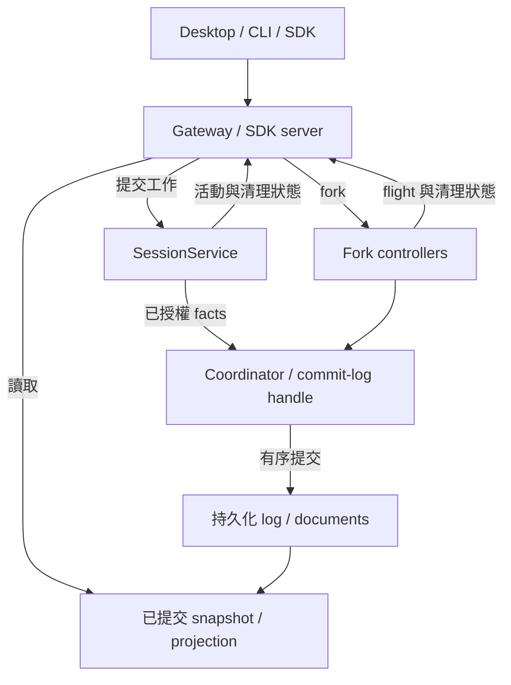

# Runtime 與持久化穩定性調整

## 基準與交付

本分支為 `codex/runtime-stability-redesign`，起點為 `f885bec895d7d54de8e56f7633bd87615ea6b469`。調整涵蓋本輪審查發現的持久化、會話狀態、SDK、導航及打包問題，並驗證正常產品入口。

本輪 production source 最後提交為 `61b0a731`，記錄更新至 2026-11-11。下表共 44 項具體問題，第 1 至 43 項已有本分支的處理，第 44 項仍待設計調整。另列 7 項剩餘結構成本與完整驗證的失敗範圍。

GitHub 操作使用已登入的 `ivankwanpn`。提交作者及提交者使用 `ivankwanpn <213307026+ivankwanpn@users.noreply.github.com>`。每次 commit 與 push 前核對登入帳號與有效 Git 身份。

參考源碼位於 `D:/ih-reference-project`，版本為 Codex 0.167.0、DSH 0.2.2-rc.1、OpenCode 2.2.6、Pi 1.5.1、ZCode 3.17.2。

## 問題清單與設計成因

原始審查基準為 `f885bec8`，本輪整合與回歸測試也暴露出需要一起處理的生命週期問題。實作欄描述本分支的調整，最後驗證結果記錄於驗收清單。各項以具體資料流、觸發條件與原始元件測試為依據，架構負擔另附目前保留的原因。

| 編號 | 問題與影響 | 設計成因 | 本分支處理 |
| --- | --- | --- | --- |
| 1 | 同一 owned commit-log handle 的並行 append 可以覆蓋已回覆成功的資料 | 序號、前綴和檔案 offset 在各個呼叫中獨立計算 | handle 統一 mutation queue，衍生值在佇列內計算 |
| 2 | 已遷移會話刪除後可以從舊 JSONL 再出現 | 新格式缺席同時代表未遷移及已刪除 | 耐久 delete op 與 deletion receipt，legacy 回退檢查刪除狀態 |
| 3 | 大歷史遷移會在發布後因陣列 spread 超過引數限制失敗 | 完整 fold 發生得太晚，資料量進入函式引數 | 先驗證 fold 再發布，逐筆處理長歷史 |
| 4 | sidecar 被修改後仍可回傳內容 | 內容定址名稱被當成完整性證明 | 讀取時計算摘要並核對已知長度 |
| 5 | 舊快照仍引用的 sidecar 被新 writer GC 刪除 | GC 只看最新文件投影 | 保留全部已提交歷史引用，回收未提交孤兒 |
| 6 | 相同 ID、相同位元組長度的重建會命中舊 scan cache | 長度被當成資料身分 | 快取使用內容指紋 |
| 7 | enqueue 後的 flush／close 可以提早完成 | 非同步工作缺少可等待的完成屏障 | 記錄 accepted append，等待結果並完成資源清理 |
| 8 | fork 子會話 header 可以保留父 ID | header 合併順序容許來源值覆蓋新身分 | 最後固定 child session ID，驗證 lineage |
| 9 | Desktop 刪除重試讀到錯誤 receipt 結構 | 新 backend 的回傳語意未遵守共用 coordinator 契約 | 使用 visibility／manifest 結構並相容舊 receipt |
| 10 | 長會話每次 append 都重播歷史，累計工作接近平方成長 | snapshot 建構與內部狀態更新綁定 | 增量 fold，公開 snapshot 延遲複製，prefix 只讀增量 |
| 11 | managed runtime 正在工作，dashboard 和關窗判斷卻顯示閒置 | `hasAssembly` 只認得 legacy assembly | SessionService 對外提供兩條 runtime 路徑的活動觀察 |
| 12 | 等待 dashboard／interaction 回覆期間的新活動仍可能被回收 | 非同步檢查結果缺乏發布前的版本核對 | 回收前重驗 runtime 身分、活動版本與最後使用時間 |
| 13 | 打包後 Windows ACL runner 找不到 `.ts` 來源 | 執行入口依賴開發期 loader 與字串替換 | 明確解析 source／compiled／standalone 入口，隔離成品實測 |
| 14 | 程序每次成功初始化後再崩潰，可以持續重啟 | 成功啟動清空失敗預算，renderer 另有 retry owner | manager 持有完整時間窗及退避，明確 Reconnect 才重設 |
| 15 | 非目前 workspace 的未分類歷史失去導航入口 | lazy load 的歸屬資訊停留在子元件 | 已展開來源的 owners 回傳 sidebar，保留 lazy 讀取 |
| 16 | Team 關閉時 UI 仍宣告功能可用 | 能力值硬編碼 | 從實際安裝的 Team 工具推導 |
| 17 | commit-log 會話無活動時間，列表排序退化 | backend profile 漏掉公共回傳欄位 | 回傳最末 commit 的數值時間 |
| 18 | `runHarness` 啟動後未初始化便送出請求 | 高階入口沒有擁有協定握手 | 啟動後完成 initialize，保留顯式 argv |
| 19 | SDK 長任務與 durable fork 套用一般 RPC 的 60 秒期限 | 任務生命週期與 request 等待時間共用預設 | 分開期限，長任務及 fork prepare／begin／retry 預設等待至完成，顯式 timeout 有獨立錯誤 |
| 20 | 子程序 stderr 塞滿 pipe 後可能阻塞 | 子程序資源管理缺少 stderr 消費者 | 持續排空並保留有界診斷 |
| 21 | SDK 舊式 shutdown 回退被 closing 狀態攔截，關閉重入有競態 | 關閉 admission 與內部收尾共用公開請求路徑 | 單次 close promise、私有 shutdown 路徑及退出等待 |
| 22 | frozen install 失敗 | pnpm 主版本與 patched dependency lock 格式不一致 | 固定 pnpm 版本並更新可重建 lockfile |
| 23 | 邊界與 reachability gate 失敗，公開型別的用途不明 | 使用跨包私有來源，既有公開 API 缺少保留理由 | provider 改用 facade，逐項記錄 8 個既有公開 export 的相容理由 |
| 24 | 正常 UI 查詢碰到 writer dependency gate 後自動 reload，影響正在執行的工作 | committed read 與新工作 admission 共用條件，IPC 依錯誤字串發動恢復 | committed snapshot 有獨立讀取條件，保留未知寫入／失敗清理的拒絕，移除隱式 reload |
| 25 | timeout 顯示成斷線，online 狀態又可能蓋過操作失敗 | request outcome 與 transport state 混合 | `SdkTimeoutError` 與診斷映射分開處理 |
| 26 | rename 改寫執行 metadata 後使 live owner 失效，手動標題也可能被自動投影覆蓋 | 顯示名稱被納入 execution identity，標題有多個寫入時序 | 提交既有 `session/title` user fact，保留 attachment，等待投影寫入順序 |
| 27 | archive／restore 會破壞 pending input、child 或 timer 的原 owner | 可逆可見性欄位被納入 structural identity | 僅 validated `archived:boolean` 變更保留 execution witness，來源授權仍重驗 |
| 28 | schedule 到期可能撞上新工作 admission 或重入服務佇列 | 已接受排程再次走外部 submit 路徑 | 使用原有 admission waiter 與已持有工作的提交入口 |
| 29 | fork 與多 ID observation 重複驗證全部 native 路徑，成本放大 | 同步內部 guard 與 opaque callback 邊界未區分 | 原始建構器產生的 guard 在同步區段合併檢查，acquisition 檢查原捕獲項目，opaque callback 前後全量驗證 |
| 30 | 切換 A→B→A 可以重送等待 admission 的同一草稿，舊 ACK 可以清掉新編輯 | send 狀態隨元件生命週期消失，草稿只比較文字 | 每個 scope 保留 pending identity，持久草稿包含 edit revision |
| 31 | 外部路徑寫入的 instruction discovery 在 sandbox 決策前失敗 | 指令讀取範圍與檔案操作授權範圍混合 | 只觀察 canonical authorized roots 的目標指令，保留 cwd 基礎規則及實際 sandbox／人類批准 |
| 32 | Desktop 主程序為一個結果查詢 parser 載入整個 SDK server／executor | 小型資料驗證工具置於有大量執行依賴的 entry | 增加純結果查詢入口並檢查打包模組圖 |
| 33 | 原始路徑驗證失敗後留下清理 reservation，後續正常 close／delete 被拒絕 | 刪除操作在確認呼叫上下文前保留資源 | 在 reservation 前拒絕觀察範圍內的自刪除 |
| 34 | 修正期間發現同 ID 重建先刪掉舊 generation，初始化失敗也可能漏關 handle | 重建與失敗 cleanup 的發布邊界不完整 | 暫存驗證後原子替換，失敗關閉 handle，fault injection 驗證 |
| 35 | coordinator 初始化提前讀取 lease retry／deadline getter，尚未取得 lease 就可能失敗 | 為捕獲單一 fold factory 而 spread 全部 options，破壞原有 lazy 讀取契約 | managed document owner 只捕獲自己的 fold factory，lease options 保留原有取得時機 |
| 36 | Windows 儲存 provider 或偏好設定時偶發 rename `EPERM`，UI 只收到通用儲存失敗 | 原子替換會與同程序或其它程序仍開啟的讀取 handle 衝突 | 在既有原子寫入處加入有界的 Windows sharing-error 重試，每次維持原有來源核對 |
| 37 | 兩個 SettingsStore 讀取同一文件後依序更新不同欄位，後一次寫入覆蓋先前成功的更新 | instance queue 只排序自身工作，set 使用過時的完整 settings 快照合併 patch | mutation 內捕獲最新持久化內容並核對 revision，成功替換後發布。跨程序的完整 section 編輯仍依賴外層 write lease |
| 38 | child header 已收到原始 committed ACK，關閉時仍被當成未知寫入，造成不必要的 recovery debt 與 owner 保留 | post-await admission guard 在關閉時拒絕，阻斷已知 I/O 結果回寫內部狀態 | cleanup 前保留既有 task barrier 已持有的 committed disposition，真正遺失 ACK 的情況繼續保留原 owner 與恢復要求 |
| 39 | 格式 14 的子會話在 birth 中途停止後，冷啟動 resume 被拒絕 | 新 task barrier 缺少對已發布 header 與部分原始 batch 的恢復證明，完整 history reader 又正確拒絕不完整 seed | 沿用既有 mode 與 native claims，驗證 stage、header、原始 batch 及一致 Task document，恢復相同操作。保持完整 history reader 的完整性要求 |
| 40 | 專案範圍已變更或撤銷，同一會話仍可讀取原範圍的保留結果 | own-session shortcut 繞過 `sourceId` 不相符的拒絕，並錯誤假設程序重啟會改變來源身分 | 先核對目前範圍的 source identity，再套用既有 own-session 與 visibility 規則。同權限冷啟動仍可讀取原結果 |
| 41 | writer 完成準備後、進入 native 寫入前短暫發布 ready，新工作會在這個空隙進入並失敗 | pending write 直到 `beforeIssue` 才建立，已接受操作的準備與提交缺少連續 reservation | 同一操作持有 staged／issued phase，discard 或原始提交結果才釋放。新工作嚴格拒絕 busy，已捕獲工作的延後核對保留原 action／member／source／fence 證明 |
| 42 | conversation hydration 讀取歷史期間可與 writer 交錯，造成原始 archive extent 改變及準備失敗 | lazy reader 的實際 I/O 生命週期未納入既有 admission reads 與 cleanup debt | 整次 hydration 持有原始依賴 scope，close 完成後才發布 ready，共用 hydration 完成訊號，每位呼叫者取得自己的 archive lease。原始 close callback 重入時明確拒絕自我等待 |
| 43 | 指令投影提交期間收到同政策、同權限的檔案失效通知，正常請求會在模型呼叫前被拒絕 | 暫時 dirty 與讀取失敗共用 unavailable 表達，post-publication 路徑缺少有限重建分類 | 由既有 snapshot witness、health 與 epoch 證據確認可重新觀察的 dirty，導入原有 bounded stale rebuild。權限／政策／讀取失敗繼續拒絕 |
| 44 | Code 在 worker 啟動前遇到原 hook epoch 永久撤銷，失敗結果與清理會持續停留 recovery-required | 工具已進入原始 dispatch，synthetic failure 仍依賴已撤銷 surface 的投影。每次 drain 都重試同一個無法再成立的投影 | 尚未修正。原始證據為 failed／dispatched，Worker 未啟動不足以把整個工具標成未 dispatch。需要定義可耐久保存的遮蔽失敗結果及原始錯誤回傳語意 |

### 程式定位

| 問題編號 | 主要實作與檢查位置 |
| --- | --- |
| 1、3、4、5、6、10、34 | [commit-log store](D:/codex-ih-development/packages/session-commit-log/src/store.ts:143)、[incremental fold](D:/codex-ih-development/packages/session-commit-log/src/fold.ts) |
| 2、7、8、9、17 | [commit coordinator](D:/codex-ih-development/packages/session-persistence/src/commit/coordinator.ts:184)、[prefix derivation](D:/codex-ih-development/packages/session-persistence/src/commit/managed.ts:15) |
| 11、12、14、28 | [SessionService activity](D:/codex-ih-development/packages/session-executor/src/service.ts:1836)、[runtime manager](D:/codex-ih-development/packages/desktop/src/main/sdk-runtime.ts:235)、[owned schedule](D:/codex-ih-development/packages/session-executor/src/owned-schedule.ts) |
| 13、22 | [compiled smoke](D:/codex-ih-development/packages/desktop/scripts/smoke-compiled-gateway.mjs)、[root package](D:/codex-ih-development/package.json)、[verification workflow](D:/codex-ih-development/.github/workflows/verify.yml) |
| 15、16 | [sidebar ownership](D:/codex-ih-development/packages/desktop/src/renderer/shell/ProjectSidebar.tsx:47)、[installed Team tools](D:/codex-ih-development/packages/desktop-gateway/src/host.ts:532) |
| 18、19、20、21、25 | [SDK client](D:/codex-ih-development/packages/sdk/src/client.ts:84)、[error display](D:/codex-ih-development/packages/desktop/src/renderer/design/error-display.ts:21) |
| 23 | [provider facade](D:/codex-ih-development/packages/provider/src/index.ts)、[boundary gate](D:/codex-ih-development/scripts/audit/check-package-boundaries.mjs)、[reachability gate](D:/codex-ih-development/scripts/audit/check-reachability.mjs) |
| 24 | [committed observation](D:/codex-ih-development/packages/core-session/src/managed/execution-state.ts:302)、[work-state read](D:/codex-ih-development/packages/desktop-gateway/src/work-state.ts:67)、[native IPC](D:/codex-ih-development/packages/desktop/src/main/ipc.ts) |
| 26、27 | [session management](D:/codex-ih-development/packages/desktop-gateway/src/session-management.ts:198)、[post-turn title](D:/codex-ih-development/packages/session-executor/src/service/owned-post-turn.ts)、[task identity projection](D:/codex-ih-development/packages/session-persistence/src/coordinator/task-parent-metadata.ts) |
| 29 | [binding acquisition](D:/codex-ih-development/packages/session-persistence/src/coordinator/binding-observation.ts:533)、[fork guards](D:/codex-ih-development/packages/session-executor/src/lifecycle/fork-handoff.ts) |
| 30 | [Composer admission](D:/codex-ih-development/packages/desktop/src/renderer/session/Composer.tsx:55)、[durable draft revision](D:/codex-ih-development/packages/desktop/src/renderer/session/durable-draft-client.ts:43) |
| 31 | [instruction mutation preflight](D:/codex-ih-development/packages/session-executor/src/context/instructions/manager.ts:194) |
| 32 | [pure results entry](D:/codex-ih-development/packages/sdk/src/results.ts)、[Desktop results dispatcher](D:/codex-ih-development/packages/desktop/src/main/result-pages.ts) |
| 33 | [deletion preflight](D:/codex-ih-development/packages/session-persistence/src/coordinator/lifecycle.ts:74) |
| 35 | [coordinator construction](D:/codex-ih-development/packages/session-persistence/src/coordinator-factory.ts:70)、[managed factory capture](D:/codex-ih-development/packages/session-persistence/src/coordinator/managed-documents.ts:27) |
| 36、37 | [settings transaction](D:/codex-ih-development/packages/settings/src/storage/transaction.ts)、[SettingsStore](D:/codex-ih-development/packages/settings/src/storage/single-store.ts) |
| 38 | [bootstrap finalization](D:/codex-ih-development/packages/session-persistence/src/coordinator/bootstrap.ts:567)、[child admission regressions](D:/codex-ih-development/packages/session-persistence/test/child-bootstrap-admission.test.ts) |
| 39 | [bootstrap recovery](D:/codex-ih-development/packages/session-persistence/src/coordinator/bootstrap.ts)、[task transition](D:/codex-ih-development/packages/session-persistence/src/coordinator/task-document-transition.ts)、[native composition](D:/codex-ih-development/packages/session-persistence-jsonl/src/backend-factory.ts) |
| 40 | [result authorization](D:/codex-ih-development/packages/session-executor/src/lifecycle/process-result-service.ts:45)、[stable source identity](D:/codex-ih-development/packages/context-output/src/workspace.ts:19)、[cold scope regressions](D:/codex-ih-development/packages/session-executor/test/result-scope-authority.test.ts) |
| 41、42 | [execution state](D:/codex-ih-development/packages/core-session/src/managed/execution-state.ts)、[restored conversation](D:/codex-ih-development/packages/core-session/src/managed/restored-view.ts)、[captured tool body](D:/codex-ih-development/packages/core-tools/src/registry/prepared-body.ts) |
| 43 | [instruction snapshot classification](D:/codex-ih-development/packages/instructions/src/service.ts)、[instruction publication](D:/codex-ih-development/packages/session-executor/src/context/instructions/manager.ts)、[prephysical admission](D:/codex-ih-development/packages/core-agent/src/agent/admission.ts) |
| 44 | [synthetic projection](D:/codex-ih-development/packages/core-agent/src/tool-batch/managed-source.ts:151)、[retained result drain](D:/codex-ih-development/packages/core-agent/src/tool-batch/record.ts:27)、[original dispatch outcome](D:/codex-ih-development/packages/core-agent/src/tool-batch/dispatch.ts:90) |

### 跨問題的設計判斷

多個錯誤源於同一個檢查混合了不同生命週期。新的工作需要完整 admission，已捕獲的工作需要核對原 action、來源及 fence，UI 查詢需要穩定的已提交投影，cleanup 則需要保存已知 I/O 結果。舊路徑反覆使用相同的 currentness 檢查，會讓操作被自己的 staged write 擋住，或把已收到的 committed ACK 當成未知結果。調整集中於既有 owner 的狀態與判斷，並以真實提交、關閉、停止及恢復測試驗證邊界。[execution state](D:/codex-ih-development/packages/core-session/src/managed/execution-state.ts) [bootstrap finalization](D:/codex-ih-development/packages/session-persistence/src/coordinator/bootstrap.ts)

過度設計較明確的部分是同一責任有多個可獨立變化的來源。renderer 與 main manager 各自重試、`hasAssembly` 與 managed runtime 各自定義活動、Stop receipt 同時負責去重與活動判斷，都造成狀態不一致。本輪把重試交回主程序，把活動交回 SessionService、request flight 與 fork owner，並讓 receipt 保持去重用途。OpenCode 的 run coordinator 與 ZCode 的 host lifecycle 都有可對照的責任歸屬。[runtime manager](D:/codex-ih-development/packages/desktop/src/main/sdk-runtime.ts) [SessionService](D:/codex-ih-development/packages/session-executor/src/service.ts) [OpenCode run coordinator](D:/ih-reference-project/opencode-2.2.6/packages/core/src/session/run-coordinator.ts) [ZCode host lifecycle](D:/ih-reference-project/ZCode-3.17.2/packages/desktop/src/main/desktopHostProcess.ts)

效能負擔主要來自重複工作。每次 append 全量 fold、只為讀取一小段結果而載入整個 executor、同步 guard 重複遍歷 native 路徑，都可以在保留既有資料與權限契約下縮減。跨越 await、外部 callback、檔案替換或新的 authority 時仍要重驗，否則快取會把實際變更遮蔽。[incremental fold](D:/codex-ih-development/packages/session-commit-log/src/fold.ts) [result parser entry](D:/codex-ih-development/packages/sdk/src/results.ts) [binding observation](D:/codex-ih-development/packages/session-persistence/src/coordinator/binding-observation.ts)

耐久 Task、outbox、原始 batch 與 child birth 證據仍有明確的 crash recovery 用途。參考項目 OpenCode 2.2.6 同樣保留 Job 持久化、恢復與通知去重。適合簡化的是重複投影、共同失敗範圍及介面能力的表達，實際需要的恢復證據應持續由原始 owner 持有。[OpenCode Job](D:/ih-reference-project/opencode-2.2.6/packages/core/src/job.ts:185) [task transitions](D:/codex-ih-development/packages/session-persistence/src/coordinator/task-document-transition.ts)

### 仍存在的結構成本

上表第 44 項為本輪最後確認、仍待修正的 recoverability 缺陷。透過正常 `onExecutionEvent` 在同一 live context 掛載 listener，會推進真實且單調增加的 hook epoch。Code before-worker 的 synthetic 路徑隨後持續拒絕，兩次 coordinator close 都得到相同 recovery debt。正常 dispatched 工具的 post-hook 永久撤銷控制案例能保存結果並清理。重現全程保留永久 epoch 變更與原始清理結果，原始輸出在 projection 失敗時仍被扣留。這個 live API 觸發已經證實，Desktop 設定刷新路徑及冷啟動恢復尚待驗證。後續調整需定義 canonical redacted failure，保留真實 failed／dispatched 結果及原始錯誤，並維持 unknown effects 的拒絕。[重現步驟與來源定位](C:/Users/IvanKwan/AppData/Local/Temp/ih-permanent-hook-epoch-issue44.txt) [重現案例](C:/Users/IvanKwan/AppData/Local/Temp/ih-permanent-hook-epoch-repro.test.ts.txt) [失敗記錄](C:/Users/IvanKwan/AppData/Local/Temp/ih-original-code-permanent-epoch-current.txt) [原始 dispatch 證據](C:/Users/IvanKwan/AppData/Local/Temp/ih-original-code-epoch-disposition.txt)

#### S1 Agent 與 executor 的循環依賴

`core-agent` 的 runtime import 仍直接指向 `session-executor` 的 generation 與 input ownership 實作，同時 executor 又依賴 agent。其閉包延伸到 `OwnedGenerationAction`、input preparation、冷啟動 Team 的原始證明和 persistence attachment。這會放大編譯、打包與測試耦合。單純搬移 assert 函式或公開註冊入口會改變目前建構器身分驗證的信任邊界。本輪保留這組 authority owner，記錄為後續需要整體遷移的結構負擔。已經拆出純結果查詢入口，減少 Desktop metadata 查詢對執行圖的載入。

#### S2 型別宣告大於實際建構能力

共用 `SessionCoordinator` 型別仍包含能力依建構方式而異的方法。raw factory 缺少 native task-transition 組合時，current-format create／append／loadOwned 會拒絕，型別卻容許呼叫。產線 native composition 已具備這些能力，舊測試與公共入口的表達仍有落差。本輪保留原有拒絕條件，正向整合測試使用產線建構方式。後續可收斂為較小的讀取介面與由建構方式保證能力的寫入介面。[coordinator factory](D:/codex-ih-development/packages/session-persistence/src/coordinator-factory.ts:70) [public facade](D:/codex-ih-development/packages/session-persistence/src/index.ts:50)

#### S3 導航查詢依賴 gateway 啟動

導航 metadata 查詢仍依賴 workspace gateway。lazy loading 與 owner 資訊回傳恢復了歷史可達性，冷啟動多個 workspace 的查詢成本仍存在。若後續建立跨 workspace 索引，需先定義提交後同步、跨程序更新及索引失效的契約。

#### S4 Task 狀態跨多份文件的共同失敗範圍

Task 的 parent document、child birth、outbox 和 completion receipt 有不同的恢復責任。目前保留耐久通知去重與 birth 證據，避免把成功回覆建立在尚未落盤的狀態上。重複投影與單一 parent document 帶來的失敗範圍仍需要按實際恢復案例逐項收斂。

#### S5 歷史 sidecar 的保留與壓縮契約

commit-log GC 現在保留全部已提交歷史引用的 sidecar。這保護仍持有舊前綴的讀者，也會增加磁碟保留量。全域 document log 尚未有帶讀者版本契約的壓縮機制，長期文件更新的掃描與空間成本仍需處理。

#### S6 Legacy retained-reference fork 的放大成本

Legacy retained-reference fork 的放大成本仍然明顯。完整驗證中的 101-ref case 量得 setup 149.8 秒、owner 223.2 秒，1,001-ref case 超過原有 30 分鐘期限。Setup 逐筆 capture／grant 與增長中的實體檔案盤點累積了大量 metadata 工作，owner 也會在不同資格檢查與提交階段反覆讀取 canonical manifest 與 owner ledger。Fixture 的線性 visibility 查詢另有額外成本，產線相應查詢使用 Set。這條路徑仍服務包含舊 `ctx_` references 的 fork，後續需分別量測 native 路徑檢查、盤點、ledger 寫入與 sync，再收斂重複工作。[scale test](D:/codex-ih-development/packages/context-output/test/legacy-fork-scale.test.ts) [legacy transfer](D:/codex-ih-development/packages/context-output/src/legacy/fork-transfer.ts) [quota inventory](D:/codex-ih-development/packages/context-output/src/artifact/quota.ts)

#### S7 CLI 跨程序 settings section 更新

SettingsStore 的 latest-base 調整保護依序發生的不同欄位更新。Desktop 與 file-provider-runtime 使用相同的 `.provider.lock` 保護跨程序讀取、衍生與寫入。CLI role 編輯目前在這個外層 lease 之外建立整段 replacement section，同時編輯的競態仍屬剩餘工作。[roles.ts](D:/codex-ih-development/apps/cli/src/roles.ts:245)

## 設計決定

### 會話工作狀態

`SessionService` 對外提供涵蓋 legacy 與 managed runtime 的工作觀察。SDK dashboard、關窗及 gateway 回收使用該觀察。執行、已接受輸入、子代理、背景程序、Code Mode、runtime 所持排程及尚未完成的清理，都有明確的保留責任。

Dashboard 另外合併 SDK 自己持有的 request flights，以及既有 fork lifecycle registry 中的 flight 與 cleanup debt。Stop receipt 留作去重，活動值由實際 settlement 與 acknowledgement 狀態決定。

保留 `hasAssembly()` 原有的 assembly 語意。新的工作狀態介面由現有 owner 提供資料，避免新增另一份可獨立漂移的業務狀態。

gateway 回收在異步檢查後重驗工作活動及 runtime 身份。重啟預算覆蓋完整時間視窗，過期的重啟回呼不得替換新一代程序。

Archive 是可逆的可見性變更。已接受的 future schedule 保留其 owner，於原訂時間到期一次。普通 pending input 與 child state 保留，archive 操作本身不觸發執行。這是本輪依既有行為採取的產品語意決定。

### 已提交讀取與執行授權

UI 的歷史、導航和 metadata 查詢讀取已提交狀態。runtime 的執行狀態由其 owner 提供。讀取失敗向呼叫者保留錯誤與範圍，使用者明確要求的 reload 保持獨立操作。

已接受但未提交的工作、未知寫入結果、損壞資料和已提交快照具有不同語意。工具授權、來源 currentness 及提交前的驗證繼續由原有權限 owner 執行。

### 寫入與關閉順序

每個 commit-log handle 使用同一條 mutation queue。追加、flush、refresh、sidecar 變更和 close 的順序由該 owner 決定。衍生序號及前綴前置條件在進入這條佇列後計算，避免檢查與寫入之間的競態。

提交前驗證輸入與操作。寫入或 fsync 失敗後，只有確定回滾成功的 handle 可以繼續修改。未知回滾結果保留錯誤並拒絕後續寫入，直到重新開啟與驗證。

追加使用增量 fold。公開 snapshot 的可觀察語意必須保留，讀取大歷史時避免把整個事件陣列展開為函式引數。

### 版本、刪除及內容定址

一個 session ID 的讀取解析涵蓋舊 JSONL 與新 generation。已刪除的 incarnation 不得透過舊格式回退復活。明確重建同一 ID 必須產生新狀態，並維持既有的重建能力。

刪除 receipt 遵守公共 coordinator 的 `visibility` 與 `manifest` 契約，重試可確認原操作結果。清除文件必須抑制其 legacy 回退。

sidecar 讀取驗證摘要與長度。仍被可讀歷史引用的內容具有保留責任。未提交的孤兒可以在 writer lease 下回收，歷史內容隨明確的 generation／namespace 退役處理。後續壓縮需保留讀者快照的可觀察行為。

### 子代理與通知

保留任務身分、可恢復工作及通知去重所需的耐久資料。OpenCode 2.2.6 有持久化的背景 Job 與恢復資訊，簡化方案應以本機新版本源碼為準。

檢查 parent task document、child session、通知及 runtime owner 的提交責任，降低單一輔助狀態失敗影響其它工作的範圍。重建投影、恢復未知提交及傳遞通知分別具有明確的完成條件。

### SDK 與錯誤

高階 SDK 入口先完成初始化。一般 RPC 期限與長任務期限分別定義。任務期限只影響其呼叫觀察，若不能確定原輸入身分，避免對共用 session 發出廣泛取消。

request timeout、傳輸關閉及協定失敗保留不同錯誤種類。stderr 持續排空並只保留有界診斷。關閉操作共享同一次收尾，並確認子程序退出。

### 導航與成品

已展開或已選取來源取得的歸屬資訊回傳給導航 owner，讓未分類歷史可見。Team 能力從實際安裝的工具決定。

成品的 runner／worker 入口由明確執行模式解析。驗證涵蓋預編譯 gateway 的正常沙箱命令，並檢查 runtime 資產在成品目錄可用。

## 驗收清單

以下狀態對應本分支的定向實作與測試證據。第 44 項及全庫失敗清單的狀態保留於相應章節。

- [x] 同一 owned handle 的並行寫入均保存，fact 寫入與 metadata 更新不互相覆蓋。
- [x] 已遷移會話刪除後不復活，附屬文件清除抑制 legacy 回退。
- [x] 長歷史可以遷移，無效內容不會發布為可見 generation。
- [x] sidecar 內容與摘要不符時拒絕讀取。
- [x] 有效讀者所引用的 sidecar 不被回收，未提交孤兒仍可回收。
- [x] 同 ID、同長度的重建資料不會命中舊快取。
- [x] enqueue、flush、close 具備正確完成屏障。
- [x] fork 保存新子會話 ID 與正確 lineage。
- [x] 刪除 receipt 可供 Desktop 重試，既有資料與明確重建有相容處理。
- [x] 追加不重播整段歷史，使用便宜的計數或有界讀取推進前綴。
- [x] 正常 managed／legacy 工作狀態一致，關窗與回收看見活躍 owner。
- [x] 檢查期間出現新活動時停止本次閒置回收。
- [x] 打包後 Windows ACL runner 可以實際執行。
- [x] 成功初始化後的反覆崩潰仍受重啟預算限制。
- [x] 非目前 workspace 的未分類歷史及跨專案來源保持可見。
- [x] Team 的 UI 能力與實際工具安裝一致。
- [x] commit-log 會話提供活動時間並正確排序。
- [x] `runHarness` 完成初始化，保留明確提供的啟動參數。
- [x] SDK 長任務沒有任意的 60 秒限制，明確期限不取消其它輸入。
- [x] SDK 子程序 stderr 排空且診斷有界。
- [x] SDK 關閉可重入，舊式 shutdown 回退及退出確認正確。
- [x] frozen install 成功，pnpm 版本與 lockfile 可重建。
- [x] 套件邊界及 reachability 閘門通過，新增公共介面有實際用途或明確保留理由。
- [x] 正常讀取不觸發會話 reload，未知寫入或損壞資料仍可見。
- [x] timeout 不顯示成斷線，online 狀態保留操作失敗回饋。
- [x] 到期排程、子代理建立／續作／取消、fork 與 close 經正常入口完成。
- [x] coordinator 初始化保留 lazy lease options，fold factory 由實際 owner 捕獲。
- [x] Windows settings replacement 以同一暫存檔進行有界重試，衝突與永久失敗保留原內容。
- [x] SettingsStore 以最新持久化內容合併 patch，stale revision 與 failed write 保留 last-good state。
- [x] Child header 的已知 committed ACK 在關閉時保留，真正 unknown 的回覆仍需原 owner 恢復。
- [x] 格式 14 的原始 partial child birth 可在冷啟動後依相同 stage／batch 證明恢復。
- [x] 保留結果先核對目前專案範圍，同權限冷啟動與異權限拒絕均經實際讀取驗證。
- [x] staged write、conversation hydration 與指令發布的最後生命週期回歸完成。
- [x] 最後版本的定向測試、完整診斷、型別檢查範圍及分支 CI 入口有記錄。

## 驗證記錄

| 範圍 | 已完成結果 |
| --- | --- |
| Commit-log 完整套件 | 最新重跑 10 個測試檔，55 項通過 |
| Commit coordinator 專項 | 9 個測試檔，50 項通過 |
| Core-session 完整套件 | 最後 production source 凍結後重跑，87 個測試檔、934 項通過 |
| SDK 完整套件 | 最後 production source 凍結後以單一 worker 重跑，22 個測試檔、140 項通過，保留既有期限 |
| Desktop 完整標準命令 | 203 個測試檔通過、3 個略過，1,565 項通過、7 項略過 |
| Settings 完整套件 | 20 個測試檔，248 項通過 |
| Provider file-runtime | 6 項通過 |
| Windows settings sharing | 5 項通過，涵蓋真實 child reader、期限、外部變更及永久錯誤 |
| Windows 同 ID 重建 | 新增 6 項 sharing／tombstone identity 案例通過，原有 2 項重建失敗案例重跑通過 |
| 已發布 child birth 恢復 | recovery、routes、cached ready、passive bootstrap、child admission 共 98 項通過 |
| 結果範圍授權 | 3 個檔案 10 項通過，另有實際 Shell revoked-scope 案例通過 |
| 實際工具與 captured source | Shell 15、private native Exec 5、nested Shell 2、nested Workflow 1、captured Code 6，共 29 項通過 |
| Summary physical admission | 2 項通過，staged writer 持有時 0 次模型呼叫，釋放後沿原有刷新路徑重新通過嚴格檢查，再進行恰好 1 次摘要 |
| Managed runtime 與 readiness | 最後 source 凍結後 3 個檔案、62 項通過，涵蓋原有 runtime 39、staged／hydration／pre-step 13、指令發布 10 |
| 指令分類與服務生命週期 | 30 項通過，包含原始 snapshot witness、健康 epoch、mapping failure 與實際讀取失敗 |
| Binding currentness | 專項使用單一 worker 與 120 秒 CLI 期限時 118 項通過，另有 16 項 artifact currentness negative cases 通過 |
| 指令適用範圍與實際工具授權 | 31 項通過 |
| Lazy options 與資料操作契約 | 11 項通過 |
| Package boundaries | 147 個既有跨包來源依賴，與既有 baseline 相同，gate 通過 |
| Reachability | gate 通過 |
| 最後本機 compiled artifact | 通過，隔離成品實際回報 gateway 與 Windows ACL 成功標記 |
| 最後 component typechecks | instructions、core-session、core-agent、session-executor 通過，相關 core-tools／code-mode 檢查亦已通過 |
| 最終分支全庫 typecheck | 由推送後的 `typecheck (all packages)` job 執行，完整執行結果保留於本分支 CI |
| 先前 GitHub CI `38c8cee7` | 全庫型別與隔離 compiled gateway／Windows ACL 通過 |

推送後的 CI 會執行全庫型別、test runner、package boundary 及隔離成品檢查。`verify:all` job 按既有 workflow 條件在手動或排程事件執行，push 的綠燈對應上述有限範圍。最終推送的狀態與 job 日誌可在本分支的工作流記錄查閱。[分支 CI](https://github.com/ivankwanpn/I-harness/actions/workflows/verify.yml?query=branch%3Acodex%2Fruntime-stability-redesign)

完整 Desktop 的初輪結果為 1,550 通過、15 失敗、7 略過。採用既有 `verify:all` 的兩個 worker 資源預算並修正測試握手後，曾取得 1,565 通過、7 略過。標準命令重跑又捕捉到 settings rename 的間歇失敗，導致問題 36、37 的進一步修正。其後標準命令取得 1,565 通過、7 略過，執行期間 production source 保持凍結。全庫診斷再次取得相同 Desktop 結果。

### 完整驗證的已知失敗

`pnpm verify:all` 已完成，83 個專案全部回報。它從 `38c8cee7` 啟動，包含當時的 fixture 修改，執行期間也有後續修正進入工作目錄，因此其用途為全庫診斷。最終交付提交的驗證另行記錄。

| 階段 | 完成結果 |
| --- | --- |
| Workspace suites | 14,589 通過、90 略過、1,564 失敗，17 個專案失敗 |
| 全庫 typecheck | 通過 |
| E2E | 107 通過、21 失敗，7 個測試檔失敗、3 個通過 |
| Reachability | 通過，1 項既有 allowlist entry 過期提示 |
| Package boundaries | 通過，147 個跨包來源依賴與 baseline 相同 |
| 隔離 compiled artifact | 通過，實際得到 `IH_COMPILED_ACL_OK` 與 `IH_COMPILED_GATEWAY_OK` |

失敗專案涵蓋 CLI、agent-team、code-mode、compaction、context-output、core-agent、desktop-gateway、exec、hooks、instructions、llm-anthropic、llm-bedrock、sandbox-windows-psec、session-executor、session-persistence、session-persistence-jsonl 及 subagent。部分失敗已促成上表的後續修正，完整列表仍有未完成逐案歸因的項目。基準分支的完整 suite 尚未執行，故無法把全部失敗歸因為基準缺陷或本分支迴歸。[診斷記錄](C:/Users/IvanKwan/AppData/Local/Temp/ih-verify-all-diagnostic-38c8cee7.log) [逐項失敗清單](C:/Users/IvanKwan/AppData/Local/Temp/ih-verify-all-diagnostic-38c8cee7.inventory.json) [執行來源與階段 metadata](C:/Users/IvanKwan/AppData/Local/Temp/ih-verify-all-diagnostic-38c8cee7.metadata.json)

CLI 的 59 個失敗中，41 個碰到缺少 native transition composition 的 fixture，13 個仍讀取舊的 tool-result 欄位，另有檔案計數、factory interception 及 help 字串落差。舊結果斷言會妨礙功能驗證，相關功能健康度仍需透過正確入口補驗。Team 的兩個 initial-input 語意失敗已補正，其餘 completion delivery 等失敗仍有驗證缺口。Windows instruction symlink 案例出現 `EPERM`，PSEC 真實 native 案例回報 `0x8007000f`，兩者需要各自釐清執行環境與產品行為。

最後另抽驗 5 個 child-instruction queued／unknown-publication／recovery 案例，結果為 5 項失敗，伴隨 5 個 cleanup rejection。這些 fixture 在 backend 建構後替換 `appendOwnedBatch` 或 `reconcileOwnedBatch`，觸發原始方法 descriptor 核對的 `PROCESS_READ_UNAVAILABLE`，預期的 native 階段因而無法到達。這 5 條舊測試需要改用建構期的原始 I/O wrapper，才能完成其預期行為的資格驗證。[定向記錄](C:/Users/IvanKwan/AppData/Local/Temp/ih-child-instruction-selected-final.log) [原始方法核對](D:/codex-ih-development/packages/session-persistence/src/coordinator/canonical-path-resolution.ts:26)

64-ID native stress case 在這台 Windows 主機由 101.91 秒降至 75.53 秒，保留 256 次 native acquisition 與 64 次文件讀取斷言。原測試包含 63 個 native-backed session 的建立，基準量測單此步驟已達 52.4 秒。該單一 stress case 現已明確使用 120 秒測試期限。新 child crash recovery 案例按實際 native I/O 量測採用個別 10 或 20 秒期限。nested Workflow fixture 的 context window 由 4,096 調為 16,000，原記錄顯示完整續作請求需要 4,342 tokens，所有結果與權限斷言均保留。

Persistence 完整套件首輪為 877 通過、267 失敗，另有兩個 unhandled error。150 個失敗發生在缺少 native task-transition composition 的舊正向 fixture，23 個失敗涉及建構後替換 backend 方法。完成 fixture 與責任邊界調整後，完整診斷取得 1,154 通過、19 失敗。其中 child admission 與 Windows recreation 失敗其後已有定向修正，其餘 cold-write、cleanup count 及 fork-controller 失敗保留在清單。已完成的修訂維持現有能力拒絕與負向授權檢查，使用正常建構方式、建構期 fault injection 及實際底層元件驗證各自責任。

## 參考機制

- Codex rollout recorder 由單一 writer 消費命令，flush 回覆前處理先前寫入。IH 採用同一 handle 的 mutation queue 與完成屏障。[recorder.rs](D:/ih-reference-project/codex-rust-v0.167.0/codex-rs/rollout/src/recorder.rs:137)
- DSH SessionHandle 明確定義讀取新鮮度、append、flush 與 close 的契約，generation 在發布前驗證暫存資料。IH 對應修正並行 append、先驗證後發布與 close 失敗清理。[handle.ts](D:/ih-reference-project/deepseek-harness-dsh-v0.2.2-rc.1/packages/session/session-persistence/src/handle.ts:48) [generation.ts](D:/ih-reference-project/deepseek-harness-dsh-v0.2.2-rc.1/packages/session/session-persistence-jsonl/src/generation.ts)
- OpenCode 的 SessionRunCoordinator 持有 active execution 與 awaitIdle，SessionStore 處理會話查詢。IH 由 SessionService 暴露活動觀察，讀取已提交資料與新工作 admission 各有條件。[run-coordinator.ts](D:/ih-reference-project/opencode-2.2.6/packages/core/src/session/run-coordinator.ts:9) [store.ts](D:/ih-reference-project/opencode-2.2.6/packages/core/src/session/store.ts)
- OpenCode 2.2.6 的背景 Job 有 SQLite 表、recovery 及 notification ID。這份版本證據支持保留 IH 的耐久工作與通知去重資料。[job.ts](D:/ih-reference-project/opencode-2.2.6/packages/core/src/job.ts:185)
- Pi 使用增量 append，fork 會建立新的 header 身分，worker 入口按 release runtime 明確解析。IH 對應修正長歷史成本、fork ID 與打包 runner。[session-manager.ts](D:/ih-reference-project/pi-1.5.1/packages/coding-agent/src/core/session-manager.ts:1188) [config.ts](D:/ih-reference-project/pi-1.5.1/packages/coding-agent/src/config.ts:524)
- ZCode 由主程序管理 host 生命週期，視窗重新掛接沿用原 host，並追蹤程序實際退出。IH 把重啟預算與收尾放回單一 manager。[desktopWindowLifecycle.ts](D:/ih-reference-project/ZCode-3.17.2/packages/desktop/src/main/desktopWindowLifecycle.ts:134) [desktopHostProcess.ts](D:/ih-reference-project/ZCode-3.17.2/packages/desktop/src/main/desktopHostProcess.ts:774)
- Windows 的開啟 handle 會持續限制檔案共享方式，rename 需要相容的 delete sharing。設定寫入的修正依據本機持有讀取 handle 的定向重現，並對照 Windows 文件。[CreateFile sharing modes](https://learn.microsoft.com/en-us/windows/win32/api/fileapi/nf-fileapi-createfilea)
