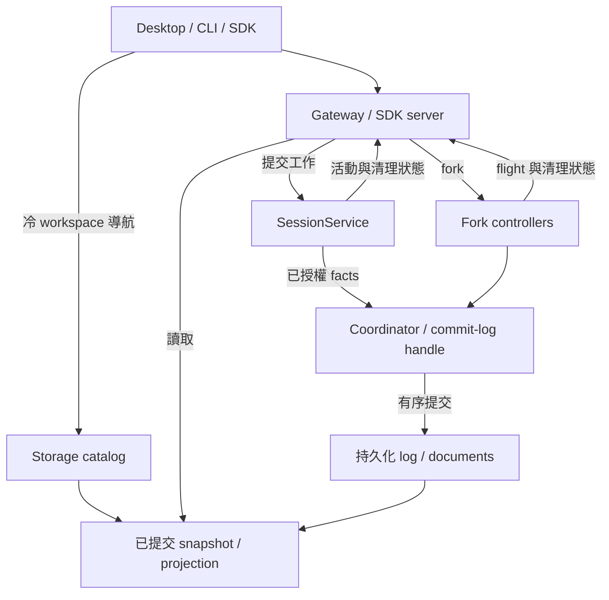

# Runtime 與持久化穩定性調整

## 基準與交付

本分支為 `codex/runtime-stability-redesign`，起點為 `f885bec895d7d54de8e56f7633bd87615ea6b469`。調整涵蓋本輪審查發現的持久化、會話狀態、SDK、導航及打包問題，並驗證正常產品入口。

### 目前整體進度

目前本報告記錄 119 項具體問題與 S1 至 S7 的結構調整。Team 執行功能已移除，Code Mode 保留獨立 package 與 QuickJS／Worker 架構。第 102 至 114 項的已確認根因均已提交對應修正並完成定向驗證，實機使用 DeepSeek Flash 的 Code 執行、背景等待、草稿清除及冷重啟亦已通過，後續真實父子任務及其關閉、冷讀取也已驗證。測試品質修訂前三批完成 65 項控制，第四批冷讀取 fixture 及其依賴回歸完成 119 項。後續確認第 118 項閒置清理恢復缺口，修正後 251 項相關控制及五個 package 型別通過。整體工程完成度估計約 80%，剩餘工作包含完整回歸失敗、效能問題、最終問題狀態及交付核對。各輪控制的範圍有重疊，完整穩定性驗收仍未完成。

測試修訂第五批已提交為 `9ce120ac`。九個發布故障點分開執行並斷言實際注入次數，索引案例核對原生 SQLite 修復及 canonical 內容，三檔合計 76 項通過。只調整實測超過原有預設的個別案例期限。後續 legacy 功能檔案的 19 個原五秒案例依量測給予 20 秒，10,001 筆案例獨立成檔並保留原五分鐘期限，完整案例內容及原生退休計數斷言保持原樣。[76 項驗證](C:/Users/IvanKwan/AppData/Local/Temp/ih-bootstrap-index-receipt.json)

第 119 項撤銷槽部分寫入的恢復修正，完整功能檔案 47 項通過，一項 Windows 原生 file symlink 權限略過。相關八檔另有 181 項通過、兩項相同環境條件略過及兩項 funding 失敗，Context 型別通過。失敗的 d31 案例超過 120 秒後仍繼續執行，隨後 d1 的共享 I/O 觀察被污染，這兩項繼續列為待處理。[修正與完整驗證紀錄](C:/Users/IvanKwan/AppData/Local/Temp/ih-torn-revocation-receipt.json)

固定 `b58d7b5b` 的 ContextOutput 部分回歸曾得到 628 項通過、55 項失敗、十項略過及零未處理錯誤，範圍排除了 101／1,001 distinct-reference 的大型檔案。這輪結果與後續定向修正各自保留，尚未取得最新全庫驗收結果。[部分回歸紀錄](C:/Users/IvanKwan/AppData/Local/Temp/ih-context-post-idle-b58d7b5b/context.log)

固定 `21f8d861` 的七階段全庫驗證於 2026-11-14 完成，耗時 3 小時 57 分 14 秒。82 個測試 package 全部回報，16,001 項通過、434 項失敗、86 項略過，另有九個未處理錯誤。全庫型別、十個 E2E 檔案、374 項 reachability、package boundaries 及 compiled Gateway／Windows ACL 通過。5,834 個來源檔案的清單、雜湊及 HEAD 在前後核對相同。執行期間 dev 已關閉，沒有其它測試或編譯工作重疊，17 項真實 predecessor fixture 已啟用。完整驗收仍未通過。[本輪完整清單](C:/Users/IvanKwan/AppData/Local/Temp/ih-verify-all-21f8d861/inventory.json) [來源及執行核對](C:/Users/IvanKwan/AppData/Local/Temp/ih-verify-all-21f8d861/metadata.json)

本輪失敗分布為 ContextOutput 60 項、Desktop Gateway 108 項、Session Executor 261 項、Exec 一項、Guard Approval 兩項、Windows PSEC 一項及 Persistence 一項。九個未處理錯誤均來自 Executor。已確認一組測試在 backend 建構後替換受原始身分保護的方法，提前觸發 PROCESS_READ_UNAVAILABLE，另有兩個 Gateway 測試替身漏掉實際使用的 export。依使用者追加指示，接續會核對測試契約並重寫相應案例，沿用真正建構入口、原生故障注入及持久化結果斷言。[逐項失敗](C:/Users/IvanKwan/AppData/Local/Temp/ih-verify-all-21f8d861/inventory.json)

固定 `73082c41` 的七階段全庫驗證已完成，82 個測試套件全部回報，合計 15,934 項通過、464 項失敗、78 項略過，另有 9 個未處理錯誤。全庫型別、10 個 E2E 檔案、reachability、package boundaries 及 compiled Gateway／Windows ACL 通過。執行前後 5,827 個來源檔案的清單與雜湊相同。測試期間曾有 dev 啟動及輔助程序負載重疊，純耗時失敗仍需獨立複驗。[完整清單](C:/Users/IvanKwan/AppData/Local/Temp/ih-verify-all-73082c41/inventory.json) [來源與執行核對](C:/Users/IvanKwan/AppData/Local/Temp/ih-verify-all-73082c41/metadata.json)

六個失敗套件分別為 ContextOutput 63 項、Desktop 1 項、Desktop Gateway 140 項、Session Executor 258 項、Persistence 1 項及 JSONL 1 項。9 個未處理錯誤均來自 Executor。Subagent 完整 856 項、Code Mode 383 項、CLI 404 項、Core Agent 647 項、Core Session 947 項、SDK 140 項及 commit-log 73 項通過。後續定向修正的結果各自保存，整體失敗數待下一輪固定版本驗證更新。

`784726fa` 修正第 99 項引入的 late-Pending 等待回歸，原 30 秒期限案例先重現失敗，修正後約 615ms 通過，31 項原生矩陣、18 項 Task 整合控制及四個套件型別檢查通過。`d7e534be` 修正工作狀態查詢的 managed adapter 選擇，三個完整檔案共 23 項通過，包含真正 writer 持有期間的已提交讀取與冷讀取對照。[Pending 修正記錄](C:/Users/IvanKwan/AppData/Local/Temp/ih-issue99-late-pending-log-hashes.json) [工作狀態驗證](C:/Users/IvanKwan/AppData/Local/Temp/ih-workstate-qualified-784726fa/receipt.json)

實機 dev 已使用 DeepSeek Flash 完成檔案寫入／讀取、Code Mode 的 5050 計算及同 cell 背景等待取得 500500。兩個 Code 回合、完整終端事件與冷重啟畫面均已核對。初輪發現的草稿復活及 Code admission 故障已有修正，實機另暴露出背景 Task 查詢錯誤，相關證據持續列入本報告。[實機基本流程](C:/Users/IvanKwan/AppData/Local/Temp/ih-dev-live-smoke.json) [草稿原始證據](C:/Users/IvanKwan/AppData/Local/Temp/ih-dev-draft-resurrection/RCA.md) [Code Mode 原始事件](C:/Users/IvanKwan/AppData/Local/Temp/ih-dev-code-mode-result.json)

### 審查與提交基準

第一輪 production source 提交為 `61b0a731`。下表記錄該輪的 44 項具體問題，另有 7 項結構成本。2026-11-11 的後續指示把這些結構成本、實際影響及根本設計問題全部納入實作。

後續已提交第 44 項的失敗結果收尾修正 `b987ae68`、S5 文件 checkpoint 與讀者保留 `015ed2d4`、S6 native 驗證與 capture 成本調整 `0b578ea3`，以及 S7 CLI 並行設定更新 `dfa5a257`。原生鎖釋放與不可變快照的補強分別為 `ff2d165b`、`98deb8d9`。S1、S2、S3、S4、Team 移除及跨層關閉流程已整合至 `a14fdbe4`。其固定版本全庫驗證已完成，套件測試仍有 1,078 項失敗及 20 個未處理錯誤。後續 Code Mode 與結果歸屬修正已提交為 `c90fa625`，其餘失敗正在逐組修正與驗證。

GitHub 操作使用已登入的 `ivankwanpn`。提交作者及提交者使用 `ivankwanpn <213307026+ivankwanpn@users.noreply.github.com>`。每次 commit 與 push 前核對登入帳號與有效 Git 身份。

2026-11-13 依使用者要求重新核對本輪 Git 身份。從 `f885bec8` 至 `42dfc339` 的 79 筆 commit，其 author 與 committer 全部使用上述名稱及信箱。GitHub 上最初推送的 24 筆 commit 全部關聯到 `ivankwanpn`，五次既有 push 對應的 Actions actor 及 triggering_actor 亦全部為同一帳號，與 remote-tracking reflog 逐筆相符。其後至 `614680d2` 的提交亦逐筆完成相同提交前後核對，該版本共有 96 筆本輪提交，推送前較遠端領先 72 筆。[本地逐筆紀錄](C:/Users/IvanKwan/AppData/Local/Temp/ih-github-identity-audit/local-commits.json) [GitHub 歸屬與推送 actor](C:/Users/IvanKwan/AppData/Local/Temp/ih-github-identity-audit/github-attribution.json)

Git 實際取得的 HTTPS 認證經 GitHub `/user` 核對為 `ivankwanpn`，帳號 ID 為 `213307026`。GitHub 專屬 credential helper 先重設其它 helper，再使用已登入的 GitHub CLI 認證。此 repo 的 Git 名稱、noreply 信箱及 `user.useConfigOnly=true` 均已設定。這輪核對結果符合使用者的身份要求。[實際 Git 認證核對](C:/Users/IvanKwan/AppData/Local/Temp/ih-github-identity-audit/effective-git-auth.json) [最近一次既有推送紀錄](https://github.com/ivankwanpn/I-harness/actions/runs/42879776750)

2026-11-14 再次逐筆核對截至 `21f8d861` 的全部 95 筆本輪提交，author 與 committer 的錯誤身份數均為零。當時 GitHub CLI 的登入帳號、repo 的名稱與 noreply 信箱設定亦全部符合上述身份。[95 筆最新核對](C:/Users/IvanKwan/AppData/Local/Temp/ih-github-identity-audit/local-commits-current.json)

2026-11-14 已將分支推送至 `beeebe08`。推送前重新以 Git 實際解析的 HTTPS 憑證查詢 GitHub `/user`，確認帳號為 `ivankwanpn`。本輪 97 筆本地 commit 及 GitHub 上的 author／committer 歸屬全部相符，這次 push 的 actor 與 triggering_actor 也同為 `ivankwanpn`。CI 已完成全庫型別、test wrapper、套件邊界及 compiled Gateway／Windows ACL 檢查，全部通過。Workflow 的完整套件步驟由手動或排程觸發。[97 筆本地核對](C:/Users/IvanKwan/AppData/Local/Temp/ih-github-identity-audit/local-commits-beeebe08.json) [GitHub 歸屬](C:/Users/IvanKwan/AppData/Local/Temp/ih-github-identity-audit/github-attribution-beeebe08.json) [推送帳號與 CI](C:/Users/IvanKwan/AppData/Local/Temp/ih-github-identity-audit/push-beeebe08.json) [GitHub CI](https://github.com/ivankwanpn/I-harness/actions/runs/43566233422)

參考源碼位於 `D:/ih-reference-project`，版本為 Codex 0.167.0、DSH 0.2.2-rc.1、OpenCode 2.2.6、Pi 1.5.1、ZCode 3.17.2。

### Team 移除決定

2026-11-11 使用者確認將 Team 從項目移除。移除前它是獨立 workspace package `@i-harness/agent-team`，直接使用者為 CLI、desktop-gateway 及 session-executor。參考 DSH 的相應功能位於 `packages/experimental`，profile package 明確標示為 experimental bundle。[DSH package](D:/ih-reference-project/deepseek-harness-dsh-v0.2.2-rc.1/packages/experimental/agent-team-profile/package.json)

本輪已刪除 Team package 的程式碼、manifest、專屬測試與掛載入口，清理 Desktop 分頁、命令、工作流操作，以及 core runtime 的 Team provisioning／recovery／delivery API。依賴宣告與 lockfile 已同步，frozen install 通過，workspace 專案數為 83。一般 subagent／Task 的建立、訊息、續作、取消與關閉正在正常入口完成整合驗證。

本機 `packages/agent-team` 下被 Git 忽略的依賴連結、測試快取與空目錄仍存在。清理它們的操作被自動審核拒絕，回傳理由為 `blocked by policy`。已追蹤的套件程式碼與 manifest 透過逐檔刪除完成，pnpm 的 workspace 與依賴圖已更新。

既有會話使用原格式讀取。歷史 `team/*` 事件、交易與 child-header 資料保有解碼支援，畫面使用只讀的歷史標籤與成員資訊。Core-session 的歷史框架、delivery 與恢復讀取 32 項測試已通過，Desktop 的工作流、草稿與回饋 51 項測試已通過。[歷史資料驗證](D:/codex-ih-development/packages/core-session/test/team-delivery-source.test.ts) [歷史相容測試結果](C:/Users/IvanKwan/AppData/Local/Temp/ih-core-team-history-compatibility.log) [Desktop 驗證](C:/Users/IvanKwan/AppData/Local/Temp/ih-team-removal-renderer.log)

## 問題清單與設計成因

原始審查基準為 `f885bec8`，本輪整合與回歸測試也暴露出需要一起處理的生命週期問題。實作欄描述本分支的調整，最後驗證結果記錄於驗收清單。各項以具體資料流、觸發條件與原始元件測試為依據，架構負擔另附目前保留的原因。

| 編號 | 問題與影響 | 設計成因 | 本分支處理 |
| --- | --- | --- | --- |
| 1 | 同一 owned commit-log handle 的並行 append 可以覆蓋已回覆成功的資料 | 序號、前綴和檔案 offset 在各個呼叫中獨立計算 | handle 統一 mutation queue，衍生值在佇列內計算 |
| 2 | 已遷移會話刪除後可以從舊 JSONL 再出現 | 新格式缺席同時代表未遷移及已刪除 | 耐久 delete op 與 deletion receipt，legacy 回退檢查刪除狀態 |
| 3 | 大歷史遷移會在發布後因陣列 spread 超過引數限制失敗 | 完整 fold 發生得太晚，資料量進入函式引數 | 先驗證 fold 再發布，逐筆處理長歷史 |
| 4 | sidecar 被修改後仍可回傳內容 | 內容定址名稱被當成完整性證明 | 讀取時計算摘要並核對已知長度 |
| 5 | 舊快照仍引用的 sidecar 被新 writer GC 刪除 | GC 只看最新文件投影 | 原生讀者 lease 保護已開啟的前綴。文件 checkpoint 在讀者釋放後回收被取代版本，普通 session 保留完整歷史引用 |
| 6 | 相同 ID、相同位元組長度的重建會命中舊 scan cache | 長度被當成資料身分 | 快取使用內容指紋 |
| 7 | enqueue 後的 flush／close 可以提早完成 | 非同步工作缺少可等待的完成屏障 | 記錄 accepted append，等待結果並完成資源清理 |
| 8 | fork 子會話 header 可以保留父 ID | header 合併順序容許來源值覆蓋新身分 | 最後固定 child session ID，驗證 lineage |
| 9 | Desktop 刪除重試讀到錯誤 receipt 結構 | 新 backend 的回傳語意未遵守共用 coordinator 契約 | 使用 visibility／manifest 結構並相容舊 receipt |
| 10 | 長會話每次 append 都重播歷史，累計工作接近平方成長 | snapshot 建構與內部狀態更新綁定 | 增量 fold，公開 snapshot 延遲複製，prefix 只讀增量 |
| 11 | managed runtime 正在工作，dashboard 和關窗判斷卻顯示閒置 | `hasAssembly` 只認得 legacy assembly | SessionService 對外提供兩條 runtime 路徑的活動觀察 |
| 12 | 等待 dashboard／interaction 回覆期間的新活動仍可能被回收 | 非同步檢查結果缺乏發布前的版本核對 | 回收前重驗 runtime 身分、活動版本與最後使用時間 |
| 13 | 打包後 Windows ACL runner 找不到 `.ts` 來源 | 執行入口依賴開發期 loader 與字串替換 | 明確解析 source／compiled／standalone 入口，隔離成品實測 |
| 14 | 程序每次成功初始化後再崩潰，可以持續重啟 | 成功啟動清空失敗預算，renderer 另有 retry owner | manager 持有完整時間窗及退避，明確 Reconnect 才重設 |
| 15 | 非目前 workspace 的未分類歷史失去導航入口 | lazy load 的歸屬資訊停留在子元件 | 已展開來源的 owners 回傳 sidebar，保留 lazy 讀取 |
| 16 | Team 關閉時 UI 仍宣告功能可用 | 能力值硬編碼 | 依使用者的移除決定，清理 Team package、UI 能力與控制入口 |
| 17 | commit-log 會話無活動時間，列表排序退化 | backend profile 漏掉公共回傳欄位 | 回傳最末 commit 的數值時間 |
| 18 | `runHarness` 啟動後未初始化便送出請求 | 高階入口沒有擁有協定握手 | 啟動後完成 initialize，保留顯式 argv |
| 19 | SDK 長任務與 durable fork 套用一般 RPC 的 60 秒期限 | 任務生命週期與 request 等待時間共用預設 | 分開期限，長任務及 fork prepare／begin／retry 預設等待至完成，顯式 timeout 有獨立錯誤 |
| 20 | 子程序 stderr 塞滿 pipe 後可能阻塞 | 子程序資源管理缺少 stderr 消費者 | 持續排空並保留有界診斷 |
| 21 | SDK 舊式 shutdown 回退被 closing 狀態攔截，關閉重入有競態 | 關閉 admission 與內部收尾共用公開請求路徑 | 單次 close promise、私有 shutdown 路徑及退出等待 |
| 22 | frozen install 失敗 | pnpm 主版本與 patched dependency lock 格式不一致 | 固定 pnpm 版本並更新可重建 lockfile |
| 23 | 邊界與 reachability gate 失敗，公開型別的用途不明 | 使用跨包私有來源，既有公開 API 缺少保留理由 | provider 改用 facade，逐項記錄 8 個既有公開 export 的相容理由 |
| 24 | 正常 UI 查詢碰到 writer dependency gate 後自動 reload，影響正在執行的工作 | committed read 與新工作 admission 共用條件，IPC 依錯誤字串發動恢復 | committed snapshot 有獨立讀取條件，保留未知寫入／失敗清理的拒絕，移除隱式 reload |
| 25 | timeout 顯示成斷線，online 狀態又可能蓋過操作失敗 | request outcome 與 transport state 混合 | `SdkTimeoutError` 與診斷映射分開處理 |
| 26 | rename 改寫執行 metadata 後使 live owner 失效，手動標題也可能被自動投影覆蓋 | 顯示名稱被納入 execution identity，標題有多個寫入時序 | 提交既有 `session/title` user fact，保留 attachment，等待投影寫入順序 |
| 27 | archive／restore 會破壞 pending input、child 或 timer 的原 owner | 可逆可見性欄位被納入 structural identity | 僅 validated `archived:boolean` 變更保留 execution witness，來源授權仍重驗 |
| 28 | schedule 到期可能撞上新工作 admission 或重入服務佇列 | 已接受排程再次走外部 submit 路徑 | 使用原有 admission waiter 與已持有工作的提交入口 |
| 29 | fork 與多 ID observation 重複驗證全部 native 路徑，成本放大 | 同步內部 guard 與 opaque callback 邊界未區分 | 原始建構器產生的 guard 在同步區段合併檢查，acquisition 檢查原捕獲項目，opaque callback 前後全量驗證 |
| 30 | 切換 A→B→A 可以重送等待 admission 的同一草稿，舊 ACK 可以清掉新編輯 | send 狀態隨元件生命週期消失，草稿只比較文字 | 每個 scope 保留 pending identity，持久草稿包含 edit revision |
| 31 | 外部路徑寫入的 instruction discovery 在 sandbox 決策前失敗 | 指令讀取範圍與檔案操作授權範圍混合 | 只觀察 canonical authorized roots 的目標指令，保留 cwd 基礎規則及實際 sandbox／人類批准 |
| 32 | Desktop 主程序為一個結果查詢 parser 載入整個 SDK server／executor | 小型資料驗證工具置於有大量執行依賴的 entry | 增加純結果查詢入口並檢查打包模組圖 |
| 33 | 原始路徑驗證失敗後留下清理 reservation，後續正常 close／delete 被拒絕 | 刪除操作在確認呼叫上下文前保留資源 | 在 reservation 前拒絕觀察範圍內的自刪除 |
| 34 | 修正期間發現同 ID 重建先刪掉舊 generation，初始化失敗也可能漏關 handle | 重建與失敗 cleanup 的發布邊界不完整 | 暫存驗證後原子替換，失敗關閉 handle，fault injection 驗證 |
| 35 | coordinator 初始化提前讀取 lease retry／deadline getter，尚未取得 lease 就可能失敗 | 為捕獲單一 fold factory 而 spread 全部 options，破壞原有 lazy 讀取契約 | managed document owner 只捕獲自己的 fold factory，lease options 保留原有取得時機 |
| 36 | Windows 儲存 provider 或偏好設定時偶發 rename `EPERM`，UI 只收到通用儲存失敗 | 原子替換會與同程序或其它程序仍開啟的讀取 handle 衝突 | 在既有原子寫入處加入有界的 Windows sharing-error 重試，每次維持原有來源核對 |
| 37 | 兩個 SettingsStore 讀取同一文件後依序更新不同欄位，後一次寫入覆蓋先前成功的更新 | instance queue 只排序自身工作，set 使用過時的完整 settings 快照合併 patch | mutation 內捕獲最新持久化內容並核對 revision，成功替換後發布。跨程序的完整 section 編輯仍依賴外層 write lease |
| 38 | child header 已收到原始 committed ACK，關閉時仍被當成未知寫入，造成不必要的 recovery debt 與 owner 保留 | post-await admission guard 在關閉時拒絕，阻斷已知 I/O 結果回寫內部狀態 | cleanup 前保留既有 task barrier 已持有的 committed disposition，真正遺失 ACK 的情況繼續保留原 owner 與恢復要求 |
| 39 | 格式 14 的子會話在 birth 中途停止後，冷啟動 resume 被拒絕 | 新 task barrier 缺少對已發布 header 與部分原始 batch 的恢復證明，完整 history reader 又正確拒絕不完整 seed | 沿用既有 mode 與 native claims，驗證 stage、header、原始 batch 及一致 Task document，恢復相同操作。保持完整 history reader 的完整性要求 |
| 40 | 專案範圍已變更或撤銷，同一會話仍可讀取原範圍的保留結果 | own-session shortcut 繞過 `sourceId` 不相符的拒絕，並錯誤假設程序重啟會改變來源身分 | 先核對目前範圍的 source identity，再套用既有 own-session 與 visibility 規則。同權限冷啟動仍可讀取原結果 |
| 41 | writer 完成準備後、進入 native 寫入前短暫發布 ready，新工作會在這個空隙進入並失敗 | pending write 直到 `beforeIssue` 才建立，已接受操作的準備與提交缺少連續 reservation | 同一操作持有 staged／issued phase，discard 或原始提交結果才釋放。新工作嚴格拒絕 busy，已捕獲工作的延後核對保留原 action／member／source／fence 證明 |
| 42 | conversation hydration 讀取歷史期間可與 writer 交錯，造成原始 archive extent 改變及準備失敗 | lazy reader 的實際 I/O 生命週期未納入既有 admission reads 與 cleanup debt | 整次 hydration 持有原始依賴 scope，close 完成後才發布 ready，共用 hydration 完成訊號，每位呼叫者取得自己的 archive lease。原始 close callback 重入時明確拒絕自我等待 |
| 43 | 指令投影提交期間收到同政策、同權限的檔案失效通知，正常請求會在模型呼叫前被拒絕 | 暫時 dirty 與讀取失敗共用 unavailable 表達，post-publication 路徑缺少有限重建分類 | 由既有 snapshot witness、health 與 epoch 證據確認可重新觀察的 dirty，導入原有 bounded stale rebuild。權限／政策／讀取失敗繼續拒絕 |
| 44 | Code 在 worker 啟動前遇到原 hook epoch 永久撤銷，失敗結果與清理會持續停留 recovery-required | 工具已進入原始 dispatch，synthetic failure 仍依賴已撤銷 surface 的投影。每次 drain 都重試同一個無法再成立的投影 | 原始通道確認 scope 已撤銷後，既有 slot 保留一次失敗。經原始 prepared outcome 核對的 failed／canceled 結果使用固定遮蔽 payload，耐久 ACK 後回報原錯誤。未知效果繼續等待原始恢復 |

第二輪結構整合另外重現以下問題。編號延續原始清單，測試包含正常公共入口及原始 I/O 的故障注入。

| 編號 | 問題與實際影響 | 根因與處理 |
| --- | --- | --- |
| 45 | legacy 會話的修改已回覆成功，緊接的格式遷移卻發布較早內容 | 遷移未取得舊 writer 的排他權。現在持有原始 legacy ownership，從讀取至發布保持互斥，並在取得後重驗 modern generation |
| 46 | 同一 navigation／project-binding key 在 modern 寫入後，legacy 再次成功寫入的值被讀取路徑遮蔽 | 兩種儲存未共享 key 的寫入歸屬。兩側使用既有 document lease，modern doc／doc-clear 形成持久 claim，legacy 拒絕被取代 key 的後續寫入 |
| 47 | JSONL 及 commit coordinator 在 close 成功後仍能接受 metadata 寫入，close 也可能越過已接受工作 | 公開方法缺少統一 admission 與完成屏障。關閉立即停止新 I/O、等待已接受 promise，再由原 owner 清理。原始操作內自我 close 明確拒絕自我等待 |
| 48 | 呼叫者修改 snapshot 或 append 回傳的巢狀內容，污染共用 scan cache 與另一讀者的歷史 | 已驗證 record 仍是共享可變物件。decode 後凍結 JSON-owned tree、scan vector 及衍生 seed，保留增量共用 |
| 49 | 等待 writer lease 時修改 create input，或開啟後修改 options，可改變已接受資料或 sidecar 目標路徑 | 寫入晚讀 caller-owned 物件。create 在第一個 await 前捕獲 payload，handle 持有固定 root／sessionId／I/O；metadata patch 亦在 admission 時捕獲 |
| 50 | 初始化、probe、sidecar 或 maintenance 的 close 失敗後，原始資源失去可重試 owner | cleanup rejection 被忽略或只回傳一般錯誤。commit-log 保留原始資源與 cleanup capability，按照取得的反向順序關閉，未完成 file close 時繼續持有 writer lease；上層 coordinator 與 document claim reader 保存該責任 |
| 51 | native release 失敗已清除 held 標記，第二次呼叫被當成成功，或重試數值 descriptor 關閉錯誤資源 | held 與 disposal ACK 混為一談。原始 native close 的成功才完成釋放，失敗包含 falsey throw 持續保留，已消耗的 handle 不再重關 |
| 52 | child birth 以同 operation ID 重試卻改變 metadata，可能回覆 ready；後續可變 metadata 也能誤導 birth inspection | 重試比對未涵蓋 immutable header、實際 birth prefix 及 manifest。現在核對原始提交身分與完成資料，receipt 使用真正的 managed document owner |
| 53 | 原生 Task 已持久完成，冗餘 job／table 保存失敗仍令關閉永久失敗 | 同一 terminal 狀態具有多份寫入責任。原生 Task 以 V3 document 與原始 ACK 為準，對應輔助投影使用原建構器的記憶體狀態，省去冗餘 journal 寫入 |
| 54 | Task recipient 已提交 receipt，關閉時的 fresh currentness 檢查卻把 ACK 丟失，outbox 留在 pending | 已接受 drain 與新工作共用 fresh admission。原始 receipt 保留已知結果，Task owner 關閉先等待已接受 drain，進度透過 await 前捕獲的真正 settlement source 保存；held ACK、unknown ACK 及 close 後重開均已通過 |
| 55 | Stop 的 receipt 等待與已完成 action 的 settlement 互相等待，恢復無法前進 | 等待順序形成循環。先收尾實際完成 owner 的 action，再等待原始 Stop receipt，最後發布指令投影 |
| 56 | 真正的 Team child 已完成，completion observer 卻收不到回呼，parent 沒有完成通知 | observer 只包住 `updateJob`，原始 registration／projection 直接發布 registry。使用者後續決定移除 Team，對應 observer、actor 與工具入口已隨 package 清除 |
| 57 | CLI 明確設定 Shell timeout retry，第一次執行已逾時後，第二次被回報 `Not the original prepared Shell body` | retry guard 直接重進 `tool.execute`，與原生 body／source 的一次性歸屬衝突。dispatcher 現在等待原始執行及清理 ACK，建立不同 attempt／source，再核對權限。CLI、managed、nested Code 的實際重試已通過，未知清理阻止第二次效果 |
| 58 | CLI 的初始 generation 在模型解析期間到期，已知失敗仍變成無法完成的 cleanup | `initialInput.close` 與 assembly disposal 並行，後者提前關閉取消未提升輸入所需要的共用來源。原始輸入 close 確認後再關閉 assembly，未知結果保留原 owner 與同一 close 供重試。14 項正常入口與真實未知 closure 測試通過 |
| 59 | 本輪省去 Task 輔助保存後，冷啟動 `resume_agent` 無法找到原有 child，後續訊息沒有寫入 child log | 舊 cold restore 只掃描輔助 table。現在由真正已確認的 Task registry 與相符 child-birth 重建 child／job 投影，再走既有恢復與續作入口。實際冷啟動送訊已通過，整組續作與關閉回歸仍在驗證 |
| 60 | 原生 Goal／Plan UI 的 metadata 操作被自己的 staged write 拒絕為 `FACT_PRECONDITION_STALE` | 已捕獲寫入的 guard 再次要求 fresh runtime admission。現在使用原始 action lifetime 核對，保留原有 observation prefix／fence 核對及入口的完整 runtime admission。真實 Goal 建立、Plan 切換與取消的兩條路徑已通過 |
| 61 | CLI 冷啟動忽略目前保存的角色、follow-up 游標及明確關閉的 child 狀態 | 保存端寫入 subagent snapshot 格式 2，入口 predicate 只接受格式 1。入口現接受既有 parser 支援的格式 1／2，實際冷啟動續作及 close opt-out 回歸已通過 |
| 62 | 重試的第二次執行結果未知或工具已撤銷時，可能取回第一次執行的結果，錯誤地完成呼叫 | 每次 attempt 現持有自己的 sink，重試等待完整 dispatcher-body 與原始清理。原生 producer 宣告的 unknown 持續保留，已知取消可完成遮蔽的失敗收尾。六項實際 native／nested Code 案例全部通過，涵蓋第二次 unknown、撤銷、清理及零重複效果 |
| 63 | Windows PSEC 沙箱在存在未就緒光碟機時無法建立，回報 `0x8007000f` | 原生 readiness 查詢現在辨識未就緒的光碟與可移除媒體，省去這些 volume 的 read grant，其他錯誤繼續拒絕。已重建 helper、bridge 與來源 manifest，實際驗證允許目錄可寫、唯讀目錄拒寫、未映射 volume 拒讀寫。原生單元 52 項、smoke 34 項通過，標準矩陣為 39 通過、4 不支援、0 失敗 |
| 64 | Code Mode 尚未取得 Worker 或產生資料，執行前失敗卻保留一個永遠無法取值的 recovery source | 通用 dispatcher 在 body 開始前呼叫 `observed()`。現在於實際回傳時觀察通用 body，producer 的原始 observation 由 producer 管理，結果選取限定目前 attempt。Code Mode 完整 377 項及 Core Tools 完整 188 項通過，修正已提交為 `c90fa625` |
| 65 | SDK child 的工具在執行前已被撤銷，結果卻記為 `unknown`／`dispatched` | catch 把初始 `unknown`／`not-dispatched` 混同實際執行結果未知，並硬寫 dispatched。現在使用原始 prepared execution 的 dispatch，已知未執行保存 failed，實際未知繼續保留。SDK 原始入口 4 項及六項 native retry 控制通過 |
| 66 | selected metadata 每次 iterator step 都重新掃描整個 legacy namespace，讀取成本隨列數與資料量相乘 | 讀取實際 metadata 的路徑仍經過 writer resume、SQLite reopen 及閒置全域盤點。修正後五列完整枚舉為 3 次頁面開啟，101 列為 9 次頁面開啟、303 次 canonical 檢查及 12 次 inventory。保留 shared gate、原始 descriptor cleanup、來源及 EOF 檢查。101 列的真實準備與完整讀取合計 20.526 秒，原 15 秒案例期限不足，其他五秒期限及負向案例仍在逐案驗證 |
| 67 | 原始 publication 已恢復並確認 final，返回前的閒置清理又把結果轉為 blocked | publication 與 passive inventory 的確認條件不同。現在普通及 cold selected reader 都接受經驗證的 matching pending prefix 與確切名稱，同時要求已確認 final，保留實體檔案與配額記帳。真實 lost-link 恢復至正常 metadata EOF、cold V2 只讀檢查及衝突負向控制的 4 項測試已通過 |
| 68 | 長時間存活的 Code Mode mount 隨每次失敗 admission 累積 cell ID 與 WeakMap | `failedAdmissions` 只在同 UUID 再次 admission 時刪除，正常執行使用新 UUID。現在由原始 cell finalization 在 terminal、publication fence、runtime 及 broker join 全部確認後釋放去重記錄。未知 admission 與失敗回呼繼續保留原記錄，相關控制及 Code Mode 完整套件通過 |
| 69 | Code Mode 設定為 only，沒有 host default surface 的正常服務仍把完整工具清單送給模型，預算也可能使用另一份 schema | Code mount 的 schema reader 只接到可選的 default surface。現在由 managed runtime 接收原始 mount 的 reader，同一個選擇供應模型 schema、初始 overhead 及 model rebind。off／mixed／only 的實際請求及 mode-only 內建立、續作 Task 共 4 項通過，修正為 `449e3dc4` |
| 70 | 管理操作已排隊收回可見性，正在讀取的結果頁仍能把內容回傳 | 公開頁面的檢查沿用已接受工作之內部 drain 許可。現在利用既有 blocked／retired 狀態，在目標及祖先 I/O 前後核對發布條件。結果頁、管理 fence 及平行讀取正向控制共 19 項通過 |
| 71 | 當前 V3 Task 文件已損壞，目錄仍可能退回逐字稿而顯示 completed | 目錄只檢查版本及 tasks 陣列，缺少 canonical codec 對 notifications 與 Task rows 的驗證。現在直接重用 `captureTaskV3Document`，涵蓋有效空 V3、缺欄、錯誤型別、錯誤 Task row 及未支援 V4。目錄與原始 ownership 相關 32 項通過，修正連同結果發布 fence 提交為 `8d9b820b` |
| 72 | Code Mode 子代理的第二輪 `turn/end` 已提交，立即關閉服務卻令原始結果永久停在 recovery-required | 已接受 followup 的 pending 投影誤用 new-work facade，先被已退休的 parent 拒絕，後續清理再令尚未確認的結果 lifetime 失效。`c4665b39` 由原始 generation 持有受限的 pending／final 發布與每個階段 ACK，Task 關閉等待原始 drive、結果、投影與輔助寫入。未知寫入保留同一不可變 snapshot 與原 writer。原生前後寫入故障、未知結果 ACK、取消、owner 替換、移除及完整關閉重建控制已通過 |
| 73 | `code_wait` 的實際回覆已是 completed，持久化 envelope 卻仍為 failed，模型收到 `isError: true` | 原始 terminal receipt 延遲觸發 recovery-required，稍後保留的 observation 已完成，舊失敗標記卻沒有更新。`41fb70c7` 由真正 observer 在直接或恢復結果 ready 時宣告結果。`code_exec` 使用 cell outcome，`code_wait` 使用查詢是否成功，原始 instruction replan 保持 failed。六項可控制 ACK 案例、Code Mode 完整 383 項及三項子代理整合通過 |
| 74 | 長對話反覆重建完整 conversation projection、複製與編碼快照，257 個指令目標案例原先在期限內只能完成 248 次讀取 | 實際 65 目標基準量測每次模型請求約十次完整 capture，670 次快照合計約 25.17 秒。私有不可變資料重用、相同位元組的短字串編碼，以及先檢查 retirement disposition 的短路條件，使 65 目標少了 67 次完整 capture。最終 257 案例以 507.775 秒通過，保留單輪 540 秒與案例 600 秒期限，指令選擇、revisit 及 watcher 清理斷言通過。輸出保存、Code Mode 與相關型別檢查通過，修正為 `d3d94e5d` |
| 75 | 公開 raw durable `spawnChild` 在有繼承事件時先發布非零 seedLength header，再開啟尚無 seed 的 child，可能留下部分 birth | `0015a24a` 改用既有 generic semantic bootstrap、原始 document 及 initial receipt。原始 Task B2 身分核對持續執行，reviewer 使用真正的 parent allowance，非持久化行為與有／無 seq 的 memory parent 均有控制。參數使用自己的捕獲資料，原始 callback receiver 與結果來源的 admission 順序保留，正常入口及取消／恢復驗證通過 |
| 76 | 冷啟動完整性測試在真正 I/O 前用完五秒期限，未完成工作繼續使用全域 fault hook，干擾後續案例 | integrity fixture 在第一個案例內才載入完整產品模組。移至隔離檢查後的測試收集階段，並讓 publication gate 同時觀察原始 flight 的提前結束。原來的五秒期限保留，冷查詢與其它 cleanup 驗證已通過，修訂為 `df7c634a` |
| 77 | Gateway fork 有大量重複 currentness 核對 | Gateway 基準的一個 reference execute 為 13.661／14.764 秒，包含 91,870／100,155 個原生 proof。`960f237c` 與 `cb42cbab` 重用原始持有者與既有 guard／reader registry，降至 28,222／30,027 個，execute 為 6.964／6.370 秒，所有外部 callback、namespace 及退休負向控制保持通過。Gateway 的剩餘成本繼續分析。Task 先前的高延遲另經確認含有第 81 項測試包裝成本 |
| 78 | Generic bootstrap 的完成資料已實際寫入，遺失 ACK 後卻無法完成 coordinator close | `0015a24a` 將相同 `b.pending` key 的原始 document reconcile 接到 bootstrap owner 的關閉責任，僅在 committed／absent 獲得證明後清除。實際一次 append、零模型請求、重複 unknown、原始 key／bytes、known-absent 保持 reserved、同一 native handle 的釋放及 consumed-close 負向控制均通過 |
| 79 | Commit-log 的 target-only binding observation 拒絕合法的空 existingSessionIds | `0015a24a` 限定修正 target 方法的 parser，新目標本身提供實際觀察範圍。既有純 existing-read 的非空要求與 ID、重複及數量驗證保留。JSONL 與 commit-log 的正常建立、target-only 與空 existing-read 拒絕均通過 |
| 80 | Commit-log observation 在 callback 拋錯後仍可使用，呼叫者也能改動預期快照而掩蓋並行變更 | `0015a24a` 於 callback 的 finally 撤銷，預先持有自己的 JSON 深度不可變快照與 fingerprint。14 項控制及型別檢查通過，包含 falsey 錯誤、真正儲存的 escaped observation，以及 metadata／binding 並行變更檢查 |
| 81 | 故障測試無條件包裝每個 native lease，失去原始 handle 身分並放大驗證成本 | runtime 依據 opaque handle 執行額外核對。`b991ed7e` 將包裝限定於明確選取的故障 handle，同樣 profile 的 replay 由 29.884 秒降至 7.688 秒，bootstrap 由 15.111 秒降至 3.257 秒。完整 Task launch 30 項在恢復 20 秒操作及 15 秒 cleanup 期限後通過。Persistence fork 的同類 fixture 也已修正，32 項於原五秒期限內通過 |
| 82 | 完整 semantic structural export 只有一個合法 fact frame，JSONL 讀者卻要求原生 birth 的兩個實體 frame 及 stage | `9706aa9b` 讓普通全歷史讀取驗證完整邏輯 seed／completion／initial。存在 native bootstrap namespace 時仍驗證原始 stage 與 phase，writer dependency 及 managed activation 使用自己的原始證據。118 項整合控制、19 項 typed fixture 複驗與兩個 persistence package 型別檢查通過 |
| 83 | 直接關閉 parent document 成功後，再關閉 SessionService 會收到 `FACT_CLOSED` | `42c0b311` 調整 `drainOriginalSourceOwners`，先執行 callback 外部呼叫檢查，再處理已完成關閉的冪等返回。Active drain 持續核對原始 owner 與 recovery debt。完整 Task settlement／native 18 項、原始 source／close 70 項及 consumed native debt 兩項通過 |
| 84 | 真正 format11／12 的未完成 semantic birth 無法恢復，回覆 unsupported | 舊 birth 分支只列入 format13，後續完整 adoption 卻支援 11、12、13。`f2dd1b56` 沿用同一 predecessor 路徑，版本取自真正 semantic header，或 header 尚未完整時已驗證的原始 stage。真正歷史版本的冷恢復、普通舊 header 及缺 Task 文件的 current14 控制已完成 |
| 85 | Generic bootstrap 收到專屬 selected-results 的 V3 payload，拒絕前已留下孤立 Task 文件 | 共用 parser／builder 合法支援 V3，generic 入口缺少自己的協定檢查。固定版本的實際失敗目錄保留了 50-byte `task-target.doc.jsonl`，內容為空 Task V2。`f2dd1b56` 在原有 captured manifest 位置提早回覆 `manifest-invalid`，bootstrap／resume 前後所有目錄項目相同的負向控制通過，selected-results 正常入口持續使用既有 V3 parser |
| 86 | 同一 Task 的原始 ACK 已恢復，關閉仍回報先前的 acknowledgment 錯誤 | `42c0b311` 由既有 source-run association 保存原始 completion chain 與錯誤 occurrence。同一 source、entry、chain、Error 及實際 Task／end／source close ACK 全部相符後，才處理該歷史錯誤。完整 18 項通過，含第一次 external close 的 held-ACK 控制。普通與 falsey 錯誤六項，以及非 required source 的真正 native UNKNOWN 回歸通過 |
| 87 | 原始 birth 已升級，或合法 metadata 改變 header 長度後，冷恢復仍誤判 conflict | 兩個 header reconciler 各自實作版本與欄位比較，其中一條只允許 13→14，另一條只讀原 stage 的 byte length。`f2dd1b56` 共用 immutable birth-header 比較，讀取有上限的完整 header，核對合法歷史版本與可變 metadata。真正 old11 冷恢復、長短 header、保護欄位、非整數版本與 native cleanup 控制通過 |
| 88 | 普通 fact-journal 的 native close 失敗後，原始 descriptor 缺少持續的清理責任 | 六個真正 native 案例均重現 close 錯誤回覆 clean 並釋放所有 exclusion leases，其中四個失敗 descriptor 仍然存活。`f2dd1b56` 重用既有 capture I/O ledger 與 constructor-native association，保存原始 close 方法和每個原 owner，冷開啟失敗的 entry 持續持有清理責任。九項 native cleanup 控制及相關 journal 整合驗證通過，已提交的 receipt 在清理失敗後仍可辨識 |
| 89 | Header 已完成的 bootstrap，在 seed 被暫時拒絕後無法繼續 | 快速恢復分支把 Task barrier 的 header 完成狀態視為整個 semantic birth 已完成，未完成 seed／completion 的重試因此持續 blocked。`f2dd1b56` 使用真正完整 birth 的狀態選擇快速路徑，未完成操作由原 entry、request 及 pending batch 接續，原始重試控制通過 |
| 90 | 已有原始 Task 文件及部分 birth 的冷恢復，被送進要求全新目標的初始化檢查 | `f2dd1b56` 依既有 retained／published proof、實際 Task 文件、原生 namespace 身分及位元組前綴選擇恢復流程。`a6d3f41e` 補齊已完整 seed 後的一個未提交 completion 尾段，原始 journal 取得實際 completion batch 後仍核對整段尾部才可修復。完整 syscall crash、foreign bytes 及非空 artifact 順序控制共 18 項通過 |
| 91 | 原始 journal descriptor 已成功重試關閉，同一 coordinator 仍被舊 process-read poison 阻擋 | Opening、document close 與外層 retirement 各自結束 mutation token，第一個 disposal failure 留下的 unknown 狀態無法由後續成功的另一個 token 結束。`f2dd1b56` 由同一 managed entry 保留與共用原始 token，實際清理完成後結束它。附著、cold pre-attach 與 opening／close overlap 的同 coordinator 重開控制通過，舊 reader 持續失效 |
| 92 | SDK 與 legacy fork 測試在初始化失敗或逾時時，可能遺留子程序、HTTP listener 或 native ownership，並干擾後續驗證 | 原 fixture 完成 setup 後才交出 cleanup，初始化拒絕時 caller 無法取得部分建立的 owner。`0624727c` 修正原始 SDK／child／server 生命週期，真實無效 store、九項授權／sandbox 控制及 CLI 型別檢查通過。`73082c41` 補上 legacy helper 的同一 partial owner 清理與失敗重試，真正 native leak、falsey cleanup、並行 sibling 與既有讀取控制通過 |
| 93 | 同一 Job producer 重複呼叫 finish，已完成狀態仍再次通知訂閱者 | 完成函式已防止重寫 outcome，通知仍在去重條件外。`b36a8de2` 讓重複 producer completion 冪等，原始 Task 投影仍可補上終端身分。原有 Jobs 19 項、新增原始 Task 身分一項及 Subagent 型別檢查通過 |
| 94 | 原始父寫入 UNKNOWN 已恢復，Task 關閉仍保留先前的就緒錯誤 | `7ed799c1` 綁定同一原始 parent proof、source、batch 及錯誤 occurrence，要求實際安裝成功或確認不存在，以及 Task／end／source close ACK。原重現、外來錯誤／parent／方法替換、持續 UNKNOWN、公開 view 延後建立及已關閉 parent 等控制通過，包含於 122 項定向驗證及五個套件型別檢查 |
| 95 | 已成功保存 Task 後，等待另一個已接受的父寫入仍被誤判為不可加入 | 原始 Pending 與 issuer 已建立，沒有清理債務的 await 及 tracked 排程卻讓 prewrite 登記延後。`7ed799c1` 省去無工作 await，並於真正原生 append 入口登記既有排程身分，在 beforeIssue 與所有退出路徑移除。真正 cleanup debt、opaque wrapper、錯誤 batch／方法及取消控制通過，包含於同輪 122 項驗證 |
| 96 | 舊模式子代理已完成，恢復到 Task2 後卻在嚴格保存前拒絕完整文字結果 | Retain guard 以儲存版本推斷一定存在 body producer。真正 Task2 schema 允許無 descriptor 的完整 resultText／error，舊模式本來也透過 strict document 保存。`aff1966c` 首次修正又把文件 ownership 視為 capture 能力，完整測試重現九項回歸。`984963d3` 僅以真正 resultOwner 判斷，原有 55 項保存測試及擴充 17 項矩陣全部通過，原始 body／ACK／歷史完整性要求保留 |
| 97 | 重啟後 pending 結果缺少原始 capture，仍可只靠 Task 文件保存而被標示 durable | 完整性檢查只處理缺少 result 的情況，pending descriptor 因為存在而跳過檢查，缺少 result owner 又略過 settle。`aff1966c` 在缺少原始 capture 時拒絕保存，控制核對零次文件寫入、原 descriptor／revision 保存及原始 producer 的獨立完成。原始故障與修正後驗證均已記錄 |
| 98 | 歷史 artifact 缺少可用 reader，重試結果保存仍能把 retention 由 failed 改成 durable，訂閱者亦可能收不到狀態變化 | 文件 ACK 與 body 可讀性缺少共同核對。`b07b22a5` 在原始保存身分核對後拒絕不可讀的歷史 artifact，恢復 reader 時沿用真正 ACK，並只在 retention／error 改變時發布通知。15 項資料矩陣及六檔 38 項通過。曾嘗試以 savedObservation 提早成功，因複製該資料可繞過 live 結果的嚴格保存而撤回 |
| 99 | 子任務完成與父會話 step/end 交錯時，合法父寫入被拒絕，通知持續停在恢復狀態 | 父 writer 已取出並接受 queue entry，等待 core.prepareWrite 時尚未建立 Pending。Task writer exclusion 在此空隙取得排他權，父準備完成後拒絕原始 step/end。`42dfc339` 保留同一 preparing entry，在實際 backend 呼叫後喚醒等待者，再核對原始 Pending／native prewrite 並等待完成。相同控制在 `984963d3` 重現 not-issued，修正後與第 100 項合計 49 項原生及 Task 整合控制、四個套件型別檢查通過 |
| 100 | 已釋放的 writer exclusion 在 resume 等待完成後重新取得排他權，後續寫入可能被已退休 owner 阻擋 | resume 僅在 await 前檢查 retired，release 發生於等待期間時，晚到的 continuation 仍發布 requiredWriter。原始已 issued native batch 的案例在 `984963d3` 重現，`42dfc339` 在發布排他權前重新核對 retired。Preparing 與 issued 兩種等待情況均通過，後續正常 metadata 寫入亦通過 |
| 101 | managed runtime 已有原始工作狀態讀者，查詢仍重新載入 profile／snapshot，私有 runtime 因而無法讀取 Todo 等已提交狀態 | `d7e534be` 優先使用既有 managed adapter 的 read，冷會話沿用 snapshot 讀取。測試使用真正服務與原始 lookup，驗證已知 writer 期間的舊提交內容、ACK 後的新內容及零模型呼叫。三檔 23 項與 Gateway 型別通過 |
| 102 | commit-log Desktop 正常回合結束後，host 關閉與重啟因 Task 文件衝突失敗 | commit Task captureParent 遺漏原始父身分的 assertOriginal。`0d245d43` 重用既有 captureManagedTaskParentReadiness。18 項原始身分控制、Desktop 完整 9 項及三個套件型別通過。Gateway 相關 24 項中 23 項通過，長會話壓縮另有 coordinator 清理狀態問題待處理 |
| 103 | 新會話已送出的文字復活，且 ACK、草稿清除失敗或跨 remount 交錯可能遺失重試身分 | `d1047acb` 區分持久化更新與真實編輯，從原 scope 讀取 live metadata。真正 clear ACK 後，在同一次清空草稿保存中消耗仍屬本次的 session／input 關聯。舊 ACK 保留較新送出的 token。舊版本同控制先重現六項失敗，追加的持久中間態及跨 remount 控制再重現兩項。最終 11 檔 87 項及 Desktop 型別通過，DeepSeek 實機及冷重啟確認空草稿與模型選擇保存 |
| 104 | 真正 Desktop 的 Code Mode 連簡單 JavaScript 都在 admission 階段失敗 | 原始追蹤確認 Desktop 授權政策讀取呼叫 fresh-domain 檢查，Code 提交自己的 delivery-source 時因 staged write 被拒絕。`3d65db47` 使用原 lifetime 與 committed observation，刪除未參與政策計算的 schema 讀取。原生 held ACK、UNKNOWN、同 capture 恢復、角色／權限撤銷及正常 Desktop 控制通過，實際 DeepSeek 已執行並保存 5050 |
| 105 | 背景 Code 完成與下一輪模型回覆交錯時，已收到的有效模型結果在受理階段被拒絕 | acceptModelExchange 前缺少既有有限工作等待。`3d65db47` 在接受同一回覆前加入原 admission waiter，保留嚴格 capture。實際 response-return gate 在舊來源明確失敗、修正後通過，模型呼叫保持一次。完整 readiness 14 項與 review 後新增四項複驗通過。DeepSeek 實機以 yield 0 回傳 running，再由同 cell 的 code_wait 完成 500500 |
| 106 | 重用相同 input token／inputId，修改 context 或 images 仍可能收到原輸入的成功 ACK | `a5646608` 在兩個重試入口與持久 readback 共用完整 payload 比較，逐欄比對有序 image 資料，沿用 absent／empty 正規化。修復過時 receipt 斷言、複製 backend 與未等 AsyncInbox ACK 的 fixture。原版本同測試重現錯誤接受，最終四檔 12 項與 Gateway 型別通過 |
| 107 | 閒置時送出的 steer 已被排為 queue，同一輸入重試卻被判為 payload 不符 | `a5646608` 依原 admission 的有效 delivery 比對重試。既有 queue 可將 steer 重試回覆為原 queue ACK，既有 steer 仍拒絕 queue 重試，持久 readback 保持精確比對。此為本輪明確採用的語義決定。真正 idle／busy／冷重啟控制通過，原 source 同案例重現拒絕 |
| 108 | 背景 Code 執行期間讀取 session/history 可回覆需要 reconciliation，隨後 close 也失敗 | 原始追蹤確認 archive 讀取 46 個事件期間，正常 writer 將同一健康 generation 推進至 47 個事件。`e613aee0` 以既有 session 操作順序保護完整 materialization，準備寫入保留並等待自己之前已開始的 materializationRead，在任何 await 前拒絕自我重入。八項原生控制、正常 Desktop 歷史讀取及兩個 package 型別通過。另一個發生在 history 前的 archive changed 記錄仍另行保留 |
| 109 | commit-log 長會話壓縮無法發布，coordinator 關閉留下 sourceFault | 捕獲的壓縮政策只需 reserveRatio，卻讀取整份 budgetConfig，觸發自己 staged write 期間的 fresh admission。投影 systemPrompt 亦有相同邊界問題。`21f8d861` 直接讀取 live reserveRatio，純投影使用原始 lifetime、descriptor 與 committed observation，保留真正政策撤銷及執行 admission。原 120 秒案例於 20.902 秒完成壓縮、發布及關閉，七項原生／撤銷控制與型別通過 |
| 110 | 相同文字的新編輯再次送出，可能被原 input token 當成舊操作去重 | `5379efea` 在第一次 await 前保留既有 token／creationToken 與原始 metadata，真正使用者編輯使原送出身分失效，後到的建立、摘要與 ACK 僅更新仍屬本次的身分。沿用既有持久欄位，未編輯的冷恢復重試保留原 token。相同來源對照重現失敗，最終定向 18 項及相關 11 檔 94 項通過，Desktop 型別通過 |
| 111 | SDK service request 拋錯後沒有回傳 JSON-RPC failure，客戶端一直等至 60 秒逾時 | 實機日誌捕捉到 session/tasks 逾時。`906f49bc` 在 request 邊界重用 hostMethodFailure，response emit 保持獨立。原版 typed／undefined／0 三個服務錯誤直接逸出，修正後同控制通過，SDK 全套 145 項、最終五項複驗及型別通過。舊 Gateway stderr 未保存，實機那次的原始例外種類仍無法確定。後續原生控制確認健康 parent writer 期間原始 Task 讀取已可正常完成，第 114 項另修正 Task 自身未知保存的讀取 |
| 112 | Windows 較長資料根目錄使 SQLite 建立／搜尋／清理失敗 | 原生控制證明 255 字元的 DB 路徑可開啟，263 字元的 journal 失敗，extended namespace 路徑正常。`e1354ef3` 在原生 SQLite 開啟邊界使用 toNamespacedPath，保留原始路徑驗證與 journal 策略。同樣長路徑控制由失敗轉為通過，實際四 artifact 生命週期案例恢復通過，Context 型別通過 |
| 113 | 更長的 Windows 工作根目錄在建立原生 session lock 時失敗 | 真正超過 300 字元路徑在 SQLite 之前收到 CreateFileW Win32 3。`b0a868ce` 在原生開啟邊界使用 toNamespacedPath，相同失敗控制轉為通過，普通與 namespace 別名保持同一互斥鎖。fs-lock 全套 136 項通過、六項既有略過，包含跨程序共享／排他、正常釋放及崩潰釋放控制，型別及 Context 長路徑整合通過 |
| 114 | Task 自身保存結果未知時，Task 列表仍可暴露未確認狀態 | 原始 required projection 已拒絕 UNKNOWN，list 缺少同一持久化健康檢查。`295b6951` 由原 persistence 的 debt、pending outcome 與 cleanup 狀態提供 assertReadable，registry 在原 assertReady 後核對。原生 UNKNOWN 控制由失敗轉為通過，健康 parent writer 的 public／private 讀取保留原行為，五檔 43 項及兩個 package 型別通過 |
| 115 | 部分測試在原始 I/O 前便失敗，預定故障及恢復流程未被執行 | 測試替身漏掉實際 export、建構後替換受身分保護的 backend 方法，或建立缺少 seedLength 的 child／只有 header 的繼承歷史。`614680d2` 沿用真正 constructor 的 wrapOwnedBatch／wrapOwnedReconcile，補齊實際模組 export，排程控制使用完整合法歷史經正常讀取／升級。第一批 30 項及兩個 package 型別通過，其餘同類失敗繼續逐案處理 |
| 116 | Code 崩潰控制仍假設只有工具結果及文字輸出兩份 artifact | 正式流程另外保存 code-output-manifest，舊斷言在正確完成的結果上失敗。`614680d2` 核對三份實際保存，並驗證 manifest 的 owner、位元組數、摘要、原 cell、輸出 reference 及 completed seal。完整 12 項原生崩潰／恢復控制通過 |
| 117 | 跨程序測試的期限及 fixture 資源責任與實際工作量不一致 | 已走通的 Code 崩潰／冷讀案例實測 30.035 及 34.326 秒，原 30 秒期限提前結束案例。`614680d2` 將此檔案調為 60 秒、子程序 receipt 期限由 20 秒調為 30 秒，記錄原始程序時序。排程 fixture 明確等待 assembly 與 coordinator 清理，setup 失敗亦嘗試原始資源清理。第一個普通 setup 曾在零 provider request 下用完 20 秒，其延遲成因仍未定位，後續完整控制通過 |
| 118 | 閒置清理失敗後，查詢與清理重試無法恢復原有服務 | acquireLifetime 正確拒絕尚未完成的 retirement，但服務的新使用入口沒有先重試原始清理。`675282ad` 在既有 exclusive gate 內先等待相同 quiesce，再取得使用權，涵蓋查詢、變更、設定、passive continuation 及撤銷／刪除入口。兩項原生控制在舊版本失敗，修正後通過，確認舊 lease 已釋放才取得下一個 lease。已消耗但 ACK 未知的 close 仍回傳原始 falsey cause，close／acquire 次數各維持一次。251 項回歸及五個 package 型別通過 |
| 119 | 撤銷槽部分寫入後，正常 clear 在恢復入口被擋住 | 原始 terminalSlots 支援在明確清理授權下完成未寫完的 inactive 槽，但 inventory 先要求完整 live／terminal，導致正常 clear 無法到達恢復步驟。共用原始槽驗證，核對 active 完整 tuple、精確容量及 inactive 原生檔案條件後才允許清理盤點。被動讀取仍要求有效的完整狀態，原始檔案清理債務必須先結清。四項新增控制核對 active 內容／大小、inactive 大小及外部 hardlink 均拒絕，canonical bytes 保持原狀。功能檔案 47 項通過，相關八檔 181 項通過、兩項既有 funding 失敗待處理，Context 型別通過 |

### 程式定位

| 問題編號 | 主要實作與檢查位置 |
| --- | --- |
| 1、3、4、5、6、10、34 | [commit-log store](D:/codex-ih-development/packages/session-commit-log/src/store.ts:143)、[incremental fold](D:/codex-ih-development/packages/session-commit-log/src/fold.ts) |
| 2、7、8、9、17 | [commit coordinator](D:/codex-ih-development/packages/session-persistence/src/commit/coordinator.ts:184)、[prefix derivation](D:/codex-ih-development/packages/session-persistence/src/commit/managed.ts:15) |
| 11、12、14、28 | [SessionService activity](D:/codex-ih-development/packages/session-executor/src/service.ts:1836)、[runtime manager](D:/codex-ih-development/packages/desktop/src/main/sdk-runtime.ts:235)、[owned schedule](D:/codex-ih-development/packages/session-executor/src/owned-schedule.ts) |
| 13、22 | [compiled smoke](D:/codex-ih-development/packages/desktop/scripts/smoke-compiled-gateway.mjs)、[root package](D:/codex-ih-development/package.json)、[verification workflow](D:/codex-ih-development/.github/workflows/verify.yml) |
| 15 | [sidebar ownership](D:/codex-ih-development/packages/desktop/src/renderer/shell/ProjectSidebar.tsx) |
| 16 | Team 的完整移除範圍及歷史讀取相容性記錄於本報告「Team 移除決定」章節 |
| 18、19、20、21、25 | [SDK client](D:/codex-ih-development/packages/sdk/src/client.ts:84)、[error display](D:/codex-ih-development/packages/desktop/src/renderer/design/error-display.ts:21) |
| 23 | [provider facade](D:/codex-ih-development/packages/provider/src/index.ts)、[boundary gate](D:/codex-ih-development/scripts/audit/check-package-boundaries.mjs)、[reachability gate](D:/codex-ih-development/scripts/audit/check-reachability.mjs) |
| 24 | [committed observation](D:/codex-ih-development/packages/core-session/src/managed/execution-state.ts:302)、[work-state read](D:/codex-ih-development/packages/desktop-gateway/src/work-state.ts:67)、[native IPC](D:/codex-ih-development/packages/desktop/src/main/ipc.ts) |
| 26、27 | [session management](D:/codex-ih-development/packages/desktop-gateway/src/session-management.ts:198)、[post-turn title](D:/codex-ih-development/packages/session-executor/src/service/owned-post-turn.ts)、[task identity projection](D:/codex-ih-development/packages/session-persistence/src/coordinator/task-parent-metadata.ts) |
| 29 | [binding acquisition](D:/codex-ih-development/packages/session-persistence/src/coordinator/binding-observation.ts:533)、[fork guards](D:/codex-ih-development/packages/session-executor/src/lifecycle/fork-handoff.ts) |
| 30 | [Composer admission](D:/codex-ih-development/packages/desktop/src/renderer/session/Composer.tsx:55)、[durable draft revision](D:/codex-ih-development/packages/desktop/src/renderer/session/durable-draft-client.ts:43) |
| 31 | [instruction mutation preflight](D:/codex-ih-development/packages/session-executor/src/context/instructions/manager.ts:194) |
| 32 | [pure results entry](D:/codex-ih-development/packages/sdk/src/results.ts)、[Desktop results dispatcher](D:/codex-ih-development/packages/desktop/src/main/result-pages.ts) |
| 33 | [deletion preflight](D:/codex-ih-development/packages/session-persistence/src/coordinator/lifecycle.ts:74) |
| 35 | [coordinator construction](D:/codex-ih-development/packages/session-persistence/src/coordinator-factory.ts:70)、[managed factory capture](D:/codex-ih-development/packages/session-persistence/src/coordinator/managed-documents.ts:27) |
| 36、37 | [settings transaction](D:/codex-ih-development/packages/settings/src/storage/transaction.ts)、[SettingsStore](D:/codex-ih-development/packages/settings/src/storage/single-store.ts) |
| 38 | [bootstrap finalization](D:/codex-ih-development/packages/session-persistence/src/coordinator/bootstrap.ts:567)、[child admission regressions](D:/codex-ih-development/packages/session-persistence/test/child-bootstrap-admission.test.ts) |
| 39 | [bootstrap recovery](D:/codex-ih-development/packages/session-persistence/src/coordinator/bootstrap.ts)、[task transition](D:/codex-ih-development/packages/session-persistence/src/coordinator/task-document-transition.ts)、[native composition](D:/codex-ih-development/packages/session-persistence-jsonl/src/backend-factory.ts) |
| 40 | [result authorization](D:/codex-ih-development/packages/session-executor/src/lifecycle/process-result-service.ts:45)、[stable source identity](D:/codex-ih-development/packages/context-output/src/workspace.ts:19)、[cold scope regressions](D:/codex-ih-development/packages/session-executor/test/result-scope-authority.test.ts) |
| 41、42 | [execution state](D:/codex-ih-development/packages/core-session/src/managed/execution-state.ts)、[restored conversation](D:/codex-ih-development/packages/core-session/src/managed/restored-view.ts)、[captured tool body](D:/codex-ih-development/packages/core-tools/src/registry/prepared-body.ts) |
| 43 | [instruction snapshot classification](D:/codex-ih-development/packages/instructions/src/service.ts)、[instruction publication](D:/codex-ih-development/packages/session-executor/src/context/instructions/manager.ts)、[prephysical admission](D:/codex-ih-development/packages/core-agent/src/agent/admission.ts) |
| 44 | [synthetic projection](D:/codex-ih-development/packages/core-agent/src/tool-batch/managed-source.ts:151)、[retained result drain](D:/codex-ih-development/packages/core-agent/src/tool-batch/record.ts:27)、[original dispatch outcome](D:/codex-ih-development/packages/core-agent/src/tool-batch/dispatch.ts:90) |
| 72 | [已接受 followup 發布](D:/codex-ih-development/packages/subagent/src/index.ts)、[原始 Task 輔助寫入](D:/codex-ih-development/packages/session-persistence/src/task-persistence-internal.ts) |
| 73 | [Code Mode observation 結果](D:/codex-ih-development/packages/code-mode/src/register.ts)、[原始 receipt 回歸](D:/codex-ih-development/packages/code-mode/test/retained-observation-outcome.test.ts) |
| 74 | [admission](D:/codex-ih-development/packages/core-agent/src/agent/admission.ts)、[不可變 capture](D:/codex-ih-development/packages/context-engine/src/snapshot/data.ts)、[JSON 串流](D:/codex-ih-development/packages/core-session/src/serialization/json-stream.ts) |
| 75 | [公開 child 建立](D:/codex-ih-development/packages/subagent/src/child.ts)、[原始初始輸入](D:/codex-ih-development/packages/subagent/src/child/generation.ts) |
| 76 | [隔離與 cold fixture](D:/codex-ih-development/packages/context-output/test/integrity-fixture.ts)、[完整性與 publication gate](D:/codex-ih-development/packages/context-output/test/cold-lookup-integrity.test.ts) |
| 77 | [真實 Gateway fork 入口](D:/codex-ih-development/packages/desktop-gateway/test/helpers/fork-fixture.ts)、[native metadata 驗證](D:/codex-ih-development/packages/desktop-gateway/test/selected-native-metadata-debt.test.ts) |
| 78 | [bootstrap 原始 pending 狀態](D:/codex-ih-development/packages/session-persistence/src/coordinator/bootstrap.ts)、[managed document 關閉](D:/codex-ih-development/packages/session-persistence/src/coordinator/managed-documents.ts) |
| 79 | [commit-log binding observation](D:/codex-ih-development/packages/session-persistence/src/commit/observations.ts) |
| 80 | [observation snapshot 與生命週期](D:/codex-ih-development/packages/session-persistence/src/commit/observations.ts)、[callback 與並行變更回歸](D:/codex-ih-development/packages/session-persistence/test/commit-observations.test.ts) |
| 81 | [Task native lease fixture](D:/codex-ih-development/packages/subagent/test/task-child-launch.test.ts)、[fork cleanup fixture](D:/codex-ih-development/packages/session-persistence/test/fork-controller.test.ts) |
| 82 | [archive reader](D:/codex-ih-development/packages/session-persistence-jsonl/src/backend/archive-reader.ts)、[歷史匯出讀取控制](D:/codex-ih-development/packages/session-persistence-jsonl/test/format11-predecessor.test.ts) |
| 83 | [原始 source drain](D:/codex-ih-development/packages/session-persistence/src/coordinator/managed-document.ts)、[正常 Task 關閉與重開](D:/codex-ih-development/packages/session-executor/test/required-task-settlement.test.ts) |
| 84 | [predecessor birth 恢復](D:/codex-ih-development/packages/session-persistence/src/coordinator/bootstrap.ts)、[真正歷史 codec 恢復](D:/codex-ih-development/packages/session-persistence-jsonl/test/semantic-codec2-predecessor.test.ts) |
| 85 | [generic bootstrap admission](D:/codex-ih-development/packages/session-persistence/src/coordinator/bootstrap.ts)、[V3 協定拒絕](D:/codex-ih-development/packages/session-persistence-jsonl/test/selected-results-denials.test.ts) |
| 86 | [entry cleanup](D:/codex-ih-development/packages/subagent/src/index.ts)、[原始 Task settlement](D:/codex-ih-development/packages/subagent/src/tools/spawn-source.ts) |
| 87 | [共用 header 比較](D:/codex-ih-development/packages/session-persistence-jsonl/src/backend/bootstrap-stage.ts)、[captured header 恢復](D:/codex-ih-development/packages/session-persistence-jsonl/src/backend/bootstrap-capture.ts) |
| 88 | [普通 fact-journal I/O](D:/codex-ih-development/packages/session-persistence-jsonl/src/backend/fact-journal.ts)、[pre-attach owner](D:/codex-ih-development/packages/session-persistence/src/coordinator/managed-documents.ts) |
| 89 | [bootstrap 狀態與接續](D:/codex-ih-development/packages/session-persistence/src/coordinator/bootstrap.ts) |
| 90 | [retained birth proof](D:/codex-ih-development/packages/session-persistence-jsonl/src/backend/bootstrap-published.ts)、[原始 Task transition](D:/codex-ih-development/packages/session-persistence/src/coordinator/task-document-transition.ts) |
| 91 | [managed entry 清理](D:/codex-ih-development/packages/session-persistence/src/coordinator/managed-documents.ts)、[公開 retirement 邊界](D:/codex-ih-development/packages/session-persistence/src/coordinator-factory.ts) |
| 92 | [SDK 測試的原始 setup 與清理](D:/codex-ih-development/apps/cli/test/sdk-approval.test.ts)、[legacy fixture 初始化清理](D:/codex-ih-development/packages/context-output/test/legacy-fork-fixture.ts)、[真正 native 失敗控制](D:/codex-ih-development/packages/context-output/test/legacy-fork-fixture-cleanup.test.ts) |
| 93 | [Job 完成發布](D:/codex-ih-development/packages/subagent/src/jobs.ts)、[原始 Task 終態控制](D:/codex-ih-development/packages/subagent/test/runtime-terminal-projection.test.ts) |
| 94、95 | [原始 parent 與 writer](D:/codex-ih-development/packages/session-persistence/src/coordinator/managed-document.ts)、[原生 prewrite 身分](D:/codex-ih-development/packages/session-persistence/src/native-fact-writer-internal.ts)、[原生 journal 入口](D:/codex-ih-development/packages/session-persistence-jsonl/src/backend/fact-journal.ts) |
| 96、97、98 | [Task 結果保留](D:/codex-ih-development/packages/subagent/src/task/registry.ts:177)、[歷史格式、reader 與原始 ACK 矩陣](D:/codex-ih-development/packages/subagent/test/legacy-task2-retention.test.ts) |
| 99、100 | [已接受準備與 writer 等待](D:/codex-ih-development/packages/session-persistence/src/coordinator/managed-document.ts:878)、[準備階段原生控制](D:/codex-ih-development/packages/session-persistence/test/required-parent-preparation.test.ts)、[issued writer 與退休控制](D:/codex-ih-development/packages/session-persistence/test/required-parent-writer-join.test.ts) |

### 跨問題的設計判斷

多個錯誤源於同一個檢查混合了不同生命週期。新的工作需要完整 admission，已捕獲的工作需要核對原 action、來源及 fence，UI 查詢需要穩定的已提交投影，cleanup 則需要保存已知 I/O 結果。舊路徑反覆使用相同的 currentness 檢查，會讓操作被自己的 staged write 擋住，或把已收到的 committed ACK 當成未知結果。調整集中於既有 owner 的狀態與判斷，並以真實提交、關閉、停止及恢復測試驗證邊界。[execution state](D:/codex-ih-development/packages/core-session/src/managed/execution-state.ts) [bootstrap finalization](D:/codex-ih-development/packages/session-persistence/src/coordinator/bootstrap.ts)

過度設計較明確的部分是同一責任有多個可獨立變化的來源。renderer 與 main manager 各自重試、`hasAssembly` 與 managed runtime 各自定義活動、Stop receipt 同時負責去重與活動判斷，都造成狀態不一致。本輪把重試交回主程序，把活動交回 SessionService、request flight 與 fork owner，並讓 receipt 保持去重用途。OpenCode 的 run coordinator 與 ZCode 的 host lifecycle 都有可對照的責任歸屬。[runtime manager](D:/codex-ih-development/packages/desktop/src/main/sdk-runtime.ts) [SessionService](D:/codex-ih-development/packages/session-executor/src/service.ts) [OpenCode run coordinator](D:/ih-reference-project/opencode-2.2.6/packages/core/src/session/run-coordinator.ts) [ZCode host lifecycle](D:/ih-reference-project/ZCode-3.17.2/packages/desktop/src/main/desktopHostProcess.ts)

效能負擔主要來自重複工作。每次 append 全量 fold、只為讀取一小段結果而載入整個 executor、同步 guard 重複遍歷 native 路徑，都可以在保留既有資料與權限契約下縮減。跨越 await、外部 callback、檔案替換或新的 authority 時仍要重驗，否則快取會把實際變更遮蔽。[incremental fold](D:/codex-ih-development/packages/session-commit-log/src/fold.ts) [result parser entry](D:/codex-ih-development/packages/sdk/src/results.ts) [binding observation](D:/codex-ih-development/packages/session-persistence/src/coordinator/binding-observation.ts)

耐久 Task、outbox、原始 batch 與 child birth 證據仍有明確的 crash recovery 用途。參考項目 OpenCode 2.2.6 同樣保留 Job 持久化、恢復與通知去重。適合簡化的是重複投影、共同失敗範圍及介面能力的表達，實際需要的恢復證據應持續由原始 owner 持有。[OpenCode Job](D:/ih-reference-project/opencode-2.2.6/packages/core/src/job.ts:185) [task transitions](D:/codex-ih-development/packages/session-persistence/src/coordinator/task-document-transition.ts)

### 結構成本的重新設計

第 44 項的原始重現透過正常 `onExecutionEvent` 在同一 live context 掛載 listener，推進真實 hook epoch，令 synthetic projection 及兩次 coordinator close 留下相同 recovery debt。後續修正保留真實 failed／dispatched 狀態，以固定遮蔽結果完成原有 finalization 與 fact ACK，再回報原始錯誤。已驗證永久撤銷、原始 unknown receipt 重試、真實 unknown producer 拒絕、重複 drain／close，以及另一程序在 native sync 後、回覆 ACK 前崩潰的冷啟動讀取。[原始重現](C:/Users/IvanKwan/AppData/Local/Temp/ih-permanent-hook-epoch-issue44.txt) [修正實作](D:/codex-ih-development/packages/core-agent/src/tool-batch/record.ts) [程序崩潰回歸](D:/codex-ih-development/packages/code-mode/test/projection-crash.test.ts)

#### S1 Agent 與 executor 的循環依賴

八個 generation／input lifecycle 模組及原始 `OwnedGenerationAction` 實作已移至 `core-agent`。executor 的既有入口重匯出同一實作，保留原始類別、WeakMap 與 owner 身分。Task 資料契約及持久化實作移至較低層的 `session-persistence`，讓 `core-agent` 的產線程式解除對 executor／subagent 的向上 runtime import。一般 generation 的 monotonic 到期檢查與已接受輸入的時間預算都有回歸驗證。[lifecycle](D:/codex-ih-development/packages/core-agent/src/lifecycle/generation-action.ts) [跨入口身分測試](D:/codex-ih-development/packages/core-agent/test/execution-lifecycle-ownership.test.ts)

Team 移除後的邊界檢查為 128 個跨包來源引用。`334484a2` 從既有 147 項 baseline 移除已解決的 19 項，新的 128 項均屬原先集合。Reachability baseline 同時移除 119 個已消失項目，保留原先集合中的 337 項，並移除已失效的 `SdkConnectionError` allowlist 記錄。當前掃描為 374 項，其餘項目由既有具理由的 allowlist 處理，兩個 gate 皆通過。[邊界檢查](D:/codex-ih-development/scripts/audit/check-package-boundaries.mjs) [清理後的 reachability 結果](C:/Users/IvanKwan/AppData/Local/Temp/ih-reachability-current-after-prune.log)

#### S2 型別宣告大於實際建構能力

JSONL backend 在原始建構時提供不可覆寫的 coordinator factory。公共 `createSessionCoordinator` 會取得完整 native Task／process 組合，並核對原 backend 身分。`createReadOnlySessionCoordinator` 明確提供 list、profile、snapshot、getDocument 及 close。既有 legacy 資料及 writer-held 讀取均透過實際檔案驗證，六個 provider 的 12 條正常路徑亦已通過。[公共建構入口](D:/codex-ih-development/packages/session-persistence/src/index.ts) [native factory 回歸](D:/codex-ih-development/packages/session-persistence/test/native-coordinator-factory.test.ts) [只讀介面回歸](D:/codex-ih-development/packages/session-persistence/test/read-only-coordinator.test.ts)

新舊格式遷移使用原始 JSONL writer 的排他 scope，從讀取、驗證至新 generation 發布都保留同一份所有權。新版文件已寫入的 key 會在既有 document lease 內攔截後續 legacy 寫入。coordinator 的公開入口在 close 開始時停止接收新 I/O，關閉程序等待已接受工作及其原始清理。[遷移所有權](D:/codex-ih-development/packages/session-persistence-jsonl/test/commit-migration-ownership.test.ts) [文件代際回歸](D:/codex-ih-development/packages/session-persistence-jsonl/test/document-generation-ownership.test.ts) [公開生命週期](D:/codex-ih-development/packages/session-persistence/src/coordinator/public-admission.ts)

#### S3 導航查詢依賴 gateway 啟動

冷 workspace 的導航及 dashboard 查詢使用 storage catalog，依目前設定選擇 JSONL 或 commit-log，直接讀取已提交的會話、pin、unread 及 project binding。已啟動的 runtime 繼續提供即時 dashboard。catalog 每次查詢管理自己的讀取資源，close 等待 workspace canonical path 解析、讀取及失敗清理。兩種儲存路徑均已驗證冷查詢的 gateway 啟動次數為零。[storage catalog](D:/codex-ih-development/packages/desktop-gateway/src/session-catalog.ts) [Desktop catalog](D:/codex-ih-development/packages/desktop/src/main/session-catalog.ts) [正常 IPC 回歸](D:/codex-ih-development/packages/desktop/test/session-catalog.test.ts)

#### S4 Task 狀態跨多份文件的共同失敗範圍

原生 Task 的結果、outbox 及 child-birth 證據由 V3 Task document 與原始持久化 ACK 持有。job／table 的可重建投影從同一已確認狀態產生，原生 Task 的重複輔助 journal 寫入已移除。既有 mailbox、resident 狀態、follow-up 與舊格式匯入繼續保存各自需要的資料。[Task 持久化](D:/codex-ih-development/packages/session-persistence/src/task/persistence.ts) [runtime 投影](D:/codex-ih-development/packages/subagent/src/runtime-projection.ts)

Task owner 替換先等待舊 owner 的原始來源與清理，再消費新的持久化讀取交接。冷啟動只從已確認的原生結果、相符 child birth 及真正完成的 reader close 恢復 terminal 狀態。parent end 與通知進度沿用原 source／save，未知 ACK 保留原操作供 reconciliation，防止重新執行工具及重複通知。20 項原生整合已驗證已接受通知 drain、held ACK、真正 unknown、Stop、程序崩潰及 close 後重開。[owner 回歸](D:/codex-ih-development/packages/subagent/test/task-canonical-owner.test.ts) [程序崩潰回歸](D:/codex-ih-development/packages/subagent/test/task-canonical-crash.test.ts) [關閉回歸](D:/codex-ih-development/packages/subagent/test/task-canonical-close.test.ts)

#### S5 歷史 sidecar 的保留與壓縮契約

後續已加入原生共享讀者 lease。仍持有舊前綴的讀者保留其 sidecar，程序退出時由 OS 釋放 lease。全域 document namespace 在取得獨占 maintenance lease 後，把被取代的更新壓成一個 checkpoint，保留目前文件值、清除 tombstone 及時間。原有 writer lease 持續排序變更，完整 session event history 維持原有保存契約。checkpoint 先驗證、同步暫存資料，再原子發布，失敗保留原始 generation。正常 coordinator 寫入、跨程序讀者、讀者崩潰、失敗重試與 legacy fallback 均已通過回歸。[文件 checkpoint](D:/codex-ih-development/packages/session-commit-log/src/document-checkpoint.ts) [讀者與維護 lease](D:/codex-ih-development/packages/session-commit-log/src/lease.ts) [coordinator 回歸](D:/codex-ih-development/packages/session-persistence/test/commit-document-checkpoint.test.ts)

這個讀者保留機制重用既有 OS lock owner，協調目錄由 `lockRoot` 指定，預設為 store root。Windows 原生測試驗證共享讀者互容、維護互斥及程序退出釋放，Linux 的對應實作使用 `LOCK_SH`。共享 lease 也與原有 exclusive ownership 的內部身分區分。[LockFileEx](https://learn.microsoft.com/en-us/windows/win32/api/fileapi/nf-fileapi-lockfileex) [flock](https://man7.org/linux/man-pages/man2/flock.2.html)

資源釋放失敗由原始 close owner 保存。數值 handle／descriptor 的未知 close 結果會保留失敗，避免 descriptor 重用後再關閉其它資源。讀取失敗及初始化失敗會攜帶原始 cleanup，coordinator 與 JSONL backend 保留該責任，直到真正收到釋放確認。已驗證的 commit record 在 decode 後一次凍結，讓快取、增量 fold 與各讀者安全共用內容。[資源 owner](D:/codex-ih-development/packages/session-commit-log/src/resources.ts) [跨層清理回歸](D:/codex-ih-development/packages/session-persistence/test/commit-cleanup-retention.test.ts) [快照隔離回歸](D:/codex-ih-development/packages/session-commit-log/test/read-snapshot-isolation-review.test.ts)

#### S6 Legacy retained-reference fork 的放大成本

原始 native owner 在同一同步區段重用已確認的祖先路徑檢查，完成所有 leaf 採樣後再重新確認祖先，外部 callback 及跨 await 的邊界仍重新驗證。capture quota 的資格綁定同一 turn、lease 與 index handle，發布前再核對實際 inventory，降低逐筆 capture 的重複盤點。[native capture](D:/codex-ih-development/packages/fs-lock/src/win32-artifact-path.ts) [quota inventory](D:/codex-ih-development/packages/context-output/src/artifact/quota.ts)

完整量測已跑通 101 及 1,001 個實際 references，保留每個案例原有的 30 分鐘期限。101-ref 的 owner 時間由先前 223.2 秒降為 142.3 秒，約下降 36%。1,001-ref 的 setup 為 211.9 秒、owner 為 1,486.8 秒，整個案例為 1,699.3 秒，即 28 分 19 秒。參考數增加約 9.91 倍，owner 時間增加約 10.45 倍。fixture 的批次準備縮短另列於 setup，量測中的 owner 仍執行實際 native 寫入。外部程序路徑替換、權限撤銷及 crash recovery 控制持續保留。[scale test](D:/codex-ih-development/packages/context-output/test/legacy-fork-scale.test.ts) [完整量測](C:/Users/IvanKwan/AppData/Local/Temp/ih-legacy-scale-bounded-grants-final.log)

2026-11-14 的獨立 10,001 筆 observation 案例仍超過原五分鐘期限。改用原始 currentness 組合的 fixture 實驗也超時，該實驗已還原。另用 60 秒診斷記錄 CPU profile，fixture 準備約 13 秒後進入 transfer，主要成本包含逐筆資格檢查及原生 Windows 路徑確認。診斷期限只用於取樣，原正式測試仍為 300 秒。此項及最新 funding 的跨案例污染仍未收尾。[五分鐘結果](C:/Users/IvanKwan/AppData/Local/Temp/ih-legacy-observation-scale-original-guards.log) [診斷時序](C:/Users/IvanKwan/AppData/Local/Temp/ih-scale-hotspots.log)

#### S7 CLI 跨程序 settings section 更新

CLI role 修改已把重新讀取、整筆 role 變更與保存放在共用 `.provider.lock` 內。Provider 與 model 設定命令使用既有 file-provider-runtime 的排序 lease。等待 stdin 的 key 命令也會在真正寫入時重驗 provider 仍存在。已通過 93 項 CLI 與 7 項 file-runtime 測試，包括真實獨立程序同時修改、同一 role replacement、set／unset、provider 與 model 的相鄰欄位更新、壞文件及保存失敗後的 lease 釋放。[roles.ts](D:/codex-ih-development/apps/cli/src/roles.ts:245) [跨程序回歸](D:/codex-ih-development/apps/cli/test/settings-write-concurrency.test.ts)

## 設計決定

### 可重複啟動的 dev 實例

`873fcefa` 加入 Windows 開發啟動器，沿用相同 Desktop／Gateway 來源。啟動器使用獨立 profile、`IH_CONFIG_DIR`、workspace 與每次啟動的日誌目錄，記錄 HEAD 及工作目錄狀態。Renderer 沿用 HMR，main watch 可用參數啟用。Repository 版本已實際啟動兩次，從 script 路徑取得 checkout 的預設值通過驗證。[開發啟動器](D:/codex-ih-development/scripts/dev-desktop.ps1)

在 checkout 執行下列命令即可使用這個 dev 實例。

```powershell
pwsh -NoProfile -File .\scripts\dev-desktop.ps1
```

實際資料根目錄為 `C:/Users/IvanKwan/AppData/Local/I-harness-dev/stability`，內含 desktop-profile、config、workspace 及 logs。Main inspector `5858` 與 renderer debugger `9222` 均實測綁定 `127.0.0.1`。目前執行版本顯示 `0.1.13-rc90` 開發版，實機覆驗使用 `d1047acb` 的全部 production source。其後的 launcher commit 只加入啟動腳本。[第一次重新啟動](C:/Users/IvanKwan/AppData/Local/Temp/ih-dev-relaunch-d1047acb.json) [冷重啟](C:/Users/IvanKwan/AppData/Local/Temp/ih-dev-cold-d1047acb.json)

使用者已授權沿用既有供應商設定，並指定 `deepseek-flash`。DeepSeek 設定及 credential 透過既有 file-provider runtime 寫入 dev config，使用現有 `anthropic-messages` 協定。來源設定與 credentials 檔案逐位元組核對相同。第一輪實際回覆 `IH_DEV_READY`，完成 write／read 檔案操作並保存兩個 turn/end。[設定核對](C:/Users/IvanKwan/AppData/Local/Temp/ih-dev-deepseek-configuration.json) [檔案操作與保存](C:/Users/IvanKwan/AppData/Local/Temp/ih-dev-live-smoke.json)

Code Mode 第一輪實機失敗後完成第 104、105 項修正。重新啟動後，DeepSeek 真正執行 JavaScript 並回覆 `IH_CODE_MODE_OK 5050`。第二回合以 `yield_time_ms=0` 返回 running，再用 code_wait 等待同一 cell，最後回覆 `IH_CODE_WAIT_OK 500500`。原生讀取核對兩個完成的 cell、兩個 code/end、兩個 turn/end，step/failed 為零。新增會話的草稿在 UI 與磁碟上均為空，metadata 保留模型選擇。[第一回合](C:/Users/IvanKwan/AppData/Local/Temp/ih-dev-code-mode-d1047acb.json) [背景等待與草稿](C:/Users/IvanKwan/AppData/Local/Temp/ih-dev-code-wait-d1047acb.json)

正常關窗後核對舊 dev 程序及三個監聽 port 均已退出，再冷啟動及開啟同一會話。兩個結果、會話標題與回合數在畫面上恢復，新會話草稿仍為空且保留 DeepSeek Flash 選擇。當次 cold read 沒有發出新的模型任務。[退出核對](C:/Users/IvanKwan/AppData/Local/Temp/ih-dev-d1047acb-closed.json) [冷讀取觀察](C:/Users/IvanKwan/AppData/Local/Temp/ih-dev-cold-reopen-d1047acb.json)

本次成功執行的 dev 日誌另有兩個 reconciliation RPC error，以及一個 session/tasks 的 60 秒逾時。第 111 項正在修復可證明的缺失回覆邊界，Task 讀取時的 busy／unknown 行為仍需原生控制。舊 child 的 8KiB stderr tail 隨正常關閉消失，保存的主程序日誌無法指出那次逾時的原始 Gateway 例外。[本次 dev stdout](C:/Users/IvanKwan/AppData/Local/Temp/ih-dev-relaunch-d1047acb.stdout.log)

第一個 dev 在全庫驗證的 Gateway 後段啟動，另一次輔助程序盤點因 PowerShell 空集合處理而未結束，已中止並修正。ContextOutput actual101 逾時後仍繼續，也影響後續共用計數器。這些負載及計數限制均保留，純耗時案例需獨立複驗。[Dev 啟動重疊](C:/Users/IvanKwan/AppData/Local/Temp/ih-verify-all-73082c41/dev-startup-overlap.json) [輔助盤點負載](C:/Users/IvanKwan/AppData/Local/Temp/ih-verify-all-73082c41/diagnostic-process-overlap.json)

在 `beeebe08` 的獨立 IH dev 中，另完成真實同步子任務。父模型為 `deepseek-flash`，採用 built-in explore 繼承父 ModelClient 的設定，fork_turns 為 none。實際 spawn_agent 回傳 completed，父子各一個回合、零 step/failed，分別保存 IH_TASK_OK 5050 及 IH_CHILD_OK 5050。Task 文件為 format 3、通知佇列為空，33 bytes 的結果 artifact 內容及摘要符合保存的 reference。正常關閉前後 Task 文件雜湊相同，另一個程序完成冷讀取。新草稿為空且保存模型選擇，dev 程序與三個監聽端點均已退出。保存的主程序日誌沒有出現先前的 RPC、FACT_RECOVERY_REQUIRED 或 Task 查詢逾時訊息。[實機與冷讀取摘要](C:/Users/IvanKwan/AppData/Local/Temp/ih-dev-task-beeebe08-summary.json) [原始父子事件](C:/Users/IvanKwan/AppData/Local/Temp/ih-dev-task-beeebe08.json) [Task 文件](C:/Users/IvanKwan/AppData/Local/Temp/ih-dev-task-document-beeebe08.json) [正常關閉及草稿](C:/Users/IvanKwan/AppData/Local/Temp/ih-dev-task-beeebe08-closed.json)

### Code Mode 參考對照與調整

使用者要求一併比較 Code Mode 的設計，並授權有需要時重新設計。IH 的 `@i-harness/code-mode` 是獨立 workspace package，程式目前在 QuickJS／WASM context 執行，外層 Node Worker 負責訊息、限制與回收。DSH 0.2.2-rc.1 的相應功能已命名為 PTC，主要入口為 `tool-executor-ptc` 與 `ptc-runtime-node`。OpenCode 2.2.6 也有獨立的 `@opencode/codemode`，預設為受限制的 JavaScript AST interpreter，另有實驗性的 bytecode VM。這次調整集中在結果及完成責任的歸屬。

| 參考機制 | 對 IH 的具體應用 |
| --- | --- |
| DSH `ProgramWorker` 的每個 Evaluation 有一次性 finish，結果在原始 process cleanup 完成後回覆，cleanupPending 阻止重用 | 每個 attempt 持有自己的完成 promise 與結果，下一次 attempt 等待前一次完整 dispatcher-body 及原始 native cleanup |
| DSH binding 捕獲確切 Evaluation，await 後重驗身分，OutputLedger 只計入實際 logs／return／error | 遲到的 callback 依原始 attempt 歸屬處理，普通 body 在真正回傳後才形成可保留資料 |
| Codex cell actor 分開處理 Started、ContentItem 及 Result，終端完成有單一序列化位置 | dispatch 開始只表示生命週期進入，producer 的實際 observation 與終端 outcome 各自保有完成條件 |
| Codex 完成輸出在交付失敗時保留於原 cell state | 已完成結果與交付 ACK 各由原 owner 保存，避免因交付失敗重新執行工具 |
| OpenCode 的產品入口每次建立新的 Effect-scoped Run，結束時中斷並加入原始 host calls | 執行狀態、目前 attempt 的結果、原始 host calls 與 cleanup 各自具有確切生命週期，重用 catalog 時仍重新建立執行狀態 |
| OpenCode 的實驗性 VM 只在沒有執行中 host call 時保存 continuation，驗證 build、host signature、source 與 bytecode | 可恢復 interpreter state 與外部效果確認具有不同條件，IH 的已知問題先透過原始執行與結果 owner 修正 |

固定版本全庫測試指出，通用 body 在 dispatch entry 被標成 observed，會在 Worker 尚未啟動時產生沒有資料的 recovery source。`c90fa625` 使用同一個 retained-dispatch source array 的目前 body 位置，限制結果選取在目前 attempt，並收尾所有 attempt 的 captured references。Shell issuer 的一次性取得由每個原始 claim 自己核對，原有 issuer 在已確認清理後提供下一次 attempt。完整 Code Mode 與工具套件，以及已知未發出、未知結果、撤銷、崩潰、關閉和 native retry 控制均已重跑通過。

上述對照以本機參考源碼為依據。[DSH ProgramWorker](D:/ih-reference-project/deepseek-harness-dsh-v0.2.2-rc.1/packages/ptc-runtime/ptc-runtime-node/src/worker.ts) [DSH OutputLedger](D:/ih-reference-project/deepseek-harness-dsh-v0.2.2-rc.1/packages/ptc-runtime/ptc-runtime-node/src/output-ledger.ts) [DSH PTC executor](D:/ih-reference-project/deepseek-harness-dsh-v0.2.2-rc.1/packages/core/tool-executor-ptc/src/ptc.ts) [Codex cell actor](D:/ih-reference-project/codex-rust-v0.167.0/codex-rs/code-mode-runtime/src/cell_actor/mod.rs) [Codex cell state](D:/ih-reference-project/codex-rust-v0.167.0/codex-rs/code-mode-runtime/src/cell_actor/types.rs)

OpenCode 的產品整合預設使用 legacy interpreter，`experimental.codemode_vm` 才會選用 bytecode VM。保存與恢復 VM state 需要額外維護語言實作、快照驗證及 host-call 邊界。IH 目前的實際問題已有 dispatcher observation 與 attempt ownership 的具體根因，設計方案保留 QuickJS／WASM 隔離，採用參考項目的每次執行作用域與原始清理責任。[OpenCode package](D:/ih-reference-project/opencode-2.2.6/packages/codemode/package.json) [產品入口](D:/ih-reference-project/opencode-2.2.6/packages/core/src/codemode/tool.ts:115) [VM suspend](D:/ih-reference-project/opencode-2.2.6/packages/codemode/src/vm/runtime/execute.ts:307) [snapshot 驗證](D:/ih-reference-project/opencode-2.2.6/packages/codemode/src/vm/snapshot.ts)

內部生命週期審查另確認，runtime finalization、mount finalization、event-fact queue、final-output source 及 observer 分別保存 worker／host-call join、terminal／publication fence、原始 capture、manifest／source-close ACK 及讀取游標。這些 registry 在各自確認後刪除記錄。`failedAdmissions` 原本會為每次失敗 admission 保留 cell ID 與 WeakMap 至 mount 結束，現在由原始 cell 的完整 finalization 釋放已完成記錄。未知 admission、晚到通知及失敗回呼仍由原 owner 持有，相關保留與釋放控制已通過。[event facts](D:/codex-ih-development/packages/code-mode/src/event-facts.ts) [mount finalization](D:/codex-ih-development/packages/code-mode/src/register.ts:163)



### 會話工作狀態

`SessionService` 對外提供涵蓋 legacy 與 managed runtime 的工作觀察。SDK dashboard、關窗及 gateway 回收使用該觀察。執行、已接受輸入、子代理、背景程序、Code Mode、runtime 所持排程及尚未完成的清理，都有明確的保留責任。

Dashboard 另外合併 SDK 自己持有的 request flights，以及既有 fork lifecycle registry 中的 flight 與 cleanup debt。Stop receipt 留作去重，活動值由實際 settlement 與 acknowledgement 狀態決定。

保留 `hasAssembly()` 原有的 assembly 語意。新的工作狀態介面由現有 owner 提供資料，避免新增另一份可獨立漂移的業務狀態。

gateway 回收在異步檢查後重驗工作活動及 runtime 身份。重啟預算覆蓋完整時間視窗，過期的重啟回呼不得替換新一代程序。

Archive 是可逆的可見性變更。已接受的 future schedule 保留其 owner，於原訂時間到期一次。普通 pending input 與 child state 保留，archive 操作本身不觸發執行。這是本輪依既有行為採取的產品語意決定。

### 已提交讀取與執行授權

UI 的歷史、導航和 metadata 查詢讀取已提交狀態。runtime 的執行狀態由其 owner 提供。讀取失敗向呼叫者保留錯誤與範圍，使用者明確要求的 reload 保持獨立操作。

已接受但未提交的工作、未知寫入結果、損壞資料和已提交快照具有不同語意。工具授權、來源 currentness 及提交前的驗證繼續由原有權限 owner 執行。

### 寫入與關閉順序

每個 commit-log handle 使用同一條 mutation queue。追加、flush、refresh、sidecar 變更和 close 的順序由該 owner 決定。衍生序號及前綴前置條件在進入這條佇列後計算，避免檢查與寫入之間的競態。

提交前驗證輸入與操作。寫入或 fsync 失敗後，只有確定回滾成功的 handle 可以繼續修改。未知回滾結果保留錯誤並拒絕後續寫入，直到重新開啟與驗證。

追加使用增量 fold。公開 snapshot 的可觀察語意必須保留，讀取大歷史時避免把整個事件陣列展開為函式引數。

### 版本、刪除及內容定址

一個 session ID 的讀取解析涵蓋舊 JSONL 與新 generation。已刪除的 incarnation 不得透過舊格式回退復活。支援同 ID 重建的儲存入口必須建立新的身分。JSONL 的永久刪除入口持續以 `SESSION_DELETED` 拒絕 `create(deletedId)`。

刪除 receipt 遵守公共 coordinator 的 `visibility` 與 `manifest` 契約，重試可確認原操作結果。清除文件必須抑制其 legacy 回退。

sidecar 讀取驗證摘要與長度。仍被可讀歷史引用的內容具有保留責任。讀者 lease、原始 writer lease 與 document checkpoint 一起決定回收邊界。讀者釋放後，文件 namespace 可移除被 checkpoint 取代的版本，普通 session 的完整 event history 繼續保留。

### 子代理與通知

保留任務身分、可恢復工作及通知去重所需的耐久資料。OpenCode 2.2.6 有持久化的背景 Job 與恢復資訊，簡化方案應以本機新版本源碼為準。

檢查 parent task document、child session、通知及 runtime owner 的提交責任，降低單一輔助狀態失敗影響其它工作的範圍。重建投影、恢復未知提交及傳遞通知分別具有明確的完成條件。

### SDK 與錯誤

高階 SDK 入口先完成初始化。一般 RPC 期限與長任務期限分別定義。任務期限只影響其呼叫觀察，若不能確定原輸入身分，避免對共用 session 發出廣泛取消。

request timeout、傳輸關閉及協定失敗保留不同錯誤種類。stderr 持續排空並只保留有界診斷。關閉操作共享同一次收尾，並確認子程序退出。

### 導航與成品

已展開或已選取來源取得的歸屬資訊回傳給導航 owner，讓未分類歷史可見。Team 的工具、控制入口及專屬分頁已移除，舊資料的讀取與顯示相容性保留。

成品的 runner／worker 入口由明確執行模式解析。驗證涵蓋預編譯 gateway 的正常沙箱命令，並檢查 runtime 資產在成品目錄可用。

## 驗收清單

以下狀態對應本分支的定向實作與測試證據。第 44 項及全庫失敗清單的狀態保留於相應章節。

- [x] 同一 owned handle 的並行寫入均保存，fact 寫入與 metadata 更新不互相覆蓋。
- [x] 已遷移會話刪除後不復活，附屬文件清除抑制 legacy 回退。
- [x] 長歷史可以遷移，無效內容不會發布為可見 generation。
- [x] sidecar 內容與摘要不符時拒絕讀取。
- [x] 有效讀者所引用的 sidecar 不被回收，未提交孤兒仍可回收。
- [x] 同 ID、同長度的重建資料不會命中舊快取。
- [x] enqueue、flush、close 具備正確完成屏障。
- [x] fork 保存新子會話 ID 與正確 lineage。
- [x] 刪除 receipt 可供 Desktop 重試，既有資料與明確重建有相容處理。
- [x] 追加不重播整段歷史，使用便宜的計數或有界讀取推進前綴。
- [x] 正常 managed／legacy 工作狀態一致，關窗與回收看見活躍 owner。
- [x] 檢查期間出現新活動時停止本次閒置回收。
- [x] 打包後 Windows ACL runner 可以實際執行。
- [x] 成功初始化後的反覆崩潰仍受重啟預算限制。
- [x] 非目前 workspace 的未分類歷史及跨專案來源保持可見。
- [x] Team package、執行入口及專屬 UI 已移除，歷史記錄可讀。
- [x] commit-log 會話提供活動時間並正確排序。
- [x] `runHarness` 完成初始化，保留明確提供的啟動參數。
- [x] SDK 長任務沒有任意的 60 秒限制，明確期限不取消其它輸入。
- [x] SDK 子程序 stderr 排空且診斷有界。
- [x] SDK 關閉可重入，舊式 shutdown 回退及退出確認正確。
- [x] frozen install 成功，pnpm 版本與 lockfile 可重建。
- [x] 套件邊界及 reachability 閘門通過，新增公共介面有實際用途或明確保留理由。
- [x] 正常讀取不觸發會話 reload，未知寫入或損壞資料仍可見。
- [x] timeout 不顯示成斷線，online 狀態保留操作失敗回饋。
- [x] 到期排程、子代理建立／續作／取消、fork 與 close 經正常入口完成。
- [x] coordinator 初始化保留 lazy lease options，fold factory 由實際 owner 捕獲。
- [x] Windows settings replacement 以同一暫存檔進行有界重試，衝突與永久失敗保留原內容。
- [x] SettingsStore 以最新持久化內容合併 patch，stale revision 與 failed write 保留 last-good state。
- [x] Child header 的已知 committed ACK 在關閉時保留，真正 unknown 的回覆仍需原 owner 恢復。
- [x] 格式 14 的原始 partial child birth 可在冷啟動後依相同 stage／batch 證明恢復。
- [x] 保留結果先核對目前專案範圍，同權限冷啟動與異權限拒絕均經實際讀取驗證。
- [x] staged write、conversation hydration 與指令發布的最後生命週期回歸完成。
- [x] 已完成各輪定向測試、完整診斷、型別檢查範圍及分支 CI 入口的記錄。
- [x] `a6d3f41e` 的 Persistence 與 JSONL 完整套件通過，17 項歷史 fixture 條件略過逐項列明。
- [ ] Windows 偶發重建失敗的來源或適用限制完成歸因。
- [ ] Gateway 剩餘 fork 成本的調整完成實際量測與權限／恢復回歸。
- [x] CLI 初始化失敗及逾時的原始子程序、HTTP listener 與在途請求完成收尾驗證。
- [x] 固定 `73082c41` 的 82 個測試 package 與七階段 `verify:all` 全部完成，保存逐項失敗及略過記錄。
- [ ] 修正後的完整固定版本驗證通過，`21f8d861` 的 434 項失敗與九個未處理錯誤完成逐案處理。
- [x] 真正 Desktop／DeepSeek Flash 的 Code Mode、草稿與重新開啟流程通過，另行保留背景 Task 查詢錯誤及其 SDK 修正證據。
- [ ] 最終提交、完整問題狀態與分支 CI 結果一致。

## 驗證記錄

### 測試契約與原始故障的重寫

依使用者於 2026-11-14 的追加指示，先釐清案例所驗證的產品行為，再調整不符合實際契約的 fixture。`614680d2` 修改六個測試／helper 檔案，使用既有 constructor 注入原生 append／reconcile 的觀察與故障。原始 owner、prefix、batch key 及實體檔案均經實際恢復控制核對。Gateway 的 Win32 探針明確限定 Windows，這次 Windows 執行沒有略過案例。[原生故障 helper](D:/codex-ih-development/packages/session-executor/test/helpers/crash-retained-result.mts) [原生路徑控制](D:/codex-ih-development/packages/desktop-gateway/test/task-child-zero-count.test.ts)

崩潰控制的第一次有效執行為八項通過、四項失敗。其中 Code 完成後實際保存工具結果、文字輸出及輸出 manifest，舊斷言只計入前兩者。新控制驗證完整 manifest 位元組及其與文字 artifact 的連結。兩個後段 Code 案例在原期限附近完成，完整重跑分別量得 30.035 及 34.326 秒，因此此檔案使用 60 秒整體期限。子程序 receipt 使用 30 秒，正常 setup 首次 20 秒啟動延遲的原始紀錄保留。此後完整 12 項通過，包含實際 kill、原始 journal 邊界、冷讀、一次效果與明確新輸入。[首次有效執行](C:/Users/IvanKwan/AppData/Local/Temp/ih-test-constructor-crash.log) [完整重跑](C:/Users/IvanKwan/AppData/Local/Temp/ih-test-constructor-crash-final.log) [測試實作](D:/codex-ih-development/packages/session-executor/test/retained-physical-crash.test.ts)

排程原本在寫入 seed 之前就打開宣告了非零 seedLength 的空會話。兩個繼承歷史案例改為用既有 header codec 寫入完整 format 5 fixture，再經正常 coordinator 開啟及升級，核對原始前綴與 seedLength。另補上 child 的零 seedLength，測試真實 child context 的冒泡事件。所有 fixture 最終等待原 assembly 及 coordinator，重建 assembly 的案例也明確界定同一 coordinator 的生命週期。取消控制則在原始建構入口暫停真正已提交的 promotion ACK，六項 live／cold／Stop 組合均通過。[排程控制](D:/codex-ih-development/packages/session-executor/test/schedule-delivery.test.ts) [取消競態控制](D:/codex-ih-development/packages/session-executor/test/received-cancellation-close.test.ts)

最終以完整回歸相同的兩個 worker 配置依序重跑。Gateway 兩項通過，耗時 48.22 秒。Executor 三個完整檔案共 28 項通過，耗時 352.60 秒，未處理錯誤與略過均為零。六個候選檔案與 HEAD 在前後核對一致，Gateway／Executor 型別檢查通過。較早的一次定向命令漏用 scripts/test-env.mjs，因證據目錄未設定而在 setup 失敗，該紀錄獨立保留，最終驗證使用正式環境包裝器。[最終收據及檔案雜湊](C:/Users/IvanKwan/AppData/Local/Temp/ih-test-rewrite-21f8d861/receipt.json) [Gateway 完整結果](C:/Users/IvanKwan/AppData/Local/Temp/ih-test-rewrite-21f8d861/gateway-inventory.json) [Executor 完整結果](C:/Users/IvanKwan/AppData/Local/Temp/ih-test-rewrite-21f8d861/executor-inventory.json)

### 最新定向修正

`675282ad` 修正新使用入口遺漏原始閒置清理重試的問題。沿用 ContextStore 既有的 quiescing 狀態及 quiesce 完成順序，在八個服務入口的 exclusive gate 內先完成原清理。兩項新增原生控制在舊來源均失敗，修正後確認可恢復的 native close 被同一原始實例重試，舊 workspace lease 已釋放才允許新的 acquisition。已消耗但回覆未知的控制維持同一 undefined cause，沒有新的 acquisition 或第二次 native close。該負向控制最後釋放原始 OS lease 的步驟屬測試程序資源收尾，邏輯清理仍未獲確認。[原生失敗與修正收據](C:/Users/IvanKwan/AppData/Local/Temp/ih-idle-retry-final-receipt.json)

ContextOutput 九個完整檔案共 149 項通過，另有 Persistence 五個檔案共 102 項通過，涵蓋刪除準備、清理責任、原生 ownership、撤銷及順序控制。五個 package 型別通過，四個候選檔案的雜湊保持一致。三個原先使用預設五秒期限的原生多階段案例，在定向量測中分別為 5.140、5.403、8.581 秒，現各有 15 秒期限。DescribeFunding 的原計數失敗在隔離執行中未重現，該斷言保持，完整 44 項 index lifecycle 控制亦已通過。[完整 ownership 控制](C:/Users/IvanKwan/AppData/Local/Temp/ih-idle-retry-ownership-qualified.log) [原生撤銷與順序](C:/Users/IvanKwan/AppData/Local/Temp/ih-idle-retry-native-ordering.log) [期限量測](C:/Users/IvanKwan/AppData/Local/Temp/ih-index-three-timing.log)

`a7663918` 修正 coldLegacyFixture 的生命週期。原 fixture 在建立 capture／grant 後沿用暖服務，隨後手動加入 V2 plan，正常 resume 因發現 namespace drift 而撤銷 historical reader。現在先關閉 producer，再安排完整持久檔案並建立冷服務。另一項真正測試暖快取 drift 的案例，明確以原生讀取建立初始 witness，再透過獨立服務改變 membership。原有撤銷判斷保持通過。ContextOutput 26 項、Gateway 七項、JSONL 五項及 Persistence 81 項合計 119 項通過，四個 package 型別通過。暫時診斷程式已逐位元組恢復。[完整收據](C:/Users/IvanKwan/AppData/Local/Temp/ih-cold-fixture-final-receipt.json) [原始 revocation 追蹤](C:/Users/IvanKwan/AppData/Local/Temp/ih-cold-revocation-trace.log)

`2054f4a4` 完成第三批程序中斷與冷讀取測試。程序由 node --import tsx 直接啟動，核對真正 producer 的 PID 及 cut，標記寫入完成後才退出，父程序等待 stdio close。已提交邊界先驗證 committed，工具結果亦核對 succeeded。副作用改為追加記錄，重播會留下額外內容，mutable 工具在 fixture 中明確批准執行。五個中斷位置在原 30 秒期限內通過，完整命令耗時 46.68 秒。

另十個 publication／pin 中斷案例保留原生檔案、pin、內容、原始 Task 文件及無 writer ownership 的斷言。原 producer 已終止，冷讀取將已保存的 running 留在 savedObservation，公開狀態為 recovery-required，且沒有 Task result、通知或新的完成事實。這符合案例對 artifact 已提交仍須有原 Task 完成證明的要求。十項全部通過，耗時 57.69 秒，原期限保持，三個檔案雜湊一致且 Executor 型別通過。[完整收據](C:/Users/IvanKwan/AppData/Local/Temp/ih-crash-publication-receipt.json) [程序中斷測試](D:/codex-ih-development/packages/session-executor/test/physical-crash.test.ts) [冷讀取與 publication 控制](D:/codex-ih-development/packages/session-executor/test/publication-pins-physical.test.ts)

`993d5999` 完成輸入提升與提交完成流程的第二批測試修訂。原始 append／reconcile 在 backend 建構時包裝，刻意遺失 ACK 前先核對真正 committed 結果。標題收尾的有界等待從已確認的原始 title 寫入開始，清楚定位回覆是否完成。原有 service 及 coordinator 的清理結果加入 soft async 斷言，使清理錯誤進入測試結果。兩個完整檔案共 20 項通過，耗時 57.10 秒，兩個 worker、原有期限及正常 test-env 啟動方式下沒有略過或未處理錯誤。Executor 型別通過，兩個檔案雜湊在前後一致。[驗證收據](C:/Users/IvanKwan/AppData/Local/Temp/ih-input-completion-receipt.json) [完整測試清單](C:/Users/IvanKwan/AppData/Local/Temp/ih-input-completion-inventory.json)

`e613aee0` 的 history materialization 修正完成八項原生控制，包含讀取與寫入相遇、準備寫入先等待原讀取、自我重入拒絕、原始讀取／關閉錯誤及關閉責任。Gateway 正常 Desktop 的背景 Code 加 history 案例以 14.367 秒通過，Persistence 與 JSONL 型別通過。另一次 `Owned dependency archive changed` 發生於 history 之前，該原始失敗記錄繼續保留，尚待完整回歸定位。[驗證收據](C:/Users/IvanKwan/AppData/Local/Temp/ih-108-final/receipt.json) [另一次原始失敗](C:/Users/IvanKwan/AppData/Local/Temp/ih-108-desktop-lane-first.log)

`21f8d861` 完成壓縮發布修正。只刪除 eager overhead 讀取的第一個候選恢復正常 close，但壓縮仍回覆 blocked，最終繼續修正 captured projection 的原始讀取邊界。原案例於 20.902 秒確認 compacted、committed、summary、todo 及正常 host close，原 120 秒期限保持。六項 native projection／Plan 控制及一項比例、prompt、hook 撤銷控制通過，Core Agent 與 Gateway 型別通過。[完整收據](C:/Users/IvanKwan/AppData/Local/Temp/ih-109-final/receipt.json)

`5379efea` 的草稿送出身分修正完成 18 項定向控制，相關 11 檔合計 94 項通過，Desktop 型別通過。案例覆蓋相同文字的真實重新編輯、最早 await 前捕獲身分、較晚建立與 ACK、跨 remount 送出及持久清除失敗。`295b6951` 的 Task 讀取健康修正完成五檔 43 項及 Persistence／Subagent 型別，原始健康 writer 的 public／private 讀取控制均已通過，保留原來的父讀取 guard。[草稿收據](C:/Users/IvanKwan/AppData/Local/Temp/ih-issue110-qualified-e613aee0/receipt.json) [Task 原始控制與收據](C:/Users/IvanKwan/AppData/Local/Temp/ih-task-read-health-receipt.json)

`b0a868ce` 的 Windows 原生鎖修正完成 fs-lock 全套 136 項通過及六項原有條件略過，型別及 Context 長路徑案例通過。`006481fe` 另將四個 Context 測試檔中的真實 file symlink `EPERM` 能力限制明確記為七項環境略過，原有 junction、hardlink 及成功建立 symlink 後的拒絕斷言保留。測試篩選造成的 deselection 另行計數。[長路徑鎖收據](C:/Users/IvanKwan/AppData/Local/Temp/ih-issue113-qualified-295b6951/receipt.json) [Context 路徑與連結收據](C:/Users/IvanKwan/AppData/Local/Temp/ih-context-path-and-link-receipt.json)

### 固定整合版本與後續修正

`a14fdbe4` 的 `pnpm verify:all` 從 2026-11-11 08:37:05 UTC 執行至 12:17:01 UTC。期間 production 與測試程式保持固定，只有本報告更新。82 個測試 package 全部報告結果，15,037 項通過、1,078 項失敗、96 項略過，另有 20 個未處理錯誤。全庫 typecheck、10 個 E2E 檔案、reachability、package boundaries 及獨立 compiled Gateway／ACL smoke 均通過。套件失敗仍需完成修正後重跑全庫。[固定版本日誌](C:/Users/IvanKwan/AppData/Local/Temp/ih-verify-all-a14fdbe4.log) [完整清單與 SHA-256](C:/Users/IvanKwan/AppData/Local/Temp/ih-verify-all-a14fdbe4.inventory.json) [來源與階段 metadata](C:/Users/IvanKwan/AppData/Local/Temp/ih-verify-all-a14fdbe4.metadata.json)

失敗的 package 為 CLI、Code Mode、context-output、core-agent、core-tools、desktop-gateway、SDK、session-executor、session-persistence、session-persistence-jsonl 及 subagent。清單保存 Vitest 的原始失敗標籤、去重標籤與各 package 的實際總數，部分案例因多個錯誤而重複列印。已確認的共同原因包括真正的結果歸屬缺陷、讀取範圍放大、測試複製名義 owner、建構後替換已捕獲方法、舊結果欄位、缺少 lineage，以及逾時後仍在執行的測試工作。尚未完成逐案歸因的項目繼續保留。

`c90fa625` 的 Code／core 修正已有下列驗證。

| 範圍 | 結果 |
| --- | --- |
| Code Mode 完整套件 | 29 檔、377 項通過 |
| Core Tools 完整套件 | 25 檔、188 項通過 |
| Core Agent 原始身分、Shell issuer、instruction pin | 4 檔、14 項通過 |
| SDK 已接受 context 與撤銷入口 | 4 項通過 |
| 原生 Shell／nested Code retry | 6 項通過，包含未知清理、第二次未知及下一次 body 前拒絕 |
| Code Mode、Core Tools、Core Agent 型別檢查 | 三個 package 全部通過 |

Prepared call 的身分被改動時，該輪現在保留原始拒絕並停止。相應負向測試要求確切錯誤與一次 provider 請求，仍驗證原 proof 不能再次使用，以及獨立的手動呼叫沒有模型來源權限。Instruction pin 測試改用產品的 `createExecutionRuntimeContext` 發布路徑，保留真實 pin 的一次釋放、falsey 故障與原始重試斷言。[Code Mode](C:/Users/IvanKwan/AppData/Local/Temp/ih-code-mode-attempt-retention-fixed.log) [Core Tools](C:/Users/IvanKwan/AppData/Local/Temp/ih-core-tools-attempt-retention-fixed.log) [Core Agent](C:/Users/IvanKwan/AppData/Local/Temp/ih-core-agent-attempt-retention-targets-final.log) [SDK](C:/Users/IvanKwan/AppData/Local/Temp/ih-sdk-prebody-outcome-fixed.log) [native retry](C:/Users/IvanKwan/AppData/Local/Temp/ih-native-retry-after-retention-fix.log)

`41089acb` 的 selected metadata／pending publication 修正，在正常兩個 worker、沒有命令列期限覆寫的情況下取得 32／32 通過。原始已確認 transfer 的關閉收尾、未知 passive close 與五項權限負向控制另取得 7／7，context-output 型別檢查通過。五列完整讀取使用 3 次頁面讀取，101 列使用 9 次，兩者均維持三次 graph pass、每列三次 canonical 檢查與 12 次 inventory。[32 項正常驗證](C:/Users/IvanKwan/AppData/Local/Temp/ih-selected32-normal2-final.txt) [關閉與權限驗證](C:/Users/IvanKwan/AppData/Local/Temp/ih-transfer-close-original-ack-final.txt) [型別檢查](C:/Users/IvanKwan/AppData/Local/Temp/ih-context-output-final-types.txt)

這組測試的期限經過實際量測調整。101 列案例的完整安靜執行為 20.526 秒，其中原生寫入至 10.818 秒完成、reader acquisition 至 12.941 秒完成，完整枚舉及關閉至 20.524 秒完成，個別期限設為 30 秒。其正常雙 worker 執行為 21.556 秒。另 25 個包含真實 native plan 準備的案例採用 15 秒個別期限，已量測的安靜執行為約 4.27–7.02 秒，空來源控制仍以五秒完成。所有頁面、canonical、inventory、原始 handle、無額外 reader 寫入及負向斷言皆有實際驗證。新增 closing-window 測試一度因 Context Mode 未啟用而沒有建立預期 gate，修正前置條件並要求實際 reference 後，五項均於 1.19–1.26 秒完成。[101 列完整分段量測](C:/Users/IvanKwan/AppData/Local/Temp/ih-selected101-full45.txt) [原 15 秒邊界](C:/Users/IvanKwan/AppData/Local/Temp/ih-selected101-original15.txt) [普通 metadata 量測](C:/Users/IvanKwan/AppData/Local/Temp/ih-selected-metadata-diagnostic15.txt)

正常服務的 Code Mode 補充驗證曾實際捕捉到 only 模式送出 19 個工具的整合錯誤。`449e3dc4` 修正後，off／mixed／only 三個模式在初始及重新綁定模型後均符合設定，真正的 `code_exec → spawn_agent → followup_task／wait_agent` 路徑完成一次 child birth、兩輪 child 執行、三個 nested call 及原始 owner 清理。四項驗證與 executor／Gateway 型別檢查通過。[正常 schema 與 Task 路徑](C:/Users/IvanKwan/AppData/Local/Temp/ih-owned-code-schemas-task-fixed.log) [首次捕捉紀錄](C:/Users/IvanKwan/AppData/Local/Temp/ih-owned-code-nested-task-first.log) [型別檢查](C:/Users/IvanKwan/AppData/Local/Temp/ih-code-mode-model-surface-types.log)

原生 Plan 的 staged-write 修正 `c007ca45` 通過六項控制，涵蓋已保存 off、原始 unknown 的恢復、建構器退休、方法替換與中止。`021b1c37` 將同步 close preflight 放回通用自我等待檢查之前，保留原 `SessionBindingObservationError`／`conflict`，已接受 I/O、關閉冪等性及 native cleanup 的 51 項控制與兩個 persistence package 型別檢查通過。[Plan 六項](C:/Users/IvanKwan/AppData/Local/Temp/ih-owned-plan-staged-lifetime-fixed.log) [ownership 與 admission 35 項](C:/Users/IvanKwan/AppData/Local/Temp/ih-persistence-original-checker-unit-final.txt) [native self-close 三項](C:/Users/IvanKwan/AppData/Local/Temp/ih-persistence-typed-self-close-final.txt) [close lifecycle 13 項](C:/Users/IvanKwan/AppData/Local/Temp/ih-persistence-commit-close13-final.txt)

`8d9b820b` 的結果發布 fence 與 Task V3 驗證分別通過 19 項及 32 項控制，Gateway 型別檢查通過。平行讀取的正向案例先加入兩個真實讀取再釋放原始 I/O gate，驗證兩者完整回傳。[結果頁與 fence](C:/Users/IvanKwan/AppData/Local/Temp/ih-gateway-result-fence-qualified.log) [Task 目錄、格式及 ownership](C:/Users/IvanKwan/AppData/Local/Temp/ih-gateway-catalog-owner-021b1c37.log) [Gateway 型別](C:/Users/IvanKwan/AppData/Local/Temp/ih-gateway-catalog-owner-types-021b1c37.log)

Executor 的十檔入口與結果測試首輪為 102 通過、2 失敗。七個 sandbox／shell／workspace 檔案與八項 managed-producer 故障控制已通過，修訂提交為 `526adb06`。其餘兩個案例完成實際模型入口與 journal 確認語意修正後，assembly 46 項及 generation-close 16 項全部通過，提交為 `e443fa71`。after-commit throw 控制核對一次故障、一次 close append、一次實體提交及一次 native reconcile，原始 generation 復原亦核對一次性操作。[十檔首輪](C:/Users/IvanKwan/AppData/Local/Temp/ih-executor-entry-extraction-10-first.log) [assembly 與 generation 62 項](C:/Users/IvanKwan/AppData/Local/Temp/ih-executor-assembly-generation-fixed.log)

`8403ea92` 的已接受工作與 close 測試通過 39 項。Persistence 三檔選取 34 項，JSONL archive 選取 5 項，均使用兩個 worker 與原有期限。關閉後的新公開請求回覆 `FACT_CLOSED`，已接受 callback、讀寫及 child birth 等待原始資源完成後關閉。成功 child birth 的第三個 lease 以真正 Task document 路徑核對，明確 target retirement 的負向控制仍只有原來兩個 ownership leases。這次僅修正測試，四檔中未選取的案例待後續完整驗證。[Persistence 34 項](C:/Users/IvanKwan/AppData/Local/Temp/ih-accepted-close-grace-persistence-final.txt) [JSONL 5 項](C:/Users/IvanKwan/AppData/Local/Temp/ih-accepted-close-grace-archive-final.txt)

`df7c634a` 的原始 cleanup 與測試隔離修訂通過 51 項。五個 context-output 檔案為 42 通過、3 略過，另有兩個獨立 owner ledger 修復案例及完整 rewind 七項通過。失敗的原始檔案 close 維持相同錯誤，健康 sibling 確實釋放，持有中的成功 close 僅執行一次。Legacy store 在真正活動期間拒絕競爭者，閒置後可由另一程序讀取。Rewind 使用建構期的原始 batch wrapper，第二輪可在上一筆 journal append 暫停時完成。context-output 與 executor 型別檢查通過，executor 的 fixture 曾把 `AgentResult` promise 註記為 void，已改為符合只等待用途的型別。[42 項與三項環境略過](C:/Users/IvanKwan/AppData/Local/Temp/ih-context-close-ownership-fixtures-qualified.log) [ledger 兩項](C:/Users/IvanKwan/AppData/Local/Temp/ih-context-original-ledger-two.log) [rewind 七項](C:/Users/IvanKwan/AppData/Local/Temp/ih-executor-rewind-original-fixtures.log) [executor 最終型別](C:/Users/IvanKwan/AppData/Local/Temp/ih-executor-rewind-fixtures-types-final.log)

三個新確認的 Windows file-symlink 案例均在實際建立 fixture link 時回報 `EPERM`。本輪新增的略過處理最初誤用 parameterized test 的 context，已改為逐個註冊案例，之後正確回報環境略過。目錄 junction 與 hardlink 的負向控制仍實際執行。[首次處理錯誤](C:/Users/IvanKwan/AppData/Local/Temp/ih-context-close-ownership-fixtures-initial.log) [修正後結果](C:/Users/IvanKwan/AppData/Local/Temp/ih-context-close-ownership-fixtures-qualified.log)

`444e9ea2` 的五個 persistence 測試檔通過 23 項選取案例，以及兩個 package 型別檢查。原生資源斷言現在核對真正的 session／Task companion，以及 fork preparation 的 project-document pin／lease 相依關係。已釋放的健康資源可以重新取得並回滾，原始失敗 handle 必須持續保留，pin 需要等待其 lease 完成釋放。Task document 的新格式正向測試使用既有完整 Transition constructor，複製 factory、永久刪除、未知 ACK 與 validator 自我修改的負向控制保留。JSONL 另有一項原本依環境啟用的 predecessor 控制未執行。[原生資源兩項](C:/Users/IvanKwan/AppData/Local/Temp/ih-next-batch-resource-identities-qualified.txt) [JSONL 21 項](C:/Users/IvanKwan/AppData/Local/Temp/ih-next-batch-jsonl-initial.txt) [Persistence 型別](C:/Users/IvanKwan/AppData/Local/Temp/ih-next-batch-persistence-types.txt) [JSONL 型別](C:/Users/IvanKwan/AppData/Local/Temp/ih-next-batch-jsonl-types.txt)

`2df98529` 的 Gateway metadata-debt 五項，連同 execution-host 十二項控制，以正常兩個 worker 通過 17 項，Gateway 型別檢查通過。原先五秒期限在原生 fork 尚未完成時到期，現在單 fork 案例使用 30 秒、雙 fork 使用 60 秒的局部期限。故障取得、原始 handle 身分、binding lease 保留與一次性釋放斷言持續執行，concurrent gate 亦會觀察原始 acquisition 是否提前結束。實際 fork 延遲另列於問題 77，仍需處理。[17 項正常驗證](C:/Users/IvanKwan/AppData/Local/Temp/ih-selected-native-metadata-normal2.log) [原生分段量測](C:/Users/IvanKwan/AppData/Local/Temp/ih-selected-native-metadata-single-diagnostic.log) [Gateway 型別](C:/Users/IvanKwan/AppData/Local/Temp/ih-selected-native-metadata-types.log)

同一 Gateway fixture 的兩次一-reference fork 進一步確認重複成本。cold／warm prepare 為 70.4／56.8 ms，execute 為 13.661／14.764 秒。原始 `checkWin32ArtifactPaths` 的批次呼叫為 17,786／19,213 次，送入檢查為 91,870／100,155 個，inclusive 時間為 10.991／12.028 秒。量測轉送原始函式的 receiver、參數及回傳值，原 path capture、owner 與 native enrollment 保持原樣。CPU 樣本指向 `withArtifactCurrentChecks`、legacy fork guard、Gateway source currentness 及 funding context。暫時測試已移除，後續調整仍需保留外部 callback 與異步邊界的驗證。[兩次 fork 的完整量測](C:/Users/IvanKwan/AppData/Local/Temp/ih-gateway-one-ref-5576.json) [CPU 樣本摘要](C:/Users/IvanKwan/AppData/Local/Temp/ih-gateway-one-ref-5576-cpu-summary.json)

`960f237c` 的第一步合併重用現有 currentness helper，核對原始方法、receiver namespace 及已登記 reader。相同量測的 cold／warm execute 降至 9.096／9.633 秒，原生 proof 數降至 49,426／53,391，inclusive 核對時間為 6.432／6.957 秒。opaque callback 與空 flush 邊界仍存在，因此 checker 入口呼叫數幾乎相同。九項定向控制通過，涵蓋真實 namespace 替換、callback 前的核對、Proxy／accessor 次數、方法替換、退休及來源撤銷後零效果。既有控制為 74 項通過，舊 E00 fixture 修正至真正 read-only facet 與 writable factory 拒絕後另行通過。這是兩次執行的資格證據。core-session、executor、Gateway 及修改過的 persistence 測試型別檢查全部通過。[第一步完整量測](C:/Users/IvanKwan/AppData/Local/Temp/ih-gateway-one-ref-19872.json) [executor 定向控制](C:/Users/IvanKwan/AppData/Local/Temp/ih-fork-currentness-focused2.log) [Gateway 定向控制](C:/Users/IvanKwan/AppData/Local/Temp/ih-fork-currentness-gateway-focused.log)

`cb42cbab` 進一步從既有 `readyOwners` 取得原始 document 的同步 guard，保留 private view、公開 descriptor、原始 readiness 與既有 snapshot 檢查。既有 global capture 行為保持原樣，custom ownership／execution 維持 opaque。受控的 legacy document 關閉旗標使用原生持有者已有的組合機制，project getter 也只在原始 observation 與 reader 關係成立時合併核對。12 項定向與 67 項既有原生控制，以及 persistence、executor、Gateway 型別檢查通過。相同 cold／warm execute 再降至 6.964／6.370 秒，proof 為 28,222／30,027 個，batch entry 為 8,358／8,825 次。暫時 profile 已移除。[完整驗證收據](C:/Users/IvanKwan/AppData/Local/Temp/ih-stage2-receipt.json) [第二步量測](C:/Users/IvanKwan/AppData/Local/Temp/ih-gateway-one-ref-12768.json)

Task replay 的 26.367 秒診斷當時包含無條件包裝 native lease 的測試成本，先前對正常產品延遲的判斷需要更正。後續同預算 profile 確認，只在指定故障路徑包裝 handle，replay 由 29.884 秒降至 7.688 秒，bootstrap 由 15.111 秒降至 3.257 秒。production source 保持相同，原生 proof 的批次計數因更多核對重新進入既有 batch 而增加，這項結果只能證明 fixture 成本已消除。`b991ed7e` 的完整 30 項在原 20 秒操作及 15 秒 cleanup 期限下通過，最慢案例為 7.260 秒，效果次數、複製／重播拒絕、generation／expiry 及原始清理均保留。[早期完整診斷](C:/Users/IvanKwan/AppData/Local/Temp/ih-task-launch-first-phase-quiet60.log) [修正後 profile](C:/Users/IvanKwan/AppData/Local/Temp/ih-task-bootstrap-scoped-profile.log) [完整 30 項與原期限](C:/Users/IvanKwan/AppData/Local/Temp/ih-task-scoped-lease-full30-final20.log) [驗證收據](C:/Users/IvanKwan/AppData/Local/Temp/ih-task-scoped-lease-receipt.json)

`4443092a` 的 cached adoption 與 cold execution 故障控制通過五項及 persistence 型別檢查。已接受的 cached adoption 等待實際 close ACK 後才失去 witness，新請求在 close 之後立即拒絕。建構後被替換的方法在執行前被拒絕，原始位元組與變更通知均未改動。streamed archive recheck 故障透過真正的 descriptor acquisition 注入，保留 primary failure、rollback、native close 與 dirty-edge 證據。[五項回歸](C:/Users/IvanKwan/AppData/Local/Temp/ih-cached-cold-fault-fixtures-initial.txt) [型別](C:/Users/IvanKwan/AppData/Local/Temp/ih-cached-cold-fault-fixtures-types.txt)

`9c31efeb` 修正七個 Gateway fixture 的空繼承 lineage，並以真正 SessionService 驗證 retained catalog 的發布來源。18 項定向案例分次通過，catalog 讀取後三個 session 均維持未掛載 assembly，現行 Gateway 型別檢查通過。兩個 retained catalog 案例最初使用沒有原始 observer 登記的結構性 service，補正至正常 constructor 後通過。[六項 lineage 與首次 catalog 拒絕](C:/Users/IvanKwan/AppData/Local/Temp/ih-gateway-empty-seed-fixtures-eight.log) [完整 instruction lifetime 十項](C:/Users/IvanKwan/AppData/Local/Temp/ih-gateway-instruction-lifetime-ten.log) [正常 catalog service 兩項](C:/Users/IvanKwan/AppData/Local/Temp/ih-gateway-retained-publication-original-service.log)

`7263a48a` 的三個 persistence fixture 通過七項，保留 genuine signal shadow 的零 override、callback 一次及零存活 native lease 斷言。關閉後的檢查改用明確 read-only facade，延遲到達的外層 publication 仍拒絕 `FACT_CLOSED`。Child callback 的 self-close 保持 typed conflict，原始 owner 持續有效，READY 後取得相同 document。首次型別檢查只碰到另一組新增測試漏填 `createdAt`，補正真實型別欄位後 persistence 型別檢查通過。[七項回歸](C:/Users/IvanKwan/AppData/Local/Temp/ih-close-readback-seven-initial.txt) [初次型別記錄](C:/Users/IvanKwan/AppData/Local/Temp/ih-close-readback-seven-types.txt)

`7a2c0edc` 的四個 constructor／capability fixture 通過 15 項及 persistence 型別檢查，均使用原有期限。必要 writer 方法缺失、複製 backend 與明確停用 ownership 的 writer 在建構時拒絕，四個可選 capture 方法缺失則保持可選入口不可用。Generic read backend 透過明確 read-only facade 檢查資料，所有 write-effect spies 保持零次。原始 child flight 與 duplicate flight 在 finally 完成後才清理。[15 項回歸](C:/Users/IvanKwan/AppData/Local/Temp/ih-constructor-capabilities-initial.txt) [型別檢查](C:/Users/IvanKwan/AppData/Local/Temp/ih-constructor-capabilities-types.txt)

`0015a24a` 整合公開 child 的原子建立、bootstrap 原始 pending 收尾，以及 commit-log observation 修正。18 個檔案的工作目錄雜湊在提交前全部核對。最新 native birth／guard／commit ACK 組合為 45 項通過，有／無 seq 的 memory observation 與引用座標另有八項複驗，完整 Task launch 為 30 項，bootstrap／close／observation 為 86 項，真正 reviewer 為十項，Task／commit 整合為七項，legacy selection／visibility 為十項，commit observation 為 14 項。這些範圍有交集。core-session、persistence、subagent、guard-approval、executor 型別檢查全部通過。[18 檔清單與收據](C:/Users/IvanKwan/AppData/Local/Temp/ih-b-runtime-final-receipt/receipt.json) [native 45 項](C:/Users/IvanKwan/AppData/Local/Temp/ih-raw-birth-native-controls45-final.log) [bootstrap 與 close 86 項](C:/Users/IvanKwan/AppData/Local/Temp/ih-bootstrap-close-observation-regressions-final.log)

Child 的捕獲資料保留原始 callback receiver、role、message、fork selection、timing 與 header hints，結果來源在 storage birth 前完成 admission。Missing seq 僅在自己的 observation copy 補上位置，原始 parent、既有座標及 context／reference 內容保持相同。Review 使用既有 parent allowance。真正 Code Mode 的非 yield 測試明確等待其預期回覆，另外的 yield 控制仍保留。Task 功能初次資格驗證曾使用 45 秒操作及 15 秒 cleanup 餘裕，`b991ed7e` 修正故障 fixture 後已恢復 20 秒操作期限。generation／expiry 及 1／0 效果斷言持續通過，所有原始 flight 在還原 spies 前完成。[unsequenced 與座標複驗](C:/Users/IvanKwan/AppData/Local/Temp/ih-raw-birth-unsequenced-typed-fixture-final.log) [reviewer 十項](C:/Users/IvanKwan/AppData/Local/Temp/ih-raw-birth-reviewer-owned-cleanup-final.log) [原期限完整 Task launch](C:/Users/IvanKwan/AppData/Local/Temp/ih-task-scoped-lease-full30-final20.log)

在 `0015a24a` 的固定工作目錄上，Persistence 與 JSONL 全套依序完成。Persistence 為 1,191 通過、26 失敗，JSONL 為 803 通過、81 失敗及 17 skipped，兩者未處理錯誤均為零。使用正常 wrapper、兩個 worker、原期限及完整 package 範圍，耗時分別為 374.34 秒及 481.35 秒。當時有五個未提交的其它 package 測試及本報告，相關 source 與測試雜湊在執行期間保持固定，完整失敗清單已保存。[完整清單與驗證範圍](C:/Users/IvanKwan/AppData/Local/Temp/ih-persistence-jsonl-full-0015a24a/inventory.md)

`a52d9a92` 修正 Persistence 七個檔案的建構、原始 lifetime、logical legacy scope 與故障注入 fixture。六個檔案共 96 項在首次整組通過，fork-controller 在最後完整執行為 32 項通過，合計 128 項分次完成，Persistence 型別檢查通過。保留原五秒期限及 falsey cause、原始 handle retry、consumed debt 與來源變更控制。已消費 reservation 而缺 header 的案例，真正 reconcile 持續回覆 unknown，測試明確要求 coordinator close 拒絕，再以測試所持有的原始 OS handle 清理。整個 Persistence package 仍需於其餘修訂完成後重跑。[首次七檔記錄](C:/Users/IvanKwan/AppData/Local/Temp/ih-p-seven-qualified.log) [最後 fork 32 項](C:/Users/IvanKwan/AppData/Local/Temp/ih-fork-controller-whole-qualified.log) [型別檢查](C:/Users/IvanKwan/AppData/Local/Temp/ih-p-seven-types-final.log)

`cfba10ea` 的五個 JSONL fixture 共 79 項分次通過，另有一項既有環境條件 predecessor 案例 skipped，JSONL 型別檢查通過。冷讀 metadata 的原 30 秒逾時案例，在保留未選取 native lease 的原始身分後以約 5.6 秒完成，期限保持原樣。Replacement fork 核對四個 semantic seed records、第五個 completion record 與下一筆 seq 5，原始訊息內容及母會話位元組一致。格式拒絕核對 native transition 的 `SESSION_FORMAT_UNSUPPORTED` 與原始 cause，constructor 內的 repair counter 保持零。實際 rename 後撤銷的測試確認已發布位元組、unknown 結果與零次最終 writable open。[四檔首次整組記錄](C:/Users/IvanKwan/AppData/Local/Temp/ih-root-jsonl-four-whole.log) [格式與 replacement 最終 11 項](C:/Users/IvanKwan/AppData/Local/Temp/ih-root-jsonl-format-fixtures-final.log) [JSONL 型別檢查](C:/Users/IvanKwan/AppData/Local/Temp/ih-root-jsonl-fixtures-types.log)

長對話效能的固定 3／33／65 目標量測保持相同請求位元組及新鮮度斷言。私有 `WeakSet` 僅重用本模組已建構及深度凍結的資料，外部物件、accessor 與 Proxy 繼續完整驗證。短字串編碼保持相同 canonical 位元組、字元跳脫及 24 KiB chunk 上限。最後再將 retirement disposition 判斷移到 `current()` 前，沒有 disposition 的請求每次減少一次完整 capture。65 目標由 670 次降至 603 次，完整快照的 inclusive 時間由 25.17 秒降至 20.56 秒，最後模型請求到達時間由 43.94 秒降至 38.49 秒。67 個請求與最後 52,574 bytes 的請求大小相同。跨 callback 的兩次獨立檢查維持原順序，68 項新鮮度及 recovery 回歸通過。[最終 65 目標比較](C:/Users/IvanKwan/AppData/Local/Temp/ih-instruction-capture-disposition-first-65.json) [內部分段量測](C:/Users/IvanKwan/AppData/Local/Temp/ih-instruction-capture-inner-3-33-65.json) [68 項回歸](C:/Users/IvanKwan/AppData/Local/Temp/ih-context-disposition-first-regression.log)

257 目標的首次完整通過為 545.017 秒。加入上述短路條件後，最終案例為 507.775 秒，整個命令包含收集階段為 529.76 秒，均使用單一 worker，原來的單輪 540 秒及案例 600 秒期限保留。最終執行從 `df7c634a` 加上待提交的三個效能檔案開始，期間只有五個無關 persistence 測試提交為 `444e9ea2`，三個 production 檔案與長測試內容保持固定。profile 中的投影、複製與編碼時間包含巢狀呼叫，不能相加作為總 CPU 時間。[首次完整通過](C:/Users/IvanKwan/AppData/Local/Temp/ih-instruction-original257-short-string.log) [最終 257 目標結果](C:/Users/IvanKwan/AppData/Local/Temp/ih-instruction-original257-final.log)

效能修訂的下游驗證包含 output-retention 45 項、Code Mode 完整 383 項、serializer／deep-result 26 項，以及 core-agent、core-session、context-engine 三個 package 最終型別檢查，全部通過。五個檔案已提交為 `d3d94e5d`。暫時量測探針已移除，長測試檔案內容與既有期限保持原樣。[輸出保存](C:/Users/IvanKwan/AppData/Local/Temp/ih-performance-output-retention-final.log) [Code Mode 完整套件](C:/Users/IvanKwan/AppData/Local/Temp/ih-performance-code-mode-final.log) [serializer 回歸](C:/Users/IvanKwan/AppData/Local/Temp/ih-performance-serializer-final.log) [三個 package 型別](C:/Users/IvanKwan/AppData/Local/Temp/ih-performance-types-final.log)

`42c0b311` 完成原始 Task recovery error 與 document close 的修正。完整 required-settlement 15 項與新增 native 三項，在正常雙 worker 下全部通過，使用各案例原 20／60 秒期限。其它已完成範圍包含 Gateway delivery／cold inspection 24 項、普通與 falsey chain 六項、Persistence source／close 70 項及 consumed cleanup 兩項。非 required source 的 native UNKNOWN 與原始 start receipts 三項另於最終檔案重跑通過。Subagent、Executor、Gateway、Persistence 型別檢查通過，提交前核對了全部 14 個檔案雜湊。[完整 18 項](C:/Users/IvanKwan/AppData/Local/Temp/ih-issue86-consolidated18-final.log) [非 required source 最終重跑](C:/Users/IvanKwan/AppData/Local/Temp/ih-issue86-nonrequired-exact-final.log) [完整清單及收據](C:/Users/IvanKwan/AppData/Local/Temp/ih-issue83-86-final-receipt.json)

Task ACK 的真正恢復由同一原始保存與 source close 證明。控制案例記錄兩份捕獲 snapshot 與三次保存嘗試，前兩次使用相同位元組，接著確認相同結果 revision 與 outbox 的 pending→delivered 更新。Held source ACK 的案例等待同一個第一次 service close 成功，並核對刻意製造的暫時 readiness 診斷訊息。Code Mode、一般 callback 與非 required source 仍各自保留其實際失敗結果。[原始 chain 與 ACK 控制](D:/codex-ih-development/packages/session-executor/test/task-chain-acknowledgment.test.ts) [保存與通知順序](D:/codex-ih-development/packages/session-executor/test/required-task-settlement.test.ts)

`16ac630f` 的子代理完整測試檔為 48／48 通過，Subagent 型別檢查通過。測試使用真正 bootstrap header 與 batch constructor 觀察建立過程，核對繼承訊息、semantic seed、initial admission、連續 fact 座標、delegation depth，以及工具 body 前的持久化 checkpoint。清理會等待原始 child body、disposer、context 和 coordinator。初始化的 provider 錯誤保持原錯誤回傳，內部清理依既有 AbortSignal 語義停止尚未執行的 setup generation，測試核對其 stopped disposition 與零 model attempt／publication。[48 項完整結果](C:/Users/IvanKwan/AppData/Local/Temp/ih-child-full48-qualified.log) [檔案及型別收據](C:/Users/IvanKwan/AppData/Local/Temp/ih-child-qualified-receipt.json)

摘要邊界同時保留 512 與原 3,000-token 情況。512 下的固定輸出 floor 使準備階段拒絕 transport。3,000 下實際送出兩個合法的 dedicated summary request，每個請求的 input 加 output cap 均在限制內，包含原始繼承內容，provider rejection 與 main request 次數均為零。兩次無效 checkpoint 後回覆 `prompt_too_long`，原始歷史與 reset 控制均通過。[原始 3,000 與 512 控制](D:/codex-ih-development/packages/subagent/test/child.test.ts)

在 `16ac630f` 加上當時待提交 journal lifetime／bootstrap 修訂的固定工作目錄上，Persistence 全套完成 1,214 通過、3 失敗、0 skipped，135 個檔案耗時 391.06 秒，未處理錯誤為零。執行期間 24 個 source／test 檔案雜湊全部核對一致。失敗項目為一個 child 讀取預期，以及 fork preparation 與全庫 durable-event 來源掃描的兩個五秒逾時。三個 fixture 的完整檔案其後取得 58 項通過並整合至 `f2dd1b56`，全套後續結果如下。[該輪完整 Persistence 記錄](C:/Users/IvanKwan/AppData/Local/Temp/ih-persistence-full-post-journal-lifetime.log) [來源雜湊與驗證範圍](C:/Users/IvanKwan/AppData/Local/Temp/ih-persistence-full-post-journal-lifetime.metadata.json)

`f2dd1b56` 整合 30 個檔案，包含 14 個 production 檔案及 16 個測試檔案。Journal descriptor、原始 mutation token、歷史格式 birth、header reconciliation 及 retained Task proof 的來源與資格驗證雜湊已保存。兩個 package 的完整測試在固定 source／test 下依序執行，均使用正常 wrapper、兩個 worker、原始期限及完整 package 範圍。[整合收據](C:/Users/IvanKwan/AppData/Local/Temp/ih-persistence-recovery-integration-receipt.json)

| Package | 通過 | 失敗 | 略過 | 耗時 |
| --- | ---: | ---: | ---: | ---: |
| session-persistence | 1,215 | 2 | 0 | 402.07 秒 |
| session-persistence-jsonl | 948 | 2 | 17 | 397.24 秒 |

合計 2,163 通過、4 失敗、17 skipped，未處理錯誤為零。Persistence 的失敗涉及合法 torn completion 的恢復，以及來源掃描的五秒逾時。JSONL 兩項 cleanup diagnostic fixture 在 native handle 已消耗但 close ACK 拋錯後，仍預期 coordinator 能回覆 clean。完整清單及執行前後雜湊均保留。[完整失敗清單](C:/Users/IvanKwan/AppData/Local/Temp/ih-full-persistence-f2dd1b56/inventory.json) [Persistence 日誌](C:/Users/IvanKwan/AppData/Local/Temp/ih-full-persistence-f2dd1b56/persistence.log) [JSONL 日誌](C:/Users/IvanKwan/AppData/Local/Temp/ih-full-persistence-f2dd1b56/jsonl.log)

`a6d3f41e` 修正 torn completion 的恢復邊界。已完整的 header 與 seed 之後，允許觀察一個長度有界且尚未提交的 completion 尾段，所有實際位元組納入 currentness fingerprint。原流程仍先確認 Task、準備 target、取得 dependencies，再由原始 `reconcileOwnedBatch` 比對整段尾部與實際 completion batch。非空 context-output artifact 的實際儲存搭配受控 dependency port 驗證此順序。完整 bootstrap recovery 為 18 項通過，JSONL 十個檔案為 232 項通過，兩個 package 型別檢查通過。Cleanup diagnostic 另核對已知 committed receipt、單次安全診斷及持續保留的清理責任。[修訂檔案收據](C:/Users/IvanKwan/AppData/Local/Temp/ih-b-tail-regression-final/receipt.json)

來源掃描使用 regex。另一輪完整 Persistence 診斷中，掃描三項均通過，實際 body 為 417.23ms，1581 個檔案、11,063,019 bytes、58 matches 與單獨量測完全相同。原先 17.528 秒的耗時尚未歸因。該輪全套為 1,215 通過、2 失敗，另觀察到明確重建已刪除會話的 Windows `rename` 偶發 `EPERM`。暫時探針已完整移除，來源位元組與 HEAD 核對一致。[掃描比較與來源核對](C:/Users/IvanKwan/AppData/Local/Temp/ih-full-p-scanner-comparison.json)

Windows 重建診斷使用相同原始 generation 與完成的 stage。既有 500ms 重試的 20 次量測中有一次失敗，暫時 2,000ms 候選的 40 次量測中仍有一次失敗。真正的 Windows reader 在約 700ms 後釋放時，較長候選可以於同一次操作完成，持續佔用及 foreign-generation 控制仍正確拒絕。兩組為不同樣本，所有已追蹤 descriptor、pending reads 與 native leases 最終均為零，偶發失敗來源尚未辨明。Production 已逐位元組恢復既有重試實作，繼續採集原生錯誤證據。[候選摘要](C:/Users/IvanKwan/AppData/Local/Temp/ih-commit-retry-candidate-summary.json) [候選量測](C:/Users/IvanKwan/AppData/Local/Temp/ih-commit-retry-candidate.log)

原生歸因探針完成七次實際重建，第七次遭遇五次 `EPERM` 後，在既有 500ms 範圍內成功。每次拒絕之後，對相同 target 與 stage 以 DELETE access 開啟均成功，檔案沒有 read-only attribute，內容雜湊保持相同，探針取得的句柄均完成關閉。這些後續觀察尚不足以辨識先前 rename 拒絕的來源。暫時測試已移除，production 與既有版本逐位元組一致。[原生觀察](C:/Users/IvanKwan/AppData/Local/Temp/ih-commit-native-attribution.jsonl) [診斷日誌](C:/Users/IvanKwan/AppData/Local/Temp/ih-commit-native-attribution.log)

`a6d3f41e` 的最新完整重跑在 source／test 全部固定下依序完成。Persistence 為 135 個檔案、1,218 項全數通過，耗時 441.77 秒。JSONL 為 950 項通過、17 項略過，105 個檔案通過、3 個檔案整檔略過，耗時 443.99 秒。兩個程序 exit 均為零，未處理錯誤為零，HEAD 與逐路徑 source／test 雜湊在執行前後完全相同。[完整結果與略過清單](C:/Users/IvanKwan/AppData/Local/Temp/ih-full-persistence-a6d3f41e/inventory.json) [Persistence 日誌](C:/Users/IvanKwan/AppData/Local/Temp/ih-full-persistence-a6d3f41e/persistence.log) [JSONL 日誌](C:/Users/IvanKwan/AppData/Local/Temp/ih-full-persistence-a6d3f41e/jsonl.log)

略過案例分布在 `cold-selected-capability` 一項、`task-d-repair-header-path` 一項、`task-transition-original13` 九項、`task-transition-selected-cold-retry` 三項，以及 `task-transition-selected-cold` 三項。全部使用既有 `IH_TASK_D_PREDECESSOR_FIXTURES` 條件，需提供真正歷史產生器及其 manifest，後續驗證將逐項記錄。[略過案例與原因](C:/Users/IvanKwan/AppData/Local/Temp/ih-full-persistence-a6d3f41e/inventory.json)

上述 17 項已完成補驗。產生器使用本機 Git 中 `5cb58e62766b4d1e821ac97b382a1dedb940a667` 的原始 format 13 程式，建立普通會話、Task1／Task2 companion、public／child birth、原始 syscall 中斷的 header-only birth，以及帶有實際 native receipts 的 selected-result birth。五個完整測試檔共 70 項全部通過，耗時 131.88 秒，包含原本 17 項略過及 53 項既有案例。267 個原始程式／manifest 檔案與 26 個產出檔案的雜湊在驗證後仍相同。[補驗收據](C:/Users/IvanKwan/AppData/Local/Temp/ih-predecessor17-current-qualification/receipt.json) [原始產生器 manifest](C:/Users/IvanKwan/AppData/Local/Temp/ih-task-d-predecessor-5cb58e6-run3/manifest.json) [原始 producer receipts](C:/Users/IvanKwan/AppData/Local/Temp/ih-task-d-predecessor-5cb58e6-run3/outputs/original-receipts.json)

`0624727c` 修正 CLI SDK fixture 的原始資源責任。完整測試檔 10 項在原有期限內通過，耗時 66.83 秒，CLI 型別檢查通過。九個具有資源的案例均記錄實際子程序 exit 0、HTTP listener 已關閉、pending operations 為零、settings 位元組相同，以及單次 close flight／SDK close ACK。新的無效 store 案例使用真正的檔案路徑與 SDK／CLI，在 3.690 秒內取得 `RpcError -32603` 及原始 `session/create` 錯誤，原生效果為零。[完整測試](C:/Users/IvanKwan/AppData/Local/Temp/ih-sdk-approval-ten-untraced.log) [資格驗證收據](C:/Users/IvanKwan/AppData/Local/Temp/ih-sdk-approval-qualified-receipt.json)

該檔首次執行為九項通過、一項初始化逾時。當時 initialize 持續 pending 至 20 秒，測試 hook 隨後完成原始 SDK 關閉，確認實際子程序被終止、HTTP listener 關閉及在途請求歸零。後續在真正 CLI 入口加入的暫時分段量測，以及移除量測後的完整十項執行，均正常回報同一無效 store 錯誤。首次延遲來源尚未歸因，原始記錄持續保留。CLI production 檔案已逐位元組恢復，測試期限保持原樣。[首次記錄](C:/Users/IvanKwan/AppData/Local/Temp/ih-sdk-approval-ten-first.log) [原始資源稽核](C:/Users/IvanKwan/AppData/Local/Temp/ih-sdk-approval-receipt-audit.json)

Gateway 的追加效能檢查使用重建的同一個實際 RPC fixture、原生 artifact 與正常 version 1 fork。原實作兩次量測的首輪 execute 分別為 5.997／6.820 秒，同一程序的第二輪為 4.851／4.607 秒。首輪均為 4,400 個原生驗證批次、13,624 個驗證項目，第二輪均為 4,141 個批次、12,777 個項目，各有六次實體 metadata 讀取。較早的 profile 原始程式已移除，因此本輪使用自己的配對基準。[第一組原實作量測](C:/Users/IvanKwan/AppData/Local/Temp/ih-gateway-one-ref-fresh-15384.json) [重複原實作量測](C:/Users/IvanKwan/AppData/Local/Temp/ih-gateway-one-ref-fresh-15864.json)

兩個候選分別重用既有 coherent project observer 於 dependency check 及 target-scope getter，原生驗證次數均與配對基準完全相同。候選已全部撤回，涉及的 production／測試檔案與原始版本逐位元組核對一致，暫時 profiler 亦已移出 repository。限量 stack 採樣定位到 legacy fork-transfer guard、observed read、result observation 及 binding currentness，host admission callback 的邊界仍會分開原生驗證批次。這次檢查記錄剩餘成本，額外效能改善尚未完成資格驗證。[採樣摘要](C:/Users/IvanKwan/AppData/Local/Temp/ih-one-ref-native-stack-summary.json) [兩個候選與調查記錄](C:/Users/IvanKwan/AppData/Local/Temp/ih-gateway-coherent-bootstrap-static/REVIEW.md)

後續第三個候選合併 host callback 之後的原始 document readiness 與 metadata 核對，單 reference fork 每輪減少 295 個批次與 885 個驗證項目，約 6.7% 至 7.1%。同一組 wall-time 量測有升有降。新增的真實獨立 writer 控制顯示，原實作可以讀取已提交前綴，候選的額外 snapshot 資格檢查卻拒絕這條正常路徑。候選已撤回，production 與額外 exports 均恢復。`cc56896e` 僅加入這條原始 writer 暫停期間的讀取回歸，完整檔案八項及 Executor 型別檢查通過。[撤回與回歸收據](C:/Users/IvanKwan/AppData/Local/Temp/ih-posthost-withdrawal-final/receipt.json)

### Subagent 完整測試與測試品質核對

`334484a2` 的完整 Subagent 套件在固定來源上完成 705 項通過、130 項失敗、零略過，83 個檔案中有 16 個失敗，耗時 664.49 秒，未處理錯誤為零。執行前後 HEAD 及 source／test 雜湊相同。失敗清單包含多個共用 fixture 的錯誤，也重現了第 93 至 95 項實際程式缺陷。[完整清單](C:/Users/IvanKwan/AppData/Local/Temp/ih-full-subagent-334484a2/inventory.json) [原始日誌](C:/Users/IvanKwan/AppData/Local/Temp/ih-full-subagent-334484a2/subagent.log)

第 93 項用相同 Jobs 測試檔重現及複驗。修正前為 18 項通過、一項失敗，重複 finish 產生第三次通知。`b36a8de2` 後 19 項全部通過，另有一項原始 Task 投影補上 terminal identity 的控制通過，Subagent 型別檢查通過。[修正前](C:/Users/IvanKwan/AppData/Local/Temp/ih-job-duplicate-publication-baseline.log) [修正後](C:/Users/IvanKwan/AppData/Local/Temp/ih-job-duplicate-publication-fixed.log) [原始 Task 身分控制](C:/Users/IvanKwan/AppData/Local/Temp/ih-job-original-terminal-identity.log)

`b5c1c0a3` 修訂 owned-load／owned-save 兩個檔案，解決前一輪的 76 項失敗。完整 92 項在原五秒期限內通過，耗時 69.04 秒。原生鎖只在指定故障路徑包裝，一個正常載入案例的準備由約 3.46 秒降至 0.77 秒。Bound-v3 案例從真正 child 檔案準備 inbox，並核對檔案位元組相同。Mirror 以原始 I/O 暫停，驗證已完成角色目錄載入時的角色操作，以及仍待 mirror 完成的 Task／Job 執行限制。[92 項收據](C:/Users/IvanKwan/AppData/Local/Temp/ih-task-owned-final92/receipt.json)

這組修訂也核對實際 native disposition。未發出的操作可以完成清理，UNKNOWN 則需取得同一原始 ACK 才能清理，原來的 rejected promise 與退休 consumer 的 handoff／release 拒絕繼續驗證。後續 queued snapshot 只在原始 ACK 恢復後推進，Task A 的 terminal 內容保持精確，後續資料差異由另一個 Task B 的正常 claim 產生。最後僅對已修改的密集測試區塊作可讀性整理，兩個完整檔案的正規化 emitted JavaScript 在整理前後逐位元組相同，TypeScript parse diagnostics 為零。[格式等價與最終雜湊](C:/Users/IvanKwan/AppData/Local/Temp/ih-task-owned-final92/format-equivalence.json)

`2494a868` 的七個測試檔完成 135 項通過及 Subagent 型別檢查，耗時 27.85 秒，來源雜湊在執行前後一致。檢查涵蓋真正 semantic child birth、送給模型的繼承訊息、最後一輪選取跨越舊 replacement、錯誤 anchor 在任何儲存或模型效果前拒絕、三個實際保存階段的排隊與 flush，以及同一原始 UNKNOWN save 在正確時間點的 ACK 與退休驗證。[七檔資格驗證收據](C:/Users/IvanKwan/AppData/Local/Temp/ih-root-subagent-seven-receipt.json)

Auxiliary persistence 的修訂驗證相同 immutable snapshot 的明確重試，並在原記憶體 Job 改變後核對重試仍保存最初內容。Followup 測試以真正 body 進入訊號確認序列順序，逾時測試以可釋放的 provider gate 維持實際未完成工作，完成後加入原始 cleanup。這些控制取代了對 microtask 次數、原始框架事件或過時格式常數的假設。[七檔完整日誌](C:/Users/IvanKwan/AppData/Local/Temp/ih-root-subagent-seven-final.log)

另有一項原生 managed-child 整合案例的本地完整工作量量到 5.94 秒及 6.35 秒，因此採用局部 15 秒案例期限。該案例驗證真正 prepared Agent／Task、parent Stop 的實際取消、單次 child transport、對應終態與完整 cleanup，已包含於 `7ed799c1` 的六檔 Subagent 驗證。

`7ed799c1` 完成第 94、95 項修正，共九個 production 檔案及十個測試檔案。原始父寫入的錯誤辨識使用既有 required-parent 證據與 source-run 記錄，要求確切的 parent、source、Pending、錯誤、entry 及 completion chain。安裝成功或確認不存在的標記在相應操作成功後產生，Task／end／source close 的原始 ACK 一併決定歷史錯誤是否已解除。未分類 callback 與普通 private parent 的拒絕順序亦經實際控制驗證。[19 檔雜湊清單](C:/Users/IvanKwan/AppData/Local/Temp/ih-c-parent-final-manifest.json)

| 驗證範圍 | 結果 |
| --- | ---: |
| 六個 Subagent 檔案與原始重現 | 37 項通過 |
| Private-parent 與 cleanup helper | 19 項通過 |
| JSONL journal／native cleanup | 41 項通過 |
| Executor required Task／原始 ACK chain | 18 項通過 |
| 普通 falsey chain／非 required UNKNOWN | 7 項通過 |

五個套件的最後型別檢查全部通過，涵蓋 Persistence、JSONL、Subagent、Executor 與 Gateway。型別檢查發現的兩個冗餘 truthy guard 已在同一 native 分支改為直接呼叫，執行條件等價。原始回歸亦驗證同一個第一次 close promise 在釋放真正 held ACK 後完成。[Subagent 37 項](C:/Users/IvanKwan/AppData/Local/Temp/ih-c-parent-full-six-final.log) [底層 19 項](C:/Users/IvanKwan/AppData/Local/Temp/ih-c-parent-low-controls-final3.log) [JSONL 41 項](C:/Users/IvanKwan/AppData/Local/Temp/ih-c-parent-jsonl-controls.log) [Executor 18 項](C:/Users/IvanKwan/AppData/Local/Temp/ih-c-parent-executor-ack-controls.log)

Managed Job 的 generic producer 使用原本獨立的 `jobs` auxiliary namespace，驗證實際 UNKNOWN、原始 reconciliation 與 Stop 後已完成結果的保存。真正 child 則各自驗證仍在執行時的取消，以及已完成但原始 end append 尚被暫停時的結果保存。兩者都核對原始 controller／transport signal、Task outcome 與一次實體 end write。前者在後續 drain 後取消，後者保留相同已完成結果與 revision。這兩種原生情境使用上述局部 15 秒案例期限。[原始結果與 Stop 控制](D:/codex-ih-development/packages/subagent/test/managed-job-facts.test.ts)

`aff1966c` 的 Task2／pending 修正通過六個完整檔案共 31 項及 Subagent 型別檢查。三個正常入口案例保留原有 legacy memory parent、角色模型及嚴格保存 hook，先重現保存前的 Retained task body incomplete，再驗證同一 Task 的完整結果經原始 ACK 保存。故障恢復保持模型呼叫兩次及工具效果一次，原始錯誤不會被 cleanup 覆蓋。[第 96、97 項收據](C:/Users/IvanKwan/AppData/Local/Temp/ih-issue96-97-final-receipt/receipt.json)

`b07b22a5` 的歷史 artifact reader 修正通過 15 項矩陣、六檔 38 項與 Subagent 型別檢查。控制包含缺少 reader、明確 unavailable reader、真正 owned Task2、已保存原始結果的 reader 撤銷與恢復，以及 live 結果複製 savedObservation 時仍須完成嚴格保存。訂閱控制先重現狀態已失敗卻收到零次通知，再驗證 failed／durable 轉換各通知一次，重複失敗及重複 ACK 不增加通知。[第 98 項最終收據](C:/Users/IvanKwan/AppData/Local/Temp/ih-issue98-notification-final-receipt/receipt.json)

隨後在固定 `b07b22a5` 執行完整 Subagent，共 844 項通過、10 項失敗、零略過，耗時 472.29 秒，未處理錯誤為零。九項 owned-save 失敗涉及預期保存入口未進入、retention 未設定、原始 terminal save 未排入及 cleanup 未完成。另一項 canonical Task 關閉案例超過原 60 秒期限。所有 production source、Subagent 測試及輔助檔案在執行前後雜湊一致。這輪結果證明定向通過仍須完整套件檢查，目前正以相同案例進行修改前後歸因。[完整結果](C:/Users/IvanKwan/AppData/Local/Temp/ih-full-subagent-b07b22a5/inventory.json)

`984963d3` 修正第 96 項引入的 owned-save 回歸。相同、未修改的原始 source-save 案例在修正前拋出 Retained task body incomplete，僅移除把 ownedTask 當成 capture 的判斷後通過。真正 Task1／Task2 document owner 的新增控制驗證完整多語文字、原格式、原始 committed save 及 cleanup ACK，無須製造 result descriptor 或 legacy 標記。原有 55 項保存測試與 17 項矩陣合計 72 項通過，六檔 40 項及 Subagent 型別檢查通過，全部使用原期限。[原始重現與最後收據](C:/Users/IvanKwan/AppData/Local/Temp/ih-issue96-owned-document-regression-final/receipt.json)

Canonical Task 的原兩項案例在單檔重跑各約 15 秒內通過，維持原 60 秒期限。完整執行留下的實體檔案顯示子任務結果及 subagent/end 已保存，通知仍為 pending、attempts 為零且沒有 delivery-received，因此逾時發生於 helper 等待通知進入，當時尚未呼叫 service.close。其後兩輪追蹤再次重現，原始 source close ACK 及通知 hint 均已發出，父會話的原始 step/end 卻先被拒絕。[未修改案例重跑](C:/Users/IvanKwan/AppData/Local/Temp/ih-issue96-canonical-close-two.log) [第一輪追蹤](C:/Users/IvanKwan/AppData/Local/Temp/ih-canonical-phase-diagnostic/run1.log)

第 99 項的控制在真正 core.prepareWrite 完成後、Pending 指派前暫停父 step/end，再讓原始子任務完成及取得真正 Task writer exclusion。Task 文件發布約在 15,735ms 被暫停，父寫入於 15,737ms 因 requiredWriter 存在而拒絕，當時 authorization.required 為 true、issued 為 false。原始 admission 在 15,747ms 回覆 not-issued／FACT_RECOVERY_REQUIRED，父 run 的 recovery hold 隨後才出現。這個時序確認首次拒絕源於準備階段的寫入保留空隙。診斷 hook 已從正式來源還原，原始失敗資料繼續保留。[因果控制追蹤](C:/Users/IvanKwan/AppData/Local/Temp/i-harness-tests-20616-mwexyoiq/ih_native_dependency_evidence_root/canonical-task-close-oLzAlw/phase-trace.jsonl)

候選修正的真實父會話／子任務控制在原 60 秒期限內完成，耗時 15.284 秒。永久回歸控制改在真正的 writer acquisition 嘗試後釋放準備 gate，並在相同測試下比較 `984963d3` 與候選來源。前者於約 935ms 回覆 not-issued／FACT_RECOVERY_REQUIRED，後者完成同一個 step/end，實體 append 與對應事件各一次。診斷 hook 已還原。[相同控制的原始失敗](C:/Users/IvanKwan/AppData/Local/Temp/ih-issue99-corrected-same-gate-baseline-red.log) [真實交錯完成控制](C:/Users/IvanKwan/AppData/Local/Temp/ih-issue99-fixed-causal/test.log)

第 100 項另以真正已 issued 的 native batch 驗證，原始 `984963d3` 在等待中收到 release 後仍讓 resume 成功。新增的準備期、原始已 issued 兩種退休控制，以及先開始等待、後遇到 opaque callback 的拒絕，同 source／同操作重入，以及四種 falsey dependency close 失敗，合計兩個完整 Persistence 檔案 31 項通過，Persistence 型別檢查通過。準備失敗會在原清理及 lane 結束後傳回原始原因，保留後續獨立操作原本的授權條件。[已 issued 退休競態原始失敗](C:/Users/IvanKwan/AppData/Local/Temp/ih-issue100-issued-baseline-red.log) [新九項回歸矩陣](C:/Users/IvanKwan/AppData/Local/Temp/ih-issue99-100-matrix-next.log)

`42dfc339` 已提交這兩項修正。最後兩個 Persistence 完整檔案為 31 項通過，原 canonical close 兩項、required Task 十五項及真正 private UNKNOWN 一項合計 18 項通過，耗時 56.19 秒，全部保留原期限。Persistence、JSONL、Subagent 與 Executor 型別檢查通過。最後可讀性整理與一項多餘檔尾換行的修正均另有等價紀錄，production source 的正規化 emitted JavaScript 逐位元組相同，parse diagnostics 為零。[最後資格驗證收據](C:/Users/IvanKwan/AppData/Local/Temp/ih-issue99-100-final/receipt.json) [最後 source 格式等價](C:/Users/IvanKwan/AppData/Local/Temp/ih-issue99-100-final/root-resume-format-equivalence.json) [檔尾換行等價](C:/Users/IvanKwan/AppData/Local/Temp/ih-issue99-100-final/root-test-eof-equivalence.json)

### Executor 與 Gateway 測試核對

`09afc598` 修訂五個測試檔案。讀取測試使用相同原始 coordinator，實體 FileHandle 的 close 故障在建構期注入，Gateway 則觀察真正的 retained coordinator close。故障案例保留原始拒絕及獨立清理錯誤，驗證單次 native close、拒絕新 owner、實體 descriptor 清理及原始 logical ACK 的區別。Setup、冷重開及已接受操作由相同測試 owner 等待完成，逾時後的延遲返回亦有清理責任。[五檔來源雜湊與範圍](C:/Users/IvanKwan/AppData/Local/Temp/ih-upper-final-five-manifest.json)

Executor 的三個完整檔案共 11 項通過，Gateway 的兩個完整檔案共 16 項通過，均使用正常兩個 worker，診斷 phase 與時間戳已移除。兩個套件的型別檢查通過。這輪執行來源為固定 `984963d3` 加上第 99 項未提交的 managed-document 候選，其 SHA256 為 `26D06088431A214B03699C5667581913F643855ED970C005404DD9AE051D1811`，來源在執行期間保持相同。[Executor 11 項](C:/Users/IvanKwan/AppData/Local/Temp/ih-upper-executor-full-untraced.log) [Gateway 16 項](C:/Users/IvanKwan/AppData/Local/Temp/ih-upper-gateway-full-untraced.log)

四項整合案例原本套用預設五秒期限，實際工作包含原生 fork、保留結果讀取、來源清除、冷重開及完整清理。先在原期限重現逾時，再以暫時 30 秒的有限診斷完成原有全部斷言，最後將這四項案例各自設為 20 秒。Project ABA 仍使用五秒，最後量到 4.025 秒。這些調整校正測試的等待預算，產品效能仍按實測耗時記錄。

| 案例 | 完整診斷耗時 | 移除診斷後耗時 | 最後案例期限 |
| --- | ---: | ---: | ---: |
| Gateway 兩次 nested fork | 7.707 秒 | 7.869 秒 | 20 秒 |
| Gateway managed／L1 transfer、來源釋放及 cold read | 10.356 秒 | 12.066 秒 | 20 秒 |
| Executor READY L1 live／cold read 與 shadowing | 8.076 秒 | 7.937 秒 | 20 秒 |
| Native-context seed、rewind、clear、read 與 retry | 8.989 秒 | 10.482 秒 | 20 秒 |

原本的資料可見性、拒絕條件、原始來源位元組、零次 provider build、captured scope、單次效果及 cleanup ACK 斷言均保留。原期限失敗、有限診斷及最後完整檔案的日誌分開保存。[Gateway 完整量測](C:/Users/IvanKwan/AppData/Local/Temp/ih-upper-gateway-phases30.log) [READY 完整量測](C:/Users/IvanKwan/AppData/Local/Temp/ih-upper-ready-diagnostic30.log) [Native-context 完整量測](C:/Users/IvanKwan/AppData/Local/Temp/ih-upper-native-diagnostic30.log)

後續另確認共用 legacyFixture 在成功 capture 後、初始化尚未返回時拒絕，service、broker 與 coordinator 的 cleanup 次數均為零。基準兩項案例先核對真正 native ownership、已提交 capture 與 source 檔案，再重現此缺口。`73082c41` 讓 helper 保存部分建立的原始 owner，初始化失敗時清理，原始 cleanup 拒絕則透過狹窄的 test-helper port 保留明確重試。已 ACK 的 sibling 不會再次關閉。並行初始化仍等待全部原始 capture／grant flight 結束後再收尾。[基準 native leak](C:/Users/IvanKwan/AppData/Local/Temp/ih-legacy-setup-baseline.log) [三檔最終雜湊清單](C:/Users/IvanKwan/AppData/Local/Temp/ih-legacy-setup-final-manifest.json)

新增完整檔案四項通過，包含普通失敗、falsey 清理拒絕、真正 held sibling 失敗及成功 grants。既有空 fork consumer 一項與 READY 完整檔案三項通過，Context-output 與 Executor 型別檢查通過。所有 native leases 與實際 FileHandle 均於原始清理 ACK 後驗證釋放；第一次清理拒絕後，只重試同一失敗 owner。大型 101／1,001 references 的完整覆蓋由本輪全庫驗證執行。[四項原生控制](C:/Users/IvanKwan/AppData/Local/Temp/ih-legacy-setup-native-concurrent.log) [READY 完整三項](C:/Users/IvanKwan/AppData/Local/Temp/ih-legacy-setup-ready-full.log)

### 第二輪整合檢查

| 範圍 | 本輪結果 |
| --- | --- |
| Commit-log 完整套件 | 15 個檔案、73 項通過，含 checkpoint、原生跨程序讀者、輸入捕獲、快照隔離及失敗清理 |
| Native fs-lock 完整套件 | 135 項通過、6 項平台或環境略過，另包含實際跨程序 close／crash 與 descriptor 重用控制 |
| coordinator／JSONL document claim 清理 | 4 項通過，成功讀取後 close 失敗及 failed-open 均由原 owner 重試，實際 native contention 驗證釋放順序 |
| 全庫 typecheck | `pnpm typecheck` exit 0，後續新增 Team 變更另作定向複驗 |
| Package boundaries | 138 個跨包來源引用，既有 baseline 147，gate 通過 |
| Reachability | gate 通過，保留 1 項既有失效 allowlist 提示 |
| S6 大型 legacy fork | 101 及 1,001 個實際 references 均在原有 30 分鐘／案例期限內完成 |
| Task 最終原生整合 | 相同 source、命令與期限重跑為 20／20 通過，總計 188.1 秒。7 個真實 crash case 各 16.7–18.8 秒，2 個 close case 各 15.6–17.1 秒 |
| Team 移除後完整 E2E | 10 個檔案、127 項全部通過，實際執行 71 秒 |
| 一般 Task／CLI 整組 | 3 個檔案、11 項全部通過，149.5 秒，涵蓋冷啟動、續作、關閉、不同 child 身分拒絕及歷史 Team 唯讀 |
| 實際 fork wire | 真正 READY 後遺失回覆、巢狀 fork、來源清理與冷讀取完成，76.2 秒 |
| Shell retry 的 native／Code 路徑 | 6 項全部通過，包含第二次 unknown、撤銷後零新效果與正常 close |
| Instructions 完整套件 | 142 項通過，3 項 Windows 檔案 symlink 案例因實際建立探測回報 EPERM 而略過 |
| PSEC 原生驗證 | 完整套件 121、Rust 單元 52、native smoke 34 通過，標準矩陣 39 通過、4 不支援、0 失敗，Git-byte checkout 亦通過 |
| 整合型別 checkpoint | 全庫執行為 81 通過、1 個 CLI fixture 型別失敗。移除未使用 polling helper，冷讀改用明確 readonly facet 後，CLI 定向 typecheck 通過 |
| 整合成品 | 隔離 compiled gateway 與 Windows ACL smoke 通過，實際回報兩個成功標記 |
| 整合邊界／reachability | 128 個跨包來源引用，原 baseline 147，兩個 gate 通過 |

Commit-log 完整結果、資源跨層回歸及型別檢查日誌可供複查。[commit-log 完整套件](C:/Users/IvanKwan/AppData/Local/Temp/ih-commit-log-retirement-full.log) [原始資源跨層清理](C:/Users/IvanKwan/AppData/Local/Temp/ih-commit-cleanup-retention.log) [全庫型別檢查](C:/Users/IvanKwan/AppData/Local/Temp/ih-structural-all-types.log)

Task 的首輪同時執行全庫型別編譯，20 項中有 6 項逾時、14 項通過。保留相同 source 與期限，在編譯完成後重跑取得 20 項通過，兩份日誌一併保留。crash case 的原有個別期限為 60 秒。[首輪記錄](C:/Users/IvanKwan/AppData/Local/Temp/ih-s4-final-native20.txt) [完成重跑](C:/Users/IvanKwan/AppData/Local/Temp/ih-s4-final-native20-quiet.txt)

端到端與 Task 整組均使用目前的正常產品入口。HTTP 測試伺服器與模型 transport fixture 提供受控回覆，檔案、子程序、持久化與 Windows 隔離由實際元件執行。[完整 E2E](C:/Users/IvanKwan/AppData/Local/Temp/ih-e2e-no-team-final.log) [CLI 整組](C:/Users/IvanKwan/AppData/Local/Temp/ih-cli-task-ordinary11-verified.txt) [fork 完整量測](C:/Users/IvanKwan/AppData/Local/Temp/ih-cli-fork-wire-full-measured.txt) [六項 retry 驗證](C:/Users/IvanKwan/AppData/Local/Temp/ih-retry-native-six-final.log)

個別原生整合案例依實際工作量設定有限期限。兩次新 CLI 程序的 help／錯誤參數案例量得 6.9 秒，採 20 秒期限。新的三次 headless run 關閉案例曾在原 20 秒期限內以 19.934 秒通過，後設為 30 秒。兩次 foreground Task birth 加四次 child turn 的案例量得 16.85 秒，採 45 秒。三個 SDK 程序、兩次 fork 與 16 次模型請求的案例量得 76.24 秒，採 90 秒。實際 child approval 矩陣的單項量得約 9 秒，採每項 30 秒期限。所有效果、權限、資料與清理斷言持續驗證。

JSONL 刪除後，明確的 `create(deletedId)` 依既有合約回覆 `SESSION_DELETED`。本輪曾為一個身分替換測試加入重建路徑，核對既有契約後已完整撤回該路徑。永久刪除 7 項與正常建構／關閉 24 項測試通過。不同 child 身分的負向案例使用另一個真實儲存區建立有效資料，再於所有 owner 關閉後替換測試檔案，驗證原 Task 拒絕接管。[永久刪除契約](D:/codex-ih-development/packages/session-persistence-jsonl/test/delete-owned.test.ts) [回歸記錄](C:/Users/IvanKwan/AppData/Local/Temp/ih-jsonl-permanent-deletion-final.log)

PSEC 標準矩陣的四項不支援繼續記錄為 PSEC／MSYS 與 PTY 的既有限制，qualification 狀態為 experimental／incomplete。一次完整套件曾觀察到 owned adapter 的 `SetFileInformationByHandle` 回報原生 code 5，root exit、輸出及取消已完成。壓力案例現在只對這個明確的 release 結果，透過同一 public handle 重試原始資源釋放，並驗證完整 ACK、輸出雜湊與冪等 close。第一次失敗與全部比較結果有保留，原生取消行為及期限維持原契約。[完整 PSEC 套件](C:/Users/IvanKwan/AppData/Local/Temp/ih-psec-staged-original-cleanup-final2.log) [新 qualification](D:/codex-ih-development/packages/sandbox-windows-psec/qualification.json) [比較記錄](C:/Users/IvanKwan/AppData/Local/Temp/ih-msys-pressure-comparison-results.json)

### 第一輪檢查記錄

| 範圍 | 已完成結果 |
| --- | --- |
| Commit-log 完整套件 | 最新重跑 10 個測試檔，55 項通過 |
| Commit coordinator 專項 | 9 個測試檔，50 項通過 |
| Core-session 完整套件 | 最後 production source 凍結後重跑，87 個測試檔、934 項通過 |
| SDK 完整套件 | 最後 production source 凍結後以單一 worker 重跑，22 個測試檔、140 項通過，保留既有期限 |
| Desktop 完整標準命令 | 203 個測試檔通過、3 個略過，1,565 項通過、7 項略過 |
| Settings 完整套件 | 20 個測試檔，248 項通過 |
| Provider file-runtime | 6 項通過 |
| Windows settings sharing | 5 項通過，涵蓋真實 child reader、期限、外部變更及永久錯誤 |
| Windows 同 ID 重建 | 新增 6 項 sharing／tombstone identity 案例通過，原有 2 項重建失敗案例重跑通過 |
| 已發布 child birth 恢復 | recovery、routes、cached ready、passive bootstrap、child admission 共 98 項通過 |
| 結果範圍授權 | 3 個檔案 10 項通過，另有實際 Shell revoked-scope 案例通過 |
| 實際工具與 captured source | Shell 15、private native Exec 5、nested Shell 2、nested Workflow 1、captured Code 6，共 29 項通過 |
| Summary physical admission | 2 項通過，staged writer 持有時 0 次模型呼叫，釋放後沿原有刷新路徑重新通過嚴格檢查，再進行恰好 1 次摘要 |
| Managed runtime 與 readiness | 最後 source 凍結後 3 個檔案、62 項通過，涵蓋原有 runtime 39、staged／hydration／pre-step 13、指令發布 10 |
| 指令分類與服務生命週期 | 30 項通過，包含原始 snapshot witness、健康 epoch、mapping failure 與實際讀取失敗 |
| Binding currentness | 專項使用單一 worker 與 120 秒 CLI 期限時 118 項通過，另有 16 項 artifact currentness negative cases 通過 |
| 指令適用範圍與實際工具授權 | 31 項通過 |
| Lazy options 與資料操作契約 | 11 項通過 |
| Package boundaries | 147 個既有跨包來源依賴，與既有 baseline 相同，gate 通過 |
| Reachability | gate 通過 |
| 最後本機 compiled artifact | 通過，隔離成品實際回報 gateway 與 Windows ACL 成功標記 |
| 最後 component typechecks | instructions、core-session、core-agent、session-executor 通過，相關 core-tools／code-mode 檢查亦已通過 |
| 最終分支全庫 typecheck | 由推送後的 `typecheck (all packages)` job 執行，完整執行結果保留於本分支 CI |
| 先前 GitHub CI `38c8cee7` | 全庫型別與隔離 compiled gateway／Windows ACL 通過 |

推送後的 CI 會執行全庫型別、test runner、package boundary 及隔離成品檢查。`verify:all` job 按既有 workflow 條件在手動或排程事件執行，push 的綠燈對應上述有限範圍。最終推送的狀態與 job 日誌可在本分支的工作流記錄查閱。[分支 CI](https://github.com/ivankwanpn/I-harness/actions/workflows/verify.yml?query=branch%3Acodex%2Fruntime-stability-redesign)

完整 Desktop 的初輪結果為 1,550 通過、15 失敗、7 略過。採用既有 `verify:all` 的兩個 worker 資源預算並修正測試握手後，曾取得 1,565 通過、7 略過。標準命令重跑又捕捉到 settings rename 的間歇失敗，導致問題 36、37 的進一步修正。其後標準命令取得 1,565 通過、7 略過，執行期間 production source 保持凍結。全庫診斷再次取得相同 Desktop 結果。

### Team 移除前的完整診斷記錄

以下保留 `38c8cee7` 階段的完整診斷與當時的待處理項目。該輪 `pnpm verify:all` 的 83 個專案全部回報，包含當時的 fixture 修改，執行期間亦有後續修正進入工作目錄。後續 Team 移除、固定版本測試及逐項修正的結果記錄於前文。

| 階段 | 完成結果 |
| --- | --- |
| Workspace suites | 14,589 通過、90 略過、1,564 失敗，17 個專案失敗 |
| 全庫 typecheck | 通過 |
| E2E | 107 通過、21 失敗，7 個測試檔失敗、3 個通過 |
| Reachability | 通過，1 項既有 allowlist entry 過期提示 |
| Package boundaries | 通過，147 個跨包來源依賴與 baseline 相同 |
| 隔離 compiled artifact | 通過，實際得到 `IH_COMPILED_ACL_OK` 與 `IH_COMPILED_GATEWAY_OK` |

失敗專案涵蓋 CLI、agent-team、code-mode、compaction、context-output、core-agent、desktop-gateway、exec、hooks、instructions、llm-anthropic、llm-bedrock、sandbox-windows-psec、session-executor、session-persistence、session-persistence-jsonl 及 subagent。部分失敗已促成上表的後續修正，完整列表仍有未完成逐案歸因的項目。基準分支的完整 suite 尚未執行，故無法把全部失敗歸因為基準缺陷或本分支迴歸。[診斷記錄](C:/Users/IvanKwan/AppData/Local/Temp/ih-verify-all-diagnostic-38c8cee7.log) [逐項失敗清單](C:/Users/IvanKwan/AppData/Local/Temp/ih-verify-all-diagnostic-38c8cee7.inventory.json) [執行來源與階段 metadata](C:/Users/IvanKwan/AppData/Local/Temp/ih-verify-all-diagnostic-38c8cee7.metadata.json)

CLI 的 59 個失敗中，41 個碰到缺少 native transition composition 的 fixture，13 個仍讀取舊的 tool-result 欄位，另有檔案計數、factory interception 及 help 字串落差。舊結果斷言會妨礙功能驗證，相關功能健康度仍需透過正確入口補驗。Team 的兩個 initial-input 語意失敗已補正，其餘 completion delivery 等失敗仍有驗證缺口。Windows instruction symlink 案例出現 `EPERM`，PSEC 真實 native 案例回報 `0x8007000f`，兩者需要各自釐清執行環境與產品行為。

最後另抽驗 5 個 child-instruction queued／unknown-publication／recovery 案例，結果為 5 項失敗，伴隨 5 個 cleanup rejection。這些 fixture 在 backend 建構後替換 `appendOwnedBatch` 或 `reconcileOwnedBatch`，觸發原始方法 descriptor 核對的 `PROCESS_READ_UNAVAILABLE`，預期的 native 階段因而無法到達。這 5 條舊測試需要改用建構期的原始 I/O wrapper，才能完成其預期行為的資格驗證。[定向記錄](C:/Users/IvanKwan/AppData/Local/Temp/ih-child-instruction-selected-final.log) [原始方法核對](D:/codex-ih-development/packages/session-persistence/src/coordinator/canonical-path-resolution.ts:26)

64-ID native stress case 在這台 Windows 主機由 101.91 秒降至 75.53 秒，保留 256 次 native acquisition 與 64 次文件讀取斷言。原測試包含 63 個 native-backed session 的建立，基準量測單此步驟已達 52.4 秒。該單一 stress case 現已明確使用 120 秒測試期限。新 child crash recovery 案例按實際 native I/O 量測採用個別 10 或 20 秒期限。nested Workflow fixture 的 context window 由 4,096 調為 16,000，原記錄顯示完整續作請求需要 4,342 tokens，所有結果與權限斷言均保留。

Persistence 完整套件首輪為 877 通過、267 失敗，另有兩個 unhandled error。150 個失敗發生在缺少 native task-transition composition 的舊正向 fixture，23 個失敗涉及建構後替換 backend 方法。完成 fixture 與責任邊界調整後，完整診斷取得 1,154 通過、19 失敗。其中 child admission 與 Windows recreation 失敗其後已有定向修正，其餘 cold-write、cleanup count 及 fork-controller 失敗保留在清單。已完成的修訂維持現有能力拒絕與負向授權檢查，使用正常建構方式、建構期 fault injection 及實際底層元件驗證各自責任。

## 參考機制

- Codex rollout recorder 由單一 writer 消費命令，flush 回覆前處理先前寫入。IH 採用同一 handle 的 mutation queue 與完成屏障。[recorder.rs](D:/ih-reference-project/codex-rust-v0.167.0/codex-rs/rollout/src/recorder.rs:137)
- DSH SessionHandle 明確定義讀取新鮮度、append、flush 與 close 的契約，generation 在發布前驗證暫存資料。IH 對應修正並行 append、先驗證後發布與 close 失敗清理。[handle.ts](D:/ih-reference-project/deepseek-harness-dsh-v0.2.2-rc.1/packages/session/session-persistence/src/handle.ts:48) [generation.ts](D:/ih-reference-project/deepseek-harness-dsh-v0.2.2-rc.1/packages/session/session-persistence-jsonl/src/generation.ts)
- OpenCode 的 SessionRunCoordinator 持有 active execution 與 awaitIdle，SessionStore 處理會話查詢。IH 由 SessionService 暴露活動觀察，讀取已提交資料與新工作 admission 各有條件。[run-coordinator.ts](D:/ih-reference-project/opencode-2.2.6/packages/core/src/session/run-coordinator.ts:9) [store.ts](D:/ih-reference-project/opencode-2.2.6/packages/core/src/session/store.ts)
- OpenCode 2.2.6 的背景 Job 有 SQLite 表、recovery 及 notification ID。這份版本證據支持保留 IH 的耐久工作與通知去重資料。[job.ts](D:/ih-reference-project/opencode-2.2.6/packages/core/src/job.ts:185)
- Pi 使用增量 append，fork 會建立新的 header 身分，worker 入口按 release runtime 明確解析。IH 對應修正長歷史成本、fork ID 與打包 runner。[session-manager.ts](D:/ih-reference-project/pi-1.5.1/packages/coding-agent/src/core/session-manager.ts:1188) [config.ts](D:/ih-reference-project/pi-1.5.1/packages/coding-agent/src/config.ts:524)
- ZCode 由主程序管理 host 生命週期，視窗重新掛接沿用原 host，並追蹤程序實際退出。IH 把重啟預算與收尾放回單一 manager。[desktopWindowLifecycle.ts](D:/ih-reference-project/ZCode-3.17.2/packages/desktop/src/main/desktopWindowLifecycle.ts:134) [desktopHostProcess.ts](D:/ih-reference-project/ZCode-3.17.2/packages/desktop/src/main/desktopHostProcess.ts:774)
- Windows 的開啟 handle 會持續限制檔案共享方式，rename 需要相容的 delete sharing。設定寫入的修正依據本機持有讀取 handle 的定向重現，並對照 Windows 文件。[CreateFile sharing modes](https://learn.microsoft.com/en-us/windows/win32/api/fileapi/nf-fileapi-createfilea)
