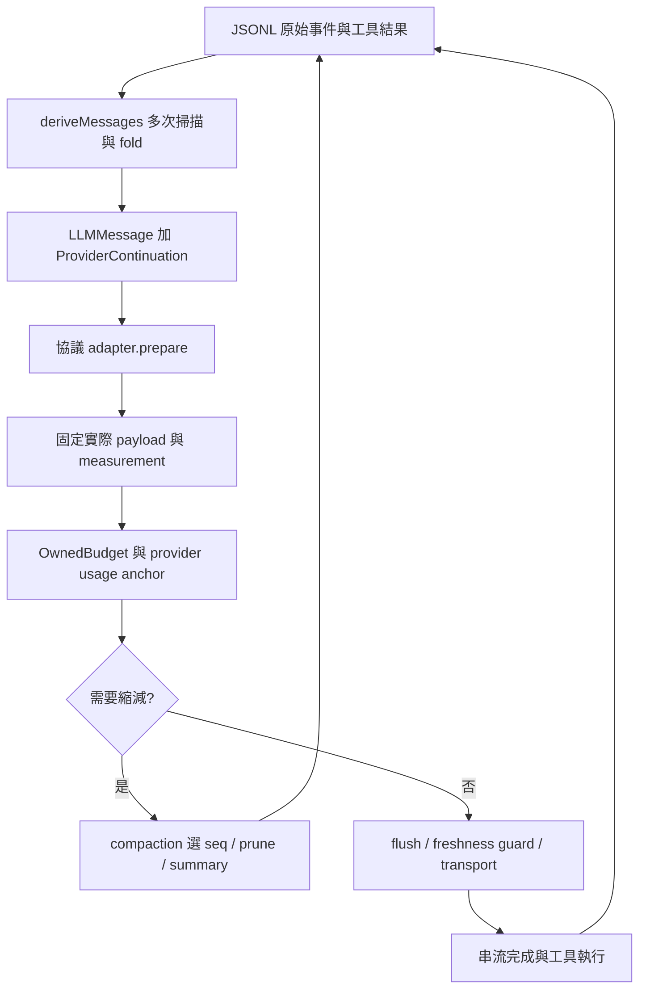

# IH 上下文架構重審：計算、壓縮、傳送、工具與子代理

日期：2026-10-15。IH 基線：`81bca938a750b73bce6bebc02219ae2665b7e47e`，分支 `codex/v0.1.13-development`，Desktop／gateway `0.1.13-rc.1`。本輪是原始碼研究、離線重現及重設計；沒有修改產品程式碼、呼叫真實模型、讀取帳戶憑證或升級使用者安裝。

## 結論

建議重設上下文子系統的資料與決策邊界，保留 IH 的多協議能力、持久事件記錄、已完成工具的執行證據與現有協議回放檢查。不能以「統一格式一定有問題」或「會話超過 100 MB」直接解釋 HTTP400。

調查找到可以重現的結構問題：容量與壓縮仍混用不同估算；自動快取標記使 Anthropic 用量校準失效；普通自動壓縮沒有保留當前使用者原文的結構保障；摘要模板會將不同來源的文字混成「敏感使用者指令」；工具回合正確性仍依賴多次事件掃描和邊界推斷。這些問題足以支持系統性重設，但不能反推所有歷史 HTTP400 都是同一個原因。

配套設計：[上下文引擎重設計提案](../superpowers/specs/2026-10-15-context-engine-redesign.md)。詳細證據保存在 [研究附件目錄](context-redesign-2026-10-15/README.md)。

## 1. 來源與可信範圍

| 項目 | 本機來源 | 已核對的版本 | 限制 |
| --- | --- | --- | --- |
| IH | `D:/I-harness-main` | Git `81bca938` | 包含前一輪修復；不把舊問題當作仍未修復 |
| Codex | `D:/ih_reference_project/codex-rust-v0.162.1` | Cargo `0.162.1` | 無 `.git`，不聲稱確切上游 commit |
| DSH | `D:/ih_reference_project/deepseek-harness-dsh-v0.2.1-alpha.3` | `0.2.1-alpha.3` | pi-ai 依賴為帶本地 patch 的 `1.1.0`，不是旁邊的 PI `1.2.0` |
| ZCode | `D:/ih_reference_project/ZCode-main` | root `3.14.0`；agent 子專案 `0.16.9` | 無 `.git`，不能用 main 目錄名宣稱最新上游狀態 |
| PI | `D:/ih_reference_project/pi-1.2.0` | coding-agent／ai `1.2.0` | root monorepo 的 `0.0.3` 不是可執行 agent 版本 |
| OpenCode | `D:/ih_reference_project/opencode-1.19.0` | executable `1.19.0` | legacy、native、V2 路徑不同；未安裝的外部 AI SDK 不能宣稱已逐行驗證 |

五份參考副本均無 Git metadata。本輪研究它們當前可讀的程式碼，不認證整個產品在使用者的實際帳戶／代理端點下的行為。所有子代理使用使用者指定的 GPT 6.1 Sol。

## 2. 「統一格式」並非 IH 獨有

| 系統 | 共用語義表示 | 協議原生資料的保留方式 | 重要限制 |
| --- | --- | --- | --- |
| IH | `LLMMessage`：user／assistant／tool；assistant text、calls 與延伸欄位 | `ProviderContinuation` 分 Responses、Chat、Anthropic、Gemini、Bedrock；部分含順序、prefix fingerprint、tool bindings | 回合需從事件流重建；摘要／選取／協議轉換分散在不同層 |
| DSH | `MessageRoleMap`、`ContentBlockMap`，內容區塊有順序 | `AssistantProviderMetadata.replayState`；pi-ai bridge 再轉成共用 PI Context，帶版本與原生區塊 sidecar | 跨 adapter ownership 清 replay；下游 pi-ai 1.1.0 的外部依賴行為有驗證邊界 |
| ZCode | `ModelInputMessage`、`ModelMessageContent`、RuntimeMessageEntry | API／provider／model identity 與 `reasoning.providerOptions` | 某路徑按 reasoning→text→calls 重建，未保證任意原始交錯順序 |
| PI | `Message`／`AssistantMessage`；有序 Text／Thinking／ToolCall union | API／provider／model、thinking signatures、各協議延伸 | 跨模型轉換有清理／降級規則，並非所有原生內容都能跨協議回放 |
| OpenCode | legacy `MessageV2`／parts；另有 V2／native 共用訊息 | 依 legacy SDK 或 native adapter 各自保留 | 不能把 V2 的保證套用到 legacy，反之亦然 |

來源：IH [projection/types.ts](../../packages/core-session/src/projection/types.ts:1)；附件 [DSH／ZCode](context-redesign-2026-10-15/unified-format-dsh-zcode.md) 與 [PI／OpenCode](context-redesign-2026-10-15/unified-format-pi-opencode.md) 有完整型別與轉換函式位置。

因此不建議拆成五套獨立會話／壓縮系統。應統一任務和對話語義，同時讓原生回放、訊息合法性、計量與編碼由各協議負責。也不能把 Codex 訂閱與公共 Responses 的端點、output cap、WebSocket delta、遠端壓縮能力當成完全相同。

## 3. 100 MB 會話與請求過大的關係

必須分開四種量：

1. **完整歷史 bytes**：事件、工具完整輸出、串流片段、UI／診斷資料、被壓縮歷史；可持續增長。
2. **當前有效上下文**：本次選中的訊息、摘要、仍需要的工具回合與原生續接。
3. **模型輸入 tokens**：system、工具定義、有效內容與模型／協議特有的計算；快取命中通常不代表這些內容不佔上下文。
4. **實際請求 bytes**：JSON escaping、base64、參數、metadata、HTTP／WS envelope；不是 token 數。Bedrock SDK command 的 JSON 大小也不是已驗證的最終 HTTP bytes。

本輪用 IH 真實 `deriveMessages` 和 Chat adapter.prepare 做離線控制：60 個已被摘要替代的工具回合，在記憶體逐事件序列化後共 **132,018,505 bytes 的 JSONL 等價內容**（含換行、不含 session header，未寫成會話檔）；有效上下文只有 2 則訊息，生成的 HTTP JSON body 是 **467 bytes**，估算 150 tokens。這是內容選取的證據，不是整個 Desktop／冷啟動／真實供應商的 132 MB 壓力測試；摘要 marker 是控制資料，沒有用模型概括那 132 MB。

所以 IH 已經有 archive／projection 分離的基礎。重新設計應讓這個區分成為明確契約，避免每次傳送、壓縮與子代理 fork 都重新從原始歷史推斷。

參考：Codex ContextManager 在 live history clone 上裁剪，rollout 保存較完整的 prepared output；PI 選最新 compaction＋保留尾部；DSH 用 replacement surface；ZCode 有 active runtime entries；OpenCode 用完成的 compaction boundary 後訊息。完整來源見附件三份 audit。

## 4. IH 現行路徑

關鍵來源：

- [admission.ts](../../packages/core-agent/src/agent/admission.ts:11)：prepare、assess、compaction、重建、送出前驗證。
- [budget.ts](../../packages/core-agent/src/agent/budget.ts:6)：owned budget、校準、output reserve、snapshot。
- [messages.ts](../../packages/core-session/src/projection/messages.ts:54)：shadow、rewind、failed step、calls／results／thinking 的多次 fold。
- [prepared/payload.ts](../../packages/llm-seam/src/prepared/payload.ts:15)：固定 payload、實際 JSON bytes、衍生 output cap。
- [compaction/commit.ts](../../packages/compaction/src/engine/commit.ts:16)：選區、prune、summary 和 marker commit。

現有 prepared payload、flush barrier、binding freshness、錯誤分類、工具不重放、子代理 bounded report 都有價值，應保留。不能因本輪要求重設計就抹掉它們。

## 5. 已證實的缺口與證據

### R1：壓縮的入口與完成判斷不是同一套計量

入口讀 owned prepared pressure；prune-only 判斷及 sticky 判斷仍呼叫 `activeTokens`／`estimateContent`。後者用 JS chars/4、固定圖片估算，未計 assistant thinking；prepared projection 則計實際協議送出的 system／schema／reasoning 等，ASCII bytes/3、非 ASCII UTF-8 bytes/1。

- [context.ts](../../packages/core-agent/src/agent/context.ts:79)、[compaction/index.ts](../../packages/compaction/src/index.ts:125)
- [commit.ts](../../packages/compaction/src/engine/commit.ts:37)、[admission.ts](../../packages/compaction/src/engine/admission.ts:78)
- [estimate.ts](../../packages/token-meter/src/estimate.ts:12)、[pricing.ts](../../packages/token-meter/src/projection/pricing.ts:1)

同一個合成中文＋thinking 工具回合：舊 activeTokens **4,283**；prepared Anthropic estimate **64,511**。這是兩套估算的差距，**不是供應商實測 64,511 tokens**。

W=100,000、80% auto gate 的控制中，初始 hard admission=fit；prune-only 回報 `compacted:true`。舊算法認為剩 2,566，實際 prepared estimate 為 43,851，加 38,400 output reserve 與 10,000 margin 後 pressure=92,251，仍高於 80,000 的 auto gate。

**界線：不是證明 hard gate 被繞過。** 主路徑會重新 prepare，超出 hard budget 仍拒絕傳送；本例 92,251 尚未越過 hard budget。缺口在「壓縮完成」不代表已達同一個目標，以及同一 admission 只壓一次的恢復效果。

### R2：Anthropic 移動 cache marker 會丟掉有效用量 anchor

`describeContext` 對加完 cache marker 的 wire message 建 unit fingerprint；下一次請求把 cache_control 移到新的最後 user block，舊語義內容沒變，但 prefix hash 變了，校準失效。

來源：[Anthropic client.ts](../../packages/llm-anthropic/src/client.ts:27)、[request/body.ts](../../packages/llm-anthropic/src/request/body.ts:49)、[context.ts](../../packages/llm-anthropic/src/context.ts:51)、[measure.ts](../../packages/token-meter/src/projection/measure.ts:53)、[checkpoint.ts](../../packages/token-meter/src/checkpoint.ts:28)。

離線給定同一個 synthetic provider sample=200，cache off 的下一步 calibrated=true、estimate=239；automatic 的 calibrated=false、estimate=708。沒有打真實 API，沒有測量真實 cache hit。Anthropic 簽名用的 pre-cache prefix fingerprint 是另一條路，不能說簽名機制也因此失效。

### R3：普通壓縮可以摘要掉當前使用者原文

`retainTokens` 預設 0；普通 preflight auto／forced compaction 沒傳 protectedSeqs，選區會包括新 user/message。CLI、Desktop assembly、child assembly 均可走到這條路。用固定摘要的離線 agent 控制，剛送出的唯一字串仍在 raw log，但被 summary marker shadow，主模型請求裡沒有原文。

來源：[config.ts](../../packages/compaction/src/config.ts:126)、[region.ts](../../packages/compaction/src/region.ts:128)、[core-agent/admission.ts](../../packages/core-agent/src/agent/admission.ts:53)。**反例／已有保障**：provider overflow recovery 會保護當前 turn tail，見 [recovery.ts](../../packages/core-agent/src/agent/recovery.ts:76)。

這不表示每個真實摘要都會漏掉新指令，而是正確性依賴摘要模型恰好保留它。任務當前輸入與作用中的工具回合需要結構保障。

### R4：摘要保留單位與來源語義有歧義

`maxTokens=1024` 的 retained checkpoint 實際以 `text.length <= 4096` 驗證；4,096 個中文 JS 字元可通過，當前 prepared estimator 對其估成 12,288 tokens。這個 char contract 在程式中是明示的，但欄位命名與下一階段計量不一致；不能將該估算當作供應商 token 實測。

`extractSensitiveLines` 對 flattened replayText 搜尋「不要、修改、必須…」，不分 human／tool／assistant，直接插入「user instructions in their exact original wording」模板。控制中的工具網頁文字被複製到 Sensitive Instructions。證明的是來源混合與提示提升風險，沒有證明真實模型已服從該工具文字。

來源：[summarizer.ts](../../packages/compaction/src/summarizer.ts:120)、[summarizer.ts](../../packages/compaction/src/summarizer.ts:241)、[summarizer.ts](../../packages/compaction/src/summarizer.ts:328)、[shadowed.ts](../../packages/compaction/src/projection/shadowed.ts:22)。

已有的 summary prepared admission、獨立 output cap、最多 8 次 summary call、truncated／refused／incomplete 拒絕提交仍有效，應繼承。

### R5：合法工具回合靠事件 fold 推導，缺少獨立最後驗證

剛修過的真實 post-compaction 400 是工具回合被拆開，並非 payload 大：shadow 的 step/start 丟失導致 assistant(tool_use) 與 tool_result 中間多了一則 assistant。現版本已保留相應 lifecycle boundaries，不能再報成尚未修復。

但事件格式仍將 call、assistant text、thinking、result 分散記錄，再由多次掃描拼回。`assertMessagesFromLog` 只驗證訊息等於同一 fold 的結果；不是協議合法性檢查。離線 orphan tool/result 歷史可被 actual Anthropic.prepare 接受，生成 399 bytes body；沒有執行網路請求。這只證明 malformed／legacy input 的最後邊界不足，不代表正常新 turn 必然產生 orphan。

來源：[messages.ts](../../packages/core-session/src/projection/messages.ts:129)、[llm-seam/index.ts](../../packages/llm-seam/src/index.ts:392)、[Anthropic messages.ts](../../packages/llm-anthropic/src/request/messages.ts:23)；既有修復證據：[400 修復報告](2026-10-15-compacted-tool-http400-repair.md)。

### R6：已量到 wire bytes，但容量決策仍以 token 為主

`createPreparedPayload` 會算最終 HTTP JSON bytes，然而 core-agent budget／compaction 不以 packet.bodyBytes 作獨立准入條件。圖片有獨立驗證與 200 張／200 MiB quarantine 條件，不能代替每個 route／proxy 的聚合 body limit。

這不等於知道所有供應商有同一限制。重設計需為**已知** route bytes limit 加 gate，未知保持 unknown；不能任意把 Codex 的 15 MiB optional metadata 軟預算當通用 HTTP 硬限制。Codex、PI、DSH、ZCode、OpenCode 的已讀路徑也未提供可直接照抄的通用保證。

### R7：工具／子代理已有界限，但完整資料生命週期不統一

IH shipping 已有工具 64,000 bytes retention、child preview 2,048 bytes、aggregate report 16,384 bytes、digest 分頁，不能再說所有子代理結果無上限。

不過一般 spill 預設是 temporary 24h／512 MiB GC；摘要中的路徑引用不必然可永久恢復。`fork_turns=all` 仍以父 raw events 建 seed、重編序號；控制中的 132 MB 舊資料仍成為 132 MB seed，即使有效內容只有 2 則。預設 fork 是 none，故這不是每次 spawn 都發生。

來源：[spill-guard.ts](../../packages/output-retention/src/spill-guard.ts:35)、[report-policy.ts](../../packages/subagent/src/report-policy.ts:6)、[fork.ts](../../packages/subagent/src/fork.ts:38)、[child.ts](../../packages/subagent/src/child.ts:27)。

應統一 durable artifact ref、model preview、read paging 與引用生命週期；fork 用可攜的 context snapshot 及來源參照，而不是複製父 archive。

### R8：UI 的「尚不可判定」不等於輸入已滿

現有 owner 在接受模型輸出後把 admission 設為 unavailable，等待下次準備實際投影。這是避免拿舊資料偽裝當前容量，但 UI 需要分開「上次實測」「本次估算」「是否可送」，避免看似跳動或毫無數字。前一輪誤把 info diagnostic 彈成失敗已修復，不重報該缺陷。

來源：[budget.ts](../../packages/core-agent/src/agent/budget.ts:82)、[context-state.ts](../../packages/core-session/src/context-state.ts:8)。

## 6. 參考項目值得採納及不應照抄之處

| 來源 | 值得採納 | 不直接照抄 |
| --- | --- | --- |
| Codex | ContextManager 與 rollout 分離；完整 replacement checkpoint；tool output 的 live clone；依 model compatibility 維護原生物件 | 私有 remote V2、只針對 optional metadata 的 15 MiB 預算、並非全路徑自動處理 HTTP400 |
| DSH | replacement surface；語義 blocks＋replay sidecar；工具結果按呼叫配對；不同觀測用途分層 | pre-step 壓縮早於新 pending input；spill／summary 的 fail-open 路徑；不能把 pi-ai 1.1 當作 PI1.2 |
| ZCode | active runtime entries；microcompact→summary；model／projection 綁定的用量 anchor | 部分 fresh schema／提醒／media 在計量後才加入；UI／壓縮算法不一；某些背景通知重啟不恢復 |
| PI | branch＋checkpoint＋tail；context edits；有序 shared parts＋原生簽名；bounded overflow recovery | chars/4 與 chars/3.5 兩套估算；固定圖片估價；沒有通用總 wire bytes gate |
| OpenCode | durable structured tool data＋bounded content preview；V2 context epoch；邏輯 request 與 physical attempt 分開 | legacy／native／V2 並非一套保證；V2 text 化 retained tail；某路徑未拒絕 length summary；413 分類不一致 |

參考項目並非無缺陷的標準答案。應提取契約與分層，透過 IH 的多協議矩陣驗證。

## 7. 尚不能定案的事項

- 最早 0.1.12 事故缺少 provider error body，不能歸因為已證實的 context overflow；後來已證實的工具排序400是另一條證據。
- 使用者提到的 gateway-job-failure 曾卡主代理，目前本輪沒有新的現場重現。新設計必須驗收 child settlement／durable delivery／parent wake，但不能宣稱又找到了其唯一根因。
- 請求上限可能來自服務、proxy、route 選項；沒有經確認的 limit，不設假精確數字。
- 本輪沒有呼叫 count_tokens 或真實 provider；所有 tokens 數字是標明來源的估算或 synthetic usage anchor。
- 大歷史的 Desktop 啟動耗時、記憶體及重啟續接，需在實作驗收階段以 cold load／warm run 分別測量。本輪只證明投影選取與子代理 seed 大小。

## 8. 本輪產出與後續

已完成五個參考副本的來源比較、統一格式專題、IH 的資料流核對、離線可重現控制與獨立反查。所有控制無真實網路傳送，結果及腳本存於附件；可從 repository root 執行 `pnpm exec tsx docs/research/context-redesign-2026-10-15/probes.ts`。

推薦方案是單一 ContextEngine 管理不可變 snapshot、單一多維 budget、transactional compaction 與結果引用；協議 adapter 保留原生語義並在 physical send 前驗證。這是可供審閱的重設計，不是宣稱修復已實作。

原 v0.1.13 的廣泛事件驅動、AGENTS／CLAUDE 指令載入、全專案大檔拆分仍暫停。本提案只涉及本次上下文、壓縮、傳送、工具／子代理資料交付所必需的調整。現有 candidate-wide verify:all 的歷史 FAILED 狀態也沒有因研究或窄範圍修復而改成通過。
