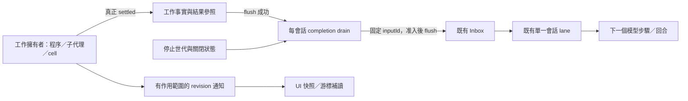

# v0.1.13 內部事件驅動設計

狀態：研究後的設計提案，尚未實作。基線 `460a2aee9395dafe196eb31425dcc2c3fcdc259e`（v0.1.12）。

## 目標與範圍

讓 IH 內部的工作狀態、完成交付、會話推進和介面更新由擁有狀態的生產者通知。Google 截圖只提供概念示例；不增加 Webhook、郵件或其他外部自動化功能。參考項目只作局部證據，IH 的目標架構不受它們是否完整事件驅動限制。

「完成」的產品驗收是：可觀察的 IH 狀態沒有固定週期查詢；需要代理接手的完成事件，經保存、准入及單一會話執行佇列推進；閒置時沒有為了尋找變更而反覆掃描。這不要求取消正常函式呼叫、Promise、模型的逐步思考迴圈，或所有計時器。

逾時、取消寬限、重試退避、輸出批次、使用者程式要求的 timer、畫面倒數、最近到期排程保留。外部登入協議的必要輪詢和底層原生程序監督必須各自列明；未移除的真實狀態輪詢不能改名後宣稱消失。

## 現況與需要重構的原因

完整證據見 `docs/research/2026-10-13-v0.1.13/runtime-events.md`、`surface-events.md`。

- `SessionExecutor` 已有每會話序列 lane；v0.1.12 工具等待已訂閱事件，不能重寫成另一套代理引擎。
- 背景子代理已有完成 outbox，但 `putDocument` 會吞掉寫入拒絕；完成 callback 早於可靠提交；drain 可以重疊；`woken` 早於 void wake。新設計不能沿用這些語意漏洞。
- 普通子代理冷恢復的 drain 可能早於 assembly 發佈，而發佈後目前只 drain team。這是讀碼風險，實作前必須先有可失敗的重現測試。
- Exec／Workflow 使用程序內 ID，Workflow 的 killed 顯示不代表實際 owner 已 join；一般 job／cell 尚無完整的閒置父會話完成交付。
- 已確認的介面／gateway 範圍有 8 個週期實作、10 個消費面；另有沒有輪詢但會停留在舊狀態的 Git／檔案／設定畫面。

## 架構選擇

選擇：**有作用範圍的生產者事件 + 會話日誌中的工作事實 + 每會話完成交付器 + 有版本的介面快照**。

不選只替換 `setInterval`：無法解決漏交付、重啟和停止競態。不選引入 Kafka／RabbitMQ 或把每個函式改為全域事件匯流排：IH 現在的程序、儲存與權限邊界不需要這些依賴。若現有檔案／介面阻礙正確所有權，允許重構；保留資料與使用者行為相容性，不保留錯誤的內部責任劃分。



三條通道分開：工作事實具有持久化意義；UI invalidation 可以合併；完成交付才有權觸發模型。任何輸出 chunk、檔案改變或 UI 重新整理都不能直接呼叫模型。

## 子系統目錄與所有權

| 目錄／入口 | 責任 | 不負責 |
|---|---|---|
| `session-executor/src/completion/index.ts` | 工作登記、terminal CAS、交付投影、恢復、停止世代、來源 adapter | 啟動原生程序、改寫沙箱、直接執行模型 |
| `completion/{types,lifecycle-store,coordinator,admission,recovery}.ts`、`sources/` | 內部狀態機與各來源轉接 | 成為第二個 TaskRegistry／全域工作表 |
| `session-executor/src/lifecycle/index.ts` | assembly 發佈、lane availability、Stop／close／dispose | 解析檔案指令 |
| `session-executor/src/assembly/index.ts` | 組裝上述子系統、逆序清理 | 混入交付狀態機 |
| `desktop-gateway/src/observation/index.ts` | 授權後的訂閱、epoch／revision、快照與斷線重建 | 持有執行權、複製 domain 的權威狀態 |
| `desktop-gateway/src/workspace-observation/index.ts` | ref-count 檔案與 Git watcher、來源失效、reset | 讀取未授權根、覆寫 editor draft |
| `desktop/src/renderer/observation/index.ts` | single-flight refresh、dirty catch-up、游標、晚到回覆隔離 | 定時猜測狀態 |

實作階段先以結構拆分計劃建立這些邊界，現有公開 import 入口暫作薄 façade。低層 Exec／Workflow／Code Mode 接受注入的 lifecycle sink，不反向 import session-executor。

## 工作事實及交付契約（新增）

```ts
type WorkKind = 'subagent' | 'team' | 'exec' | 'workflow' | 'code-cell'
type Delivery = 'observe-only' | 'parent'
type WorkOutcome = 'completed' | 'error' | 'cancelled' | 'recovery-required'
interface WorkBinding {
  workId: string             // UUID；不能用可重複的 bash-N
  ownerSessionId: string
  ownerGeneration: string
  kind: WorkKind
  sourceId: string           // 舊工具的公開 ID，保留作查詢 alias
  attemptId: string          // followup／重試回合的獨立 identity
  delivery: Delivery
}
interface SettledWork {
  outcome: WorkOutcome
  summary: string            // UTF-8 <= 4096 bytes
  resultRef?: string         // 已保存、仍受原 owner 授權的結果參照
}
interface CompletionLifecycle {
  register(binding: WorkBinding): Promise<void>
  handoff(workId: string, delivery: Delivery): Promise<void>
  settle(workId: string, result: SettledWork): Promise<boolean>
  requestDrain(): void
  recover(): Promise<void>
  stopGeneration(reason: string): Promise<void>
  close(): Promise<void>
}
```

`work/registered`、`work/delivery-changed`、`work/settled`、`work/suppressed`、`work/generation-stopped` 是版本 1 的新增事實；在 core-session 的 `events/work.ts` 定義與驗證，在 persistence 註冊。登記在既有 policy／approval 成功之後、外部副作用啟動之前 flush。結果參照先保存，terminal 事實再 flush；成功之後才有資格交付。不能把 root exit 或發出 kill 視為 settled。

以父會話日誌的 terminal 事實直接投影待交付項，避免 terminal 與另一個 outbox 的雙重寫入。`inputId = completion:<workId>:<attemptId>`；去重查看整段已准入／promoted／cancelled 證據，而非僅 pending。模型輸入准入 flush 後才 schedule，schedule 只承諾已排入 lane，不宣稱模型已完成。

持久化模式必須先取得既有 session-operation／coordinator 的單一 writer 權，所有 terminal CAS 和 generation mutation 在同一序列化 owner 執行。未配置 persistence 的合法 headless／測試模式仍可用同一記憶體狀態機，但 capability 明示 `recoverable:false`；不得把無 coordinator 的 resolved Promise 稱為已持久化。沒有跨程序 lease 的儲存配置不得宣稱多writer exactly-once。

drain 是一個 Promise + dirty bit；執行中收到信號要再跑一次。成功閒置時沒有 timer。可重試的保存／交付故障保留待交付狀態，使用單個錯誤退避 timer（1、2、4、8、16、30 秒上限）；停止、關閉、世代過期則永久抑制該通知。重試只重送同一 identity，不重跑工具。畫面與 Log 顯示等待交付／重試／抑制及原因，不記錄完整敏感輸出。

## 哪些完成事件會喚醒

| 工作 | v0.1.13 新工作規則 |
|---|---|
| 明確背景子代理及其後續回合 | 每個 attempt 一次 parent 完成交付 |
| 前景子代理正常被等待到完成 | observe-only；工具結果已交付就不再通知 |
| 前景子代理被引導釋放等待 | 在交回 ID 的同一狀態轉換 handoff 為 parent；這是相對 v0.1.12 的明確變更 |
| model 啟動的背景／已 promotion shell | parent；保留同一 capture，完整 I/O／樹清理後才 settled |
| `workflow_run` 已背景化／等待被引導釋放 | parent；只有最外層 workflow 通知，內部步驟不重複 |
| `code_exec`／`code_wait` 交回仍運行 cell | 最外層 cell parent；通知只帶摘要與 ID，不消耗 output window |
| 被 Code Mode／Workflow owner 正在 await 的巢狀工作 | observe-only；不得和 guest 搶結果 |
| 使用者開的 terminal、內部搜尋／預覽、沒有父會話的手動工作 | 只更新介面；不得推測一個主代理來叫醒 |

handoff 與 completion 同時發生，由同一 lifecycle 序列化決定；即使工作先完成，後來 handoff 仍只交付一次。手動讀取結果不增加新通知；若要抑制尚未交付的通知，必須透過明確、可保存的 consumed transition，不以 UI 有看過推論。

父代理忙碌時，完成輸入在安全 step 邊界合併領取；正在支援的觀察等待可由 **可信任 completion input** 釋放，回 `yield_reason:"background-event"`，與人類 steer 分開。任意已派出的直接工具仍由其 owner 完成；不強制中斷 provider request、不自動重播任意工具。保持每會話最多一個模型 turn。

## Stop、重啟與舊資料

- Stop 先在記憶體封鎖 admission，再寫入並 flush 停止世代；取消相關 pending input，join 原 owner。保存失敗必須可見，不能宣稱已保存 Stop。Stop後新的人類回合開新世代，不釋放已停止世代的完成結果；一般未經Stop的下一回合／steer不撤銷仍合法運作的背景工作世代。
- close／dispose 先 revoke，再清理訂閱／退避，join commit、drain、producer；晚到 callback 只能留結果，不能重啟模型。
- 恢復僅在 exact assembly 與 lane 發佈後執行一次 initial reconcile。已 settled 未 admitted 補交付；已 admitted 未 promoted 補 schedule；已 promoted 但 turn 未完成只標記 interrupted，不自動重跑模型。
- 已登記但沒有可信 terminal 的程序／workflow／cell 標記 recovery-required；不假裝恢復記憶體中的 continuation。
- 舊 task/outbox 匯入使用版本化 marker 與原 task／call identity；識別既有 `parent-notify-*` 的 admission／consumption。舊 foreground 任務保持 observe-only。一次切換 active drain，不能讓新舊兩個交付器同時送。
- 提供 `putDocumentStrict` 作舊 task 遷移的明確失敗介面，沿用原 chain／lease；不更改所有 legacy `putDocument` caller 的錯誤語意。新 completion 以 session log + flush 為主。

## UI、設定與檔案事件

訂閱鍵由 server 確認 owner／workspace／session，不能信任 renderer 傳入的身分。每個快照帶 `{epoch, revision}`；通知帶 subscriptionId、作用範圍、revision 與 reason，不帶無界 stdout。

訂閱先建立，再捕捉快照；讀取中變更累積 dirty，快照完成後最多追加一次必要讀取。舊 epoch、舊 ticket、已移除 scope 一律丟棄。重連重新授權、取快照並訂閱，不聲稱舊 SDK notification 具有 replay。佇列溢出回 reset／snapshot-required。

必須遷移的十個消費面：ExecutionPane、AgentProcessesPane、Code Context 設定、terminal 輸出、browser tabs、slash 資源目錄、Coding Plans 本地狀態、gateway policy sync、Code Context 自動索引、managed plugin registry。另補 Git／檔案／MCP／模型設定的 owner invalidation；保留編輯草稿及衝突狀態。

terminal 使用 owner 發出的可讀 offset，再以既有 bounded read 排空；等待 xterm write callback 做 backpressure，truncated 後立即補讀屬於排空，不是 idle polling。EOF、root exit、樹 settlement 和 removal 分開。瀏覽器由 Electron WebContents 事件和 tab mutations 直接更新。

workspace watcher 共用 canonical root lease，明確包含 worktree 真正的 Git metadata 路徑。舊 root 被撤銷後不得繼續出事件。索引 initial build、source 變更和設定改變才執行；執行中變更只標 dirty，完成後補一輪。監看失敗要顯示 degraded／reset；重建成功作一次 reconcile，不能靜默使用週期掃描掩蓋失敗。

## 底層與計時邊界

1. 排程 `start()` 改最近 deadline + 變更 invalidation；維持目前 session-local reminder 不自行啟動閒置模型的行為。deadline 觸發重新核對時間，系統恢復／時鐘變更再 rearm。
2. Windows legacy ACL pipe 的 `PeekNamedPipe + 1ms` 與 POSIX 的 `kill(-pgid,0) + 25ms` 是真正 polling。必須先驗證原生事件介面：Windows overlapped I/O／完成 ACK；POSIX 原生 supervisor 對完整子樹的責任與 reaping。不能只用 root exit 替代清理完成。
3. 原生遷移單列執行前技術驗證與平台測試 gate；若實測做不到，保留清理正確性並明確回報阻擋，不把那個 backend 標成完全事件驅動。禁止以移除沙箱或降級 lifetime 達標。
4. 外部 OAuth device flow 的協議輪詢保留且有 expiry／cancel；本地 UI 仍改 push。沒有配額推送的外部服務改顯示 observed-at／stale，按明確更新、焦點恢復、已知用量變化取得資料，不假裝遠端有事件。

## 驗收與發佈 gate

- 成功 idle 的 runtime／gateway／相關可見 UI 在虛擬時間推進 10 分鐘時不反覆 status/read/index；只有允許的 display clocks／requested deadlines。
- producer 完成時主代理可在沒有新的人類提示下接手；同 source identity 准入一次，工具 launch 一次；同會話 turn 不重疊。
- 注入每個 flush／admit／schedule／promote 邊界的失敗及重啟；無錯報完成、無吞掉交付、無自動重播副作用。
- Stop 與完成、後續人類回合、程序重啟競態不復活舊工作；結果仍可讀。
- 觀察者在 registration／snapshot 中收到變更仍能看到最新 revision；断線／關閉／權限撤銷不洩漏資料。
- Windows/POSIX/WSL 的聲明各有真實平台證據；未跑的平台不能被總測試數代替。
- `pnpm verify:all` 全 population、型別、E2E、reachability；打包後 gateway／Desktop subscription／完成喚醒／Stop／恢復實測；版本更新最後才做。
