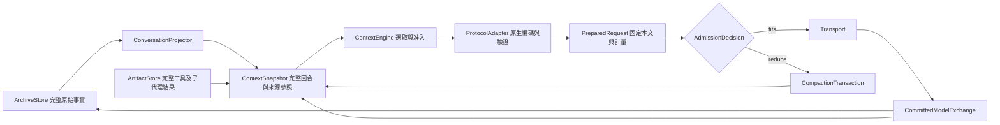

# IH ContextEngine 重設計提案

狀態：研究後的設計草案，尚未進入產品實作。基線 `81bca938`／Desktop `0.1.13-rc.1`。需求：長會話可靠運作；多協議；正確容量、壓縮和送出；工具／子代理可恢復而不重複執行。

依據：[來源與重現報告](../../research/2026-10-15-context-architecture-reassessment.md)。本提案取代該範圍的零散補強方向，並不重啟其他已暫停的 v0.1.13 工作。

2026-10-15 使用者再審要求：接受必要開發複雜度，優先完整框架與正確性；與原拆分任務重合的責任一併交付。規範補充：[開發框架、依賴／owner／port及驗收](2026-10-15-context-engine-framework.md)、[原拆分任務重合地圖](../../refactoring/2026-10-15-context-decomposition-overlap.md)。補充中的責任邊界與完成規則適用於下列R0–R6；不把單一ContextEngine理解為一個大檔或包辦全部副作用的模組。

## 1. 選擇

| 方案 | 得益 | 代價與判斷 |
| --- | --- | --- |
| A：留在目前結構，逐一修估算／protect／marker | 改動小，能處理已知例子 | projection、reducer、budget、protocol 仍分散推斷相同事實；下一個邊界容易再次失配，不建議作最終架構 |
| B：單一 ContextEngine＋穩定語義模型＋各協議原生 adapter | 一個決策入口，archive 與 active context 明確分開；能逐步替換 | 需要 legacy projector、型別和持久 checkpoint 遷移；**推薦** |
| C：每種協議一套完整 history／compaction engine | 可最直接貼近各 provider | 轉模型、子代理、重啟與 UI 語義容易分裂，測試與維護成本乘倍；不建議 |

「統一」限定為任務、訊息與工具執行語義。協議的原生 replay、token 語義、cache metadata、序列化與 capability 保持分開。原始歷史不作為每次模型輸入的工作資料結構。

## 2. 不變條件

- 任何 summary／prune／模型重試不重新執行已派發工具，不重新宣稱未確認的工具結果，也不更改授權。
- 當前 human input 原文、尚未結束的 tool exchange、當前授權及 pending delegation 狀態受到保護。過大而不可容納時明確回報，不能默默摘要掉目前要求。
- Summary 是帶來源的低權限衍生資料；不能因文字含「必須／不要」而變成使用者指令。
- 同一 candidate 的選區、計量、縮減、送出驗證使用同一 snapshot revision 和最終 protocol projection。
- archive bytes、semantic token estimate、provider usage、wire bytes、累計 billing 分開。unknown 不當作 0；估算不標成實測。
- 每個 physical request（主模型、摘要、子代理、恢復）都走相同 admission contract；UI 讀取不能觸發 prepare／auth／模型請求。
- Stop 阻止後續模型 transport、新的 compaction 發布與 parent wake；已派發工具的結果、未知 outcome 與 child settlement 仍須完成事實記錄。已越過 durable commit point 的 checkpoint 不回滾。引導只解除等待，不取消已授權背景工作。
- public Responses、Codex subscription、Chat、Anthropic、Gemini、Bedrock 保持獨立 capability 與 compatibility identity。

## 3. 資料邊界

### ArchiveStore

保留現有 session event log 作唯一事實來源，raw tool results、failed attempts、使用者訊息、授權、task outcomes 不破壞。新增 checkpoint 可保存可重建的 context manifest，但不是第二套互相競爭的會話真相。

大檔冷載入改成串流讀取，並讓有效 checkpoint＋tail 能增量恢復；歷史 UI／搜尋分頁讀 archive。先正確區分資料，再優化查詢，不為此立即重寫成另一種資料庫。

### ConversationProjector 與 ModelExchange

用結構化 exchange 明確綁定一次被接受的模型回應：ordered text／reasoning／tool calls、provider provenance、call→outcome map、attempt 與 step identity。完整工具回合是合法縮減單位，不能靠「某個 seq 附近剛好有 step/start」猜分組。

新 session 在 stream settled 後持久記錄 response/group identity；工具的 dispatch、結果提交和未知結果仍有獨立 durable boundaries。串流顯示及失敗片段保留為觀測資料，未提交回應不自動進入有效 prompt。不存在 tool_result 的 unresolved call 不能偽造成功。

舊 v1／v2 JSONL 由 legacy importer 重建 group；保留目前已修好的 projector 作相容參考。發現矛盾／孤兒事件時產生明確 diagnostic，最後協議 validator 阻止非法送出，不暗中執行工具修補。Legacy 的 user role／summary 不能單憑角色名稱認證為人類授權；以既有可信 admission／來源事實還原，缺失時保留 unknown／inherited provenance，不憑摘要文字擴大權限。

### ContextSnapshot

不可變 snapshot 包含：revision／branch／binding epoch、明確 instruction sources、當前 human input、最近完整 exchange、summary checkpoints、artifact refs、仍待收取的 job／child 狀態。用穩定 ID 參照 archive，不複製完整 archive。

指令、工具觀察、child report、模型摘要各有來源及 scope；序列化到只有 role 的協議時用 adapter 決定可表示形式。共同模型保存 provenance，不把所有材料提升成 user authority。

### ProtocolProjection

每個 adapter 產生兩種 identity：

- **semantic identity**：影響模型可見語義與有效 token anchor 的穩定內容。
- **wire identity**：最後真正送出的 bytes，包含 cache marker、transport metadata、escaping。

動態 cache_control 改變 wire identity，但不能僅因此讓相同內容的 usage anchor 失效。這不是廣泛刪除任意名為 cache_control 的 JSON key：只排除 adapter 自己新增的已知 transport/cache 欄位，工具參數裡同名欄位仍是內容。模型、system、tools、簽名相容性、投影刪改和 raw option 語義變動照樣失效。

保留現有 immutable PreparedModelRequest 和 transport 前 freshness guard。協議驗證在最終 payload 上檢查 role/order、tool pairing、原生 block/order/signature、必要參數及已知上限；不是僅比較 payload 是否等於自己產生的內容。工具檢查是各協議的 group-order 規則：一組平行 calls 的結果、合法 interleaving、hosted/external tool 對象都有 route-specific 語義，不能強制所有協議都變成每一個 call 緊接一個 result。對 opaque 簽名只驗證可觀測結構與記錄的相容條件，不能聲稱本地驗證供應商密碼學有效性。

## 4. 單一多維 BudgetPolicy

資料分成三層，不能以同一個 maxTokens 同時代表：

1. `ModelLimits`：供應商／route 可支援的 context、max input、max output、body bytes、media/count 限制及來源。
2. `GenerationPolicy`：使用者要求的 output cap、route 預設／不可設定能力、reasoning floor。
3. `BudgetObservation`：同一 projected request 的 tokens 估算／已校準部分／不確定部分、wire bytes、schema／media／opaque 成分。

硬准入以 route 能確認的限制為準，例如共享 context 的 route：`inputEstimate + effectiveOutputReserve + safetyMargin <= contextWindow`；有獨立 input limit 的 route 另檢查。這不是所有協議都套相同公式的藉口，output reserve 語義由 capability 宣告。SDK command estimate 不冒充已知 HTTP body bytes。

output supported ceiling 和日常 preferred output 分開，不能把型錄最大輸出值無條件當作每一輪生成意圖。實作時保留現有使用者顯式設定；先以真實 route fixtures 確認預設，不在研究階段指定任意全域生成上限。

自動壓縮門檻與壓縮目標使用**有效輸入預算**，不混合純 input、input＋reserve、window 百分比三種量。預設比例及 recent tail 大小在 R0 基準後選定並寫成 policy fixture；此處不以沒有模型實測的數字承諾最佳值。硬限制、軟觸發、縮減後目標必須三者明確。

估算優先序：相同語義前綴的 provider input sample＋新增 projection 的估價；其次經驗證的 model tokenizer／provider count capability；最後保守估算並標示 unknown components。provider count 只在必要 admission 工作時執行，不能因 UI hover 產生網路呼叫。Provider usage 與本地增量都記 lineage，對 rewrite／換模型／改 schema 正確失效。

保留六類 route 差異：

| Route | 需由 adapter 負責的事 |
| --- | --- |
| Public Responses | output cap／reasoning replay／stored references／tool namespaces；remote context 不可憑空估成已完整 |
| Codex subscription | backend auth、支援的 output 控制、native compaction／WS delta 能力；只在 capability 明確時使用 |
| OpenAI-compatible Chat | max_tokens／max_completion_tokens、reasoning_content、tool IDs；依 route，不依品牌字串猜 |
| Anthropic Messages | thinking/signatures/order、tool_use-result adjacency、cache marker、cache read/create 與 input usage semantics |
| Gemini | contents/parts、thought signatures、function responses、cachedContent／inline media |
| Bedrock Converse | reasoning blocks、toolUse/toolResult、SDK command 與 transport bytes 的驗證邊界 |

## 5. Transactional compaction

一個流程涵蓋 auto、manual、confirmed overflow；只有 reason 和受保護集合不同，不維護三套縮減語義。

1. **Capture**：固定 source snapshot／binding／pending input revision；挑選完整已關閉 exchange。新引導仍可入 inbox，但不能改變正在摘要的 source。
2. **Plan**：先保護當前輸入與 active exchange，針對舊工具輸出選 preview／artifact refs，再挑 older prefix 摘要；保留近期 typed tail。若不可分割部分本身過大，回報是哪個成分，不能靠反覆重試假裝能處理。
3. **Measure**：用該 binding 的 adapter.prepare 計量候選，不能用另一套 chars/4 決定完成。
4. **Summarize**：獨立受限 request；只允許所需的摘要能力，不執行任務工具。明確傳入來源標籤及 authority scope。保留現有最多 8 次實體摘要請求、失敗停止界線及截斷拒絕。
5. **Validate**：檢查完成狀態、摘要品質欄位、受保護資料、工具配對、artifact 可解析性，再以完整新 request 重算是否達目標。summary length 的單位用明確 `retainedTextBytes`／估算 token budget，不再把 chars/4 命名成精確 tokens。
6. **Commit**：當 source revision 仍適用才在原 log append checkpoint/manifest＋commit record；完成 flush 後才切換 active snapshot。對新 pending input、已提交的工具結果、child settlement、notification admission 等追加後綴，必須以穩定 ID 完整保留並重新准入；無法證明後綴可安全接合時，捨棄候選並有界重建，不能覆寫／漏交付或重跑工具。branch／binding／被摘要內容改變亦使候選失效。持久 commit record 是發布的線性化點：Stop 在此之前被觀察到則取消發布；record 已持久化，即使 Stop／崩潰發生在 flush 回覆或記憶體切換之前，重啟仍恢復該已提交 checkpoint 及後綴，只禁止後續模型呼叫與 wake。record 尚未提交的 summary candidate 不進入有效上下文。
7. **Continue**：以新 snapshot 生成主 request。成功是達目標／有明確 blocked reason，不能只有 `compacted:true`。

建議結果型別區分 `unchanged`、`reduced-but-still-over-target`、`ready`、`blocked`。主迴圈能決定是否再做下一種縮減，所有縮減與模型 calls 共用總預算，避免失敗後每個 step 無限重新支付。

Native checkpoint 是 adapter capability 的一種，可以保存不透明 compaction item＋相容身份；它不是可以轉成通用文字或直接挪給其他模型的摘要。身份涵蓋 adapter／route、provider／model、帳戶或租戶邊界、workspace／server reference ownership 及已知有效期限，日誌只保存安全的身份參照。Unsupported route 在仍有合法語義來源時使用 portable structured text checkpoint；若只剩 opaque checkpoint／expired server ref，且無可恢復的原始內容，必須 blocked 並說明需要兼容 route 或恢復來源，不默默丟掉歷史。跨模型切換亦先走這個相容性判斷。

## 6. 工具輸出與子代理

工具結果統一為：執行 outcome＋model preview＋typed media＋optional ArtifactRef。完整內容先有可確認的儲存，再發布 ref；失敗／unknown outcome 不因截短而失去狀態。一般輸出、Code Mode、MCP、synthetic failures、背景 job 和 child report 都走同一 envelope contract，但各工具可提供更好的語義預覽。

現有 64 KB tool／2 KB child／16 KB aggregate 初期作相容 policy 保留，待實際 corpus 比較再調整。**不是把 2 KB 當作子代理實際能力或報告長度上限**；完整結果可授權分頁讀取。

Artifact 儲存採 session owner／ACL／digest／revision；checkpoint 所引用資料需要明確 retention。Temporary spill 不能被表示成 durable promise；GC 不刪仍被有效 snapshot 引用的 durable artifact。超 quota 必須保留可信 outcome 並明示 retained status，不退回無界全文進 prompt。

子代理 context=none 預設保持。明確 full/context fork 從有效 snapshot 匯出語義 seed、必要規則與來源參照，不複製父 100 MB raw log；重新在子模型計量，不能搬父模型 usage anchor／權限。不同模型／協議的 native replay 要重新驗證，只有存在合法 portable source 時才降級；opaque-only 或越過 account/server ownership 的輸入應阻止繼承而不是假造摘要。

完成交付拆成可觀測的事實：`execution settled → result durable → parent input admitted → wake scheduled → consumed`。以 `(parentSessionId, taskId, resultRevision, deliveryKind)` 保證同一結果只有一次邏輯 durable inbox admission／claim；允許 wake signal 重送並冪等處理，不承諾物理 signal／HTTP 傳輸只發生一次。Stop 阻止 wake，結果仍可查。模型上下文的刪改不改變 job authority／settlement。使用者引導解除等待時，背景 job 結果用後續事件交付。

## 7. 錯誤與介面

HTTP400 是 HTTP 類別，不能直接決定壓縮。保留現有 typed error taxonomy，細分 context limit、body size、output cap、message order/schema、unsupported parameter、auth／quota、transient transport／server。

Context recovery 必須縮減可影響供應商限制的輸入，byte-size recovery 需要縮減 bytes，schema/order 要在本地修復或報錯；不能只是刪更多歷史。恢復沿用 logical step 身份，tools 不重放，總嘗試次數有界且可跨重啟查明。

UI 分開顯示上次 provider input 實測、本次預估與 confidence、輸出保留、是否需要縮減／等待新投影、必要時 request bytes。普通 info 不彈失敗。錯誤彈窗給可理解的原因、可重試狀態與詳細資料入口；diagnostic 只有 allowlisted scalar facts、phase、snapshot/attempt IDs，不寫 prompt、tool bodies、credentials 或原生簽名。

## 8. 模組調整

| 責任 | 建議位置／調整 |
| --- | --- |
| 語義 group／checkpoint DTO、原始事件 | `core-session`；增加 response/group identity；legacy importer 與新 projector 分開 |
| 主決策與交易 | 新 `packages/context-engine/src/{snapshot,admission,reduction,commit,recovery}`，每個資料夾一個責任；不建另一個全能大檔 |
| measurement primitives／usage normalization | `token-meter`；移除作為 production 決策者的 legacy activeTokens 依賴，保留相容 facade |
| raw summary generation | `compaction` 過渡成 ContextEngine 的 summary/reduction provider；不再獨立擁有 admission 判斷 |
| protocol shape／native state／validator | `llm-seam` contracts＋各 `llm-*` adapter；不讓 context-engine 知道各家 JSON 欄位 |
| tool result／artifact projection | `output-retention`、`context-output` 與 `core-tools` 接同一 envelope/ref 介面 |
| main/child lifecycle | `core-agent` 調用 ContextEngine；`session-executor` 負責 owner/lease；`subagent` 接 snapshot seed 與 durable result |
| observation only | SDK／desktop-gateway／Desktop 只讀共享 DTO，不重算第三套百分比 |

替換必須有退出條件：每一新 owner 啟用時，移除對應 production 舊判斷；舊 API 只能是明確 facade，不保留永久雙寫／雙引擎。

## 9. 實作階段與驗收

以下是設計級遷移順序；每階段的變更清單、fixture、實際介面和提交安排須隨設計定案寫入執行計畫。

| 階段 | 可交付結果 | 必須通過的驗收 |
| --- | --- | --- |
| R0：baseline corpus | 六 route 的非私密 golden requests，來源版本、合法／非法回合、容量／bytes／usage 獨立 oracle | 本報告所有研究控制可重跑；保留已修復400與retry/Stop基線；不靠同一 estimator 自證準確 |
| R1：context data model | typed exchange、snapshot、legacy importer、source/authority metadata | live／cold／rewind／in-step compaction 下每個 tool group 符合該協議的配對／順序；當前 human 不被摘要；failed attempt 不污染後續；legacy unknown provenance 不升權 |
| R2：projection/measurement | semantic identity、wire identity、route validator、單一 BudgetPolicy | cache marker 移動不失去語義 anchor；不同模型／schema／context edits 正確失效；圖片、中文、程式碼、reasoning、raw route options 與 bytes gate 各有獨立控制 |
| R3：compaction transaction | 舊輸出縮減＋typed recent tail＋summary＋原子 checkpoint | auto/manual/recovery 同契約；summary超長/截斷/拒絕/失敗不 commit；reduction達同一目標或 blocked；storage failure／Stop／flush不確定／新引導與工具或child結果競態不丟後綴；opaque-only跨route不假降級 |
| R4：tools/children | 統一 result envelope、durable artifact、snapshot fork、交付鏈 | 1 MB／100 MB tool output 有界 prompt＋可取原結果；多 child fan-in 有界；父止住時不 wake；重啟／並行完成不漏結果、不雙執行、不借父 usage／權限；重送wake不重複claim；跨帳戶ref／失效ref有明確blocked結果 |
| R5：恢復/UI/遷移 | typed recoveries、共享可解釋 DTO、版本化持久化 | context400、size413、schema400、401、503、capacity 分別處理；改變輸入的模型恢復不重跑工具；UI read無網路副作用 |
| R6：候選版驗證 | whole-path offline／隔離 packaged 檢查＋經授權的少量真實 protocol controls | 從 >100 MiB archive 冷恢復並續跑；新舊格式；所有 shipped route；主／子模型切換；真正打包 runtime 與來源一致；完整 gate 不以focused pass覆蓋失敗 |

測試資料需包含：超大純文字單筆、many small tool outputs、中文／混合碼／JSON escaping、inline images、signed thinking、opaque Responses state、server refs、multiple tool rounds in one human turn、parallel calls、child failure/notification、hook/skills/MCP schema 變動、summary 正好跨當前 step/start。

量測指標：provider實測相對預估的差值分布與來源、每次縮減前後有效tokens與bytes、保留當前意圖的斷言、摘要呼叫總成本、first-token恢復時間、context fold耗時、100MiB／更大 corpus 的cold/warm峰值記憶體、重複工具執行數=0、重複／漏交付=0。尚未取得 provider samples 前，不能聲稱估算誤差達固定百分比。

## 10. 遷移和發布邊界

保留原始 session，先 importer 與離線差異比較，再切新 session，最後讓舊 session 在 lease 下建立新 checkpoint。新增持久欄位如果舊 reader 會誤解，必須升格式版本並明確拒絕舊版續寫；不能用 ignorable 讓舊程式繼續寫出矛盾資料。

回退只允許舊 reader 能理解的 checkpoint/格式；已寫入不相容資料時保留原檔、選擇相容 runtime 或只讀，不無條件退版。影子比較只做純 projection，不發雙份模型請求、不派雙份工具。

研究與設計不更改版本或發布新包。實作完成後沿用使用者決定的候選版流程重新 qualification；原廣泛事件驅動／AGENTS/CLAUDE及不重合的拆分維持暫停。與上下文重構重合的S/CX項目按重合地圖一併交付，功能與結構各有驗收，未完成不提前更新拆分計數。全部 delegated 實作及審查仍用 GPT 6.1 Sol。
